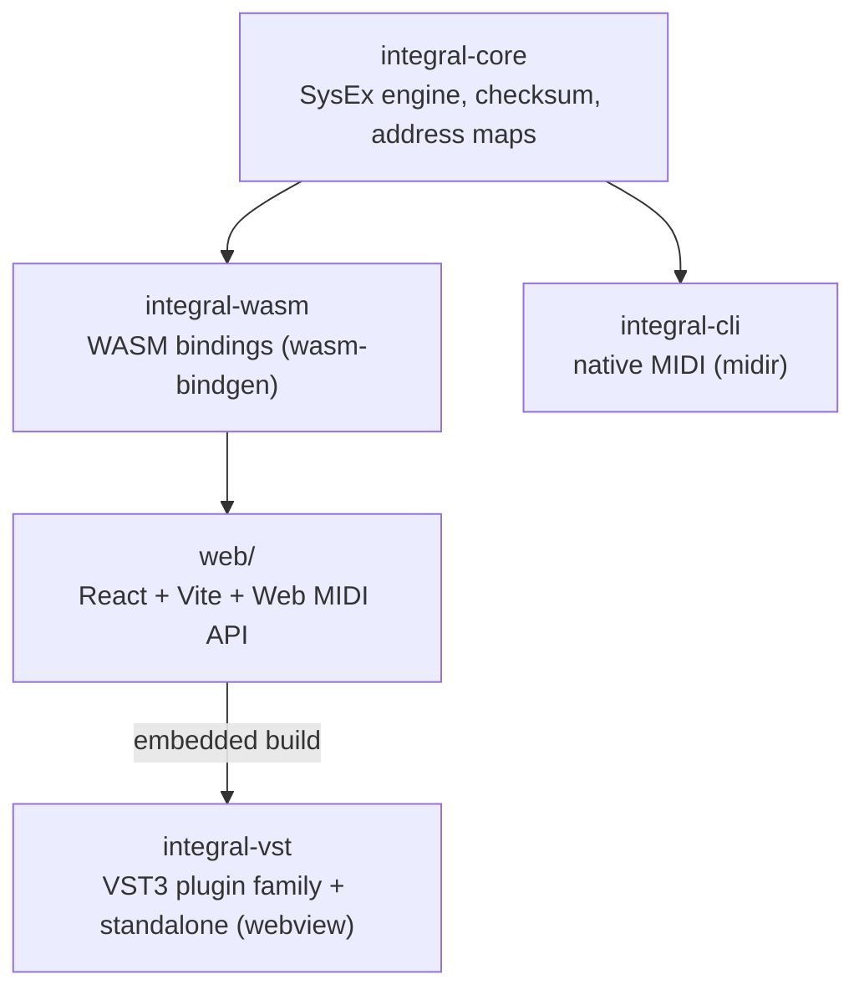

# Integral — Integra-7 Control Surface

A cross-platform, open-source control surface for the Roland INTEGRA-7
Synthesizer Module. All SysEx protocol logic lives in a shared Rust core
that compiles to both native and WebAssembly.

## Targets

- **Web** — React app powered by the Rust core via WASM, using the Web MIDI API
- **CLI** — Native command-line tools for device communication
- **VST3** — a family of six DAW plugins via nih-plug, with the web UI in a webview (macOS)

## Quick Start

```bash
nix develop          # enter the dev shell (direnv does this automatically)
just check           # full gate: fmt, lint (Rust, TS, CSS), build (native, WASM, plugin web), tests (Rust, web), PWA check
just ping            # verify the Integra-7 is reachable
just dev-web         # start the web dev server (packs the WASM first)
```

## Subdirectories & System Boundaries

- `crates/`: [./crates/README.md](./crates/README.md) - the Rust workspace.
  - `integral-core`: [./crates/integral-core/README.md](./crates/integral-core/README.md) - the portable, I/O-free engine. It covers SysEx build and parse, the address map, the device spec layer, `DeviceState` with its throttled queue, the Librarian, SVD, Expansions, Waves and the sequencer.
  - `integral-wasm`: [./crates/integral-wasm/README.md](./crates/integral-wasm/README.md) - wasm-bindgen bindings that the web frontend uses. JS owns the clock and the MIDI I/O.
  - `integral-cli`: [./crates/integral-cli/README.md](./crates/integral-cli/README.md) - the `integral` CLI. It covers diagnostics, raw SysEx, monitor, the Wireless bridge, the Librarian, Expansions and Waves.
  - `integral-device-service`: [./crates/integral-device-service/README.md](./crates/integral-device-service/README.md) - the Device service: one process owning the device link and `DeviceState`, with a virtual note port. `integral-cli bridge` launches it.
  - `integral-vst`: [./crates/integral-vst/README.md](./crates/integral-vst/README.md) - the nih-plug VST3 plugin family and the `integral-app` standalone. Both embed the web build in a webview (macOS only).
- `web/`: [./web/README.md](./web/README.md) - the React + TypeScript frontend (Vite). It ships as a PWA and as the plugin's embedded UI.
- `docs/`: [./docs/README.md](./docs/README.md) - the MIDI Implementation, Parameter Guide, SVD format, ADRs, specs and research. `docs/research` also holds two research scripts.

## Just Targets

Run `just` for the full list. Key targets:

| Target | Description |
|--------|-------------|
| `just fmt` | Format all code (Rust + Nix) |
| `just check` | Full pre-commit gate: fmt, lint (Rust, TS, CSS), build (native, WASM, plugin web), tests (Rust, web), PWA check |
| `just ping` | Ping the Integra-7 via SysEx Identity Request |
| `just bridge` | Run the Device service on a link (`--link wireless\|rtp --port <name>\|usb`); it exposes the note port `Integral Device Service` |
| `just pack-wasm` | Build the WASM package for the web app |
| `just dev-web` | Start the Vite dev server |
| `just build-web` | Production web build (includes WASM pack) |

## Architecture



`integral-vst` links `integral-core` for the plugins' host parameter lists and
`integral-device-service` for their client. The editor runs the WASM core
inside its embedded web UI and only passes MIDI bytes through
([ADR 0004](docs/adr/0004-plugin-ui-in-a-webview.md)).

## Global Invariants

- Device constants (parts, outputs, FX types, tone banks, ranges) come from
  the spec layer in `integral-core`. Front ends consume them and never copy
  them.
- The Model ID is always `00 00 64`. The device ID is a parameter, discovered
  from the Identity Reply.
- SysEx pacing lives in Rust (`THROTTLE_MS` = 40 ms in `DeviceState`).
  Callers never build raw SysEx or address offsets themselves.
- `integral-core` must compile for `wasm32-unknown-unknown` and does no I/O.
- The web UI and the plugin share one IPC wire format:
  `web/src/plugin.ts` must match `crates/integral-vst/src/webview/ipc.rs`.

## Global Side Effects

- MIDI SysEx traffic to the INTEGRA-7 via Web MIDI, midir (CLI, plugin) or
  the Device service (virtual MIDI ports, RDDP UDP broadcast, TCP).
- Librarian imports overwrite the device's User memory.
- Build time: `integral-core/build.rs` generates tables from the JSON in `docs/sounds`, `docs/waves`,
  `docs/sn-*-insts` and `docs/research`, and
  `integral-vst/build.rs` embeds `web/dist-plugin`.

## System Verification

- Run: `just check`

## License

[MIT](LICENSE)
