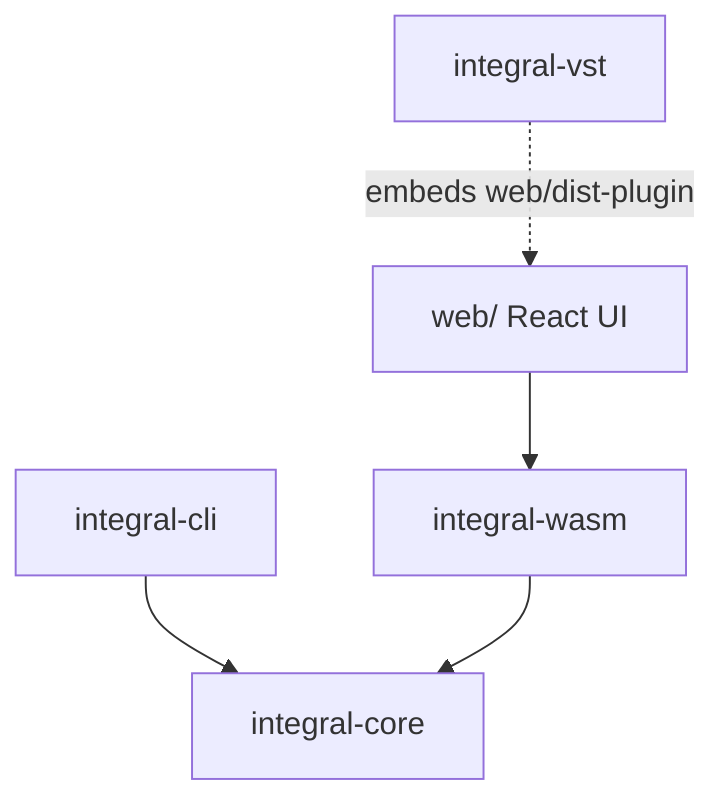

# crates

## Overview

The Rust workspace members (edition 2024, see the root `Cargo.toml`). The
portable core library holds all INTEGRA-7 protocol, state and device spec
logic. Three front ends sit on it:

- the CLI, which uses the core directly
- the WASM bindings, which use the core directly
- the DAW plugin, which embeds the web build (and therefore the WASM core)
  and does not link the core itself

## Subdirectories & Boundaries

- integral-core: [`./integral-core/README.md`](./integral-core/README.md) -
  the SysEx engine (`DeviceState`, `sysex`, `params`), the device
  specification layer, the tone and effect parameter maps, the SVD format,
  the Librarian, Expansions, Waves and the optional sequencer. It does no I/O
  and must compile for `wasm32-unknown-unknown`.
- integral-cli: [`./integral-cli/README.md`](./integral-cli/README.md) - the
  `integral` binary. It covers device diagnostics, raw SysEx, the monitor,
  the Wireless bridge, Pack import and export, and Expansion and Wave tools.
  It does MIDI I/O through `midir`.
- integral-vst: [`./integral-vst/README.md`](./integral-vst/README.md) - the
  `nih-plug` VST3/CLAP plugin and the `integral-app` standalone. It runs a
  macOS webview editor that serves the embedded web UI and links it to MIDI
  ports directly.
- integral-wasm: [`./integral-wasm/README.md`](./integral-wasm/README.md) -
  `wasm-bindgen` wrappers for the web frontend. JS pulls outbound SysEx and
  owns the clock.

## Verification

- Run: `cargo test --workspace` (`just test`)
- Run: `just build-wasm`
- Repo gate: `just check`
