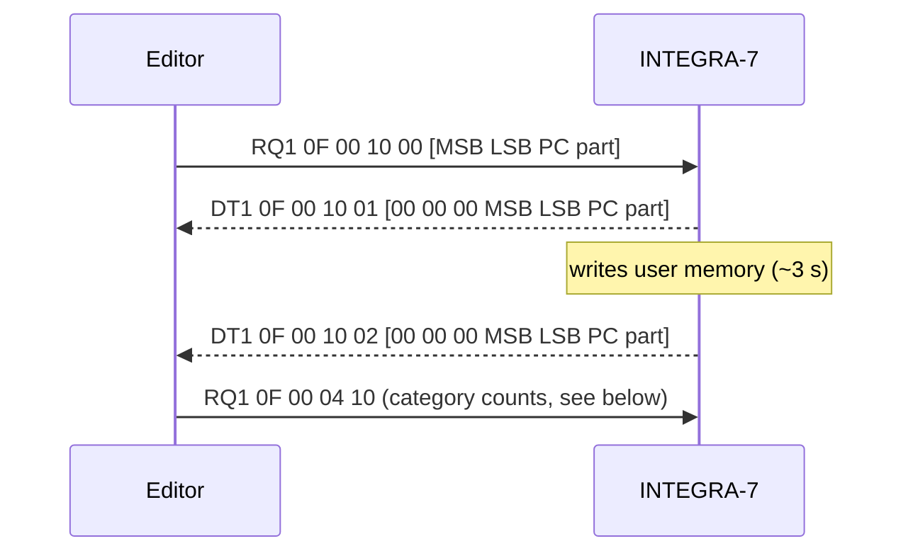

# Undocumented INTEGRA-7 SysEx Behavior

This document records SysEx behaviors discovered through reverse-engineering
the Roland iPad Editor app's communication with the INTEGRA-7. These are NOT
part of the official MIDI Implementation (v1.00) and may change with firmware
updates.

**Discovery method:** MIDI traffic capture while operating the iPad app (see
[Capturing the iPad Editor's Traffic](#capturing-the-ipad-editors-traffic)),
followed by systematic probing of address and payload variations via the CLI.

### Capturing the iPad Editor's Traffic

`integral monitor --port <port>` only shows what the INTEGRA-7 sends; the
editor's requests never reach that port. To see both sides, make the Mac a
relay between the iPad and the device with `--bridge`, which forwards every
message in both directions and logs each one with a timestamp and direction:


1. **Cut the editor's own link.** By default the editor talks over Wi-Fi to
   the INTEGRA-7's USB wireless adapter, a link the Mac cannot see. Unplug
   the adapter (or turn wireless off in the INTEGRA-7's SYSTEM menu) so the
   bridge is the only path.
2. **Join the iPad's network session.** With the editor open, iOS publishes
   a network MIDI session named after the iPad. In macOS Audio MIDI Setup →
   MIDI Studio → Network, add a session under *My Sessions* (e.g.
   `iPad Tap`), enable it, select the iPad under *Directory* and click
   *Connect*. Keep it separate from the session that reaches the INTEGRA-7.
3. **Point the editor at it.** Set the editor's MIDI device to *Network*.
4. **Start the bridge:**

   ```
   integral monitor --port "iPad Tap" --bridge Integra > capture.log
   ```

   Lines read `<ms> ms <from> -> <to>: [<n> bytes] <hex>`, with a DT1 decode
   where one parses.

Notes:

- For the first few minutes after connecting, the editor may resend each
  request after 3 s even though the reply was forwarded within ~10 ms;
  this stops once the network session settles. Separately, the editor
  paces its reads at about one per second.
- The network session runs over link-local IPv6. To inspect it at the
  packet level, filter on ports rather than the iPad's IPv4 address:
  `sudo tcpdump -i <if> -n 'udp portrange 5004-5009'`.
- Note the log line count before each action you want to isolate, and
  do one action at a time.

---

## 1. Preset/User Name Catalog Query

### Purpose

Read the names of all 64 Studio Sets (both factory presets and user sets)
without loading them into the Temporary area. This is how the iPad app
populates the Studio Set selector dropdown.

### Request Format

An RQ1 whose 4-byte size field carries the query instead of a size:

```
F0 41 <dev> 00 00 64 11 <addr[4]> <MSB> <LSB> <start> <count> [<checksum>] F7
```

| Byte(s)       | Value          | Description                                |
|---------------|----------------|--------------------------------------------|
| `F0`          | `F0`           | SysEx start                                |
| `41`          | `41`           | Roland manufacturer ID                     |
| `dev`         | `10`–`1F`     | Device ID                                  |
| `00 00 64`    | `00 00 64`     | INTEGRA-7 model ID                         |
| `11`          | `11`           | Command ID (RQ1)                           |
| `addr`        | see below      | Catalog address (4 bytes)                  |
| `MSB`         | e.g. `55`      | Bank Select MSB of the category to query   |
| `LSB`         | e.g. `00`      | Bank Select LSB                            |
| `start`       | `00`–`7F`     | Starting index within this LSB (0-indexed) |
| `count`       | `01`–`7F`     | Number of entries to return (max 127)      |
| `checksum`    | optional       | Roland checksum over `addr` + 4 payload bytes |
| `F7`          | `F7`           | SysEx end                                  |

**Checksum:** The iPad editor sends a standard Roland checksum, e.g.
`F0 41 10 00 00 64 11 0F 00 03 02 55 00 00 10 07 F7`. The device also
answers when it is omitted, which is what `integral-core`'s
`catalog::build_*_catalog_request` do.

**Catalog addresses:**

| Address        | Content       |
|----------------|---------------|
| `0F 00 03 02`  | Studio Sets   |
| `0F 00 04 02`  | Tones         |

### Known Addresses and Bank Values

**Address `0F 00 03 02` — Studio Set catalog:**

| MSB  | LSB  | Category        | Entries | Notes                          |
|------|------|-----------------|---------|--------------------------------|
| `55` | `00` | Studio Sets     | 64      | 0–15 factory, 16–63 user      |

**Address `0F 00 04 02` — Tone catalog:**

| MSB  | LSB  | Category        | Entries tested | Notes                 |
|------|------|-----------------|----------------|-----------------------|
| `59` | `40` | SN Acoustic Preset | 247         | Full Grand 1, etc.    |
| `57` | `40` | PCM Synth Preset   | 247         | 128voicePno, etc.     |
| `5F` | `40` | SN Synth Preset    | 247         | JP8 Strings1, etc.    |

Other MSB/LSB combinations (User banks, SRX expansions, GM2, Drum kits)
likely work at the same `0F 00 04 02` address but have not been tested.
The Bank Select MSB/LSB values match the standard bank select table from
the MIDI Implementation.

**Note:** The padding bytes (offsets 3-4 in each response) are always `00`
for tones — no category information is included. The iPad app's "By Category"
grouping must use an internal lookup table.

### Response Format

The device responds with multiple standard DT1 messages at address
`0F 00 03 02`, one per entry. The responses use normal DT1 framing
including a valid Roland checksum:

```
F0 41 <dev> 00 00 64 12 0F 00 03 02 <data[21]> <checksum> F7
```

Data layout (21 bytes):

| Offset | Size | Description                              |
|--------|------|------------------------------------------|
| 0      | 1    | Bank Select MSB (echo of request MSB)    |
| 1      | 1    | Bank Select LSB (echo of request LSB)    |
| 2      | 1    | Program number (0-indexed)               |
| 3      | 1    | `00` (padding/reserved)                  |
| 4      | 1    | `00` (padding/reserved)                  |
| 5–20   | 16   | Name (ASCII, space-padded)               |

### Delimiter Messages

The device inserts zero-data delimiter messages at irregular intervals
within the response stream:

```
F0 41 10 00 00 64 12 0F 00 03 02 00 00 00 00 00 00 00 00 00 00 00 00 00 00 00 00 00 00 00 00 00 6C F7
```

All 21 data bytes are `00`. These should be filtered out when parsing.
The delimiters do NOT indicate the end of the stream — more entries may
follow after a delimiter.

### Pagination

Each query returns exactly `count` entries (plus occasional delimiter
messages). Each LSB holds up to 128 entries (PC 0–127). To retrieve all
entries in a multi-LSB bank:

1. For each LSB in the bank, send 2 queries: `start=0, count=64` and
   `start=64, count=64`
2. Collect entries from each query and concatenate in order

For Studio Sets (single LSB, 64 entries): one query with `count=64` suffices.

For tone banks spanning multiple LSBs (e.g., SN Acoustic Preset with
LSB 64-65 = 256 tones): query each LSB with 2 pages of 64 entries each.

**Tone catalog responses** include entries with the real `(MSB, LSB, PC)`
from the data — not necessarily matching the queried LSB. The response also
includes a **category byte** at offset 3 in the data (see below).

### Example

**Request all 64 Studio Set names:**

```
F0 41 10 00 00 64 11 0F 00 03 02 55 00 00 40 F7
```

`55 00` = Studio Set bank, `00` = start from index 0, `40` = return 64 entries.

**Response (first entry):**

```
F0 41 10 00 00 64 12 0F 00 03 02 55 00 00 00 00
49 6E 74 65 67 72 61 20 50 72 65 76 69 65 77 20 2B F7
```

Data bytes: `55 00 00 00 00` + "Integra Preview " (16 ASCII chars)

**Request Studio Sets 5-20 (start=4, count=16):**

```
F0 41 10 00 00 64 11 0F 00 03 02 55 00 04 10 F7
```

First response: `55 00 04 00 00` + "Techno Set      "

**Request SN Acoustic Preset tones (first 64):**

```
F0 41 10 00 00 64 11 0F 00 04 02 59 40 00 40 F7
```

`59 40` = SN Acoustic Preset bank, `00` = start, `40` = 64 entries.

### Verified Factory Studio Set Names (Indices 0–15)

| Index | PC | Name              |
|-------|----|-------------------|
| 0     | 1  | Integra Preview   |
| 1     | 2  | Full Orch Set     |
| 2     | 3  | Chamber Orch Set  |
| 3     | 4  | Electro Set       |
| 4     | 5  | Techno Set        |
| 5     | 6  | Rock Band Set     |
| 6     | 7  | Jazz Band Set     |
| 7     | 8  | Big Band Set      |
| 8     | 9  | Ac Pop Set        |
| 9     | 10 | R&B Set           |
| 10    | 11 | Country Set       |
| 11    | 12 | World Pop Set     |
| 12    | 13 | Keyboard Set      |
| 13    | 14 | Guitar Set        |
| 14    | 15 | House Set         |
| 15    | 16 | Game Set          |

User Studio Sets (indices 16–63) default to "INIT STUDIO".

---

## 2. User Memory Address Space

### Purpose

Direct read access to every User slot, without loading it into a Temporary
area. Probed on a device on 2026-10-10.

### Address Map

Each User slot holds exactly the layout of the matching Temporary block
(`docs/midi/04-address-map.md`), rebased at the slot address. Addresses are
7-bit (`aa bb cc dd`).

| Base address | Slot index | Contents | Slots |
|---|---|---|---|
| `2F NN 00 00` | NN = 0–63 | User Studio Set NN+1 | 64 |
| `(30+B) NN 00 00` | B = 0–1, NN = 0–127 | User PCM Synth Tone B·128+NN+1 | 256 |
| `(40+B) (k·10h) 00 00` | B = 0–3, k = 0–7 | User PCM Drum Kit B·8+k+1 | 32 |
| `(50+B) NN 00 00` | B = 0–3, NN = 0–127 | User SN Synth Tone B·128+NN+1 | 512 |
| `(60+B) NN 00 00` | B = 0–1, NN = 0–127 | User SN Acoustic Tone B·128+NN+1 | 256 |
| `6E NN 00 00` | NN = 0–63 | User SN Drum Kit NN+1 | 64 |

The first byte adds `B` to the type's base: e.g. User SN Synth Tone 130 is at
`51 01 00 00`. For PCM Synth, SN Synth and SN Acoustic tones, B is the User
bank's Bank Select LSB. PCM Drum Kits use LSB 0 only, so their B is not the LSB.

A PCM Drum Kit spans two address units (`00 00 00`–`02 00 00`, Common 2 at
`02 00 00`), so kits sit 16 units apart.

Reads past the last slot of a block (e.g. `2F 40 00 00`) get no reply.

### Evidence

- **Names.** User Studio Set names at `2F NN 00 00` match the catalog query
  for slots 1–64 (`Integra Preview`, `Full Orch Set`, …). User SN Synth Tone
  names at `50 NN 00 00` match the sound list of the pack loaded on the device
  (*INTEGRA-7 Synth Legends*), 40 of 40.
- **Studio Set.** Every block of User Studio Set 5 (Common, Chorus, Reverb,
  Motional Surround, Master EQ, MIDI, Parts, Part EQ) is byte-identical to the
  Temporary Studio Set when that set is loaded. The only difference was an
  unsaved tone change on Part 1.
- **SN Synth Tone.** User slots 1, 2 and 17 are byte-identical, block by block
  (Common, MFX, Partials 1–3), to the SVD entries of the same tones decoded with
  the SN-S packing table (`docs/svd/03-sn-synth.md`).
- **Sub-blocks.** Every other type answers at the offsets of its Temporary
  layout: PCM Synth Common, MFX, PMT, Partials 1–4 and Common 2; SN Acoustic
  Common and MFX; SN Drum Common, MFX, Comp/EQ and Notes 27–88; PCM Drum
  Common, MFX, Comp/EQ, Partials 21–108 and Common 2.

### Read Notes

- An RQ1 cannot start or end inside a multi-byte (nibblized) parameter: a
  1-byte read at an SN Drum Note (whose first parameter is 4 nibbles) gets
  no reply.
- A reply covers only whole parameters inside the requested range, and only
  addresses that exist. It can be **shorter than requested**, or come as
  **several DT1 packets with gaps between them**. Readers must place packets
  by address and check that every byte arrived. Observed with `integral
  raw-read` on User SN Synth Tone 1, MFX (`50 00 02 00`):
  - A 64-byte read returns one 61-byte DT1, and nothing follows. MFX
    Parameter 12 spans `3D`–`40`, so it would end past byte 64; the reply
    stops at the last whole parameter.
  - A 145-byte read (`00 00 01 11`, the whole MFX block) returns all 145
    bytes in one DT1.
  - A 384-byte read at `2F 00 20 00` (Studio Set Parts 1–3 of User Studio
    Set 1) returns three 77-byte DT1s at `2F 00 20 00`, `2F 00 21 00` and
    `2F 00 22 00`. Each Part block is 77 bytes (`00 00 00 4D`), so bytes
    77–127 of each 128-byte step never arrive.
- The SysEx size field is 7-bit: SN Synth MFX is `00 00 01 11` (145 bytes).

### Not User Memory

These answer but hold INIT data, whatever the slot index:

| Address | Reads as |
|---|---|
| `10 00 00 00` | `INIT LIVE` (a Studio Set) |
| `11 00 00 00` | `INIT TONE` |
| `20`–`27 NN 00 00` | `INIT LIVE` for every NN |

An earlier version of this section took `20 NN 00 00` for user Studio Set
storage. That was wrong: it reads `INIT LIVE` for all 128 values of NN, while
the catalog shows real User Studio Set names.

### Writes Do Not Persist

A DT1 to a User slot address **does** change what that address reads back,
and the catalog query (Section 1) lists the new name. But the change lives only
in RAM: after a power cycle the slot reads back its stored content.

Tested on the last User slot of every type, renaming each one by DT1: User
Studio Set 64 and the last User slot of each tone and kit type.

So:

- To **store** into a User slot, load the data into a Temporary area and send
  the write request (Section 4).
- Until the next power cycle, a direct read (and the catalog) can return data
  that was never stored.

### Open

- What the `10`, `11` and `20`–`27` areas are.
- Whether anything other than the write request (Section 4) commits a direct
  RAM change to storage.

---

## 3. Preview Trigger

### Purpose

Trigger the built-in phrase preview for any of the 16 parts, equivalent to
pressing the hardware VOLUME knob. The device plays the phrase associated
with the tone's Phrase Number parameter.

### Command Format (DT1)

```
F0 41 <dev> 00 00 64 12 0F 00 20 00 <part> <checksum> F7
```

| Byte    | Value      | Description |
|---------|------------|-------------|
| `<part>` | `00`      | Preview OFF |
|          | `01`–`10` | Preview parts 1–16 |

### Usage Notes

- **Must send OFF between parts.** Sending a new part preview without
  stopping the current one does not work properly.
- The preview mode (SINGLE/CHORD/PHRASE) follows the device's System
  settings.
- No response is returned (fire-and-forget DT1).

### Examples

**Preview part 1 (device ID 10H):**
```
F0 41 10 00 00 64 12 0F 00 20 00 01 50 F7
```

**Stop preview:**
```
F0 41 10 00 00 64 12 0F 00 20 00 00 51 F7
```

### Discovery

Discovered by user "Wonderer" on Roland Clan Forums via systematic address
scanning. Verified working on our device 2026-04-12.

---

## 4. Write (Save) to User Memory

### Purpose

Store the Temporary tone of a part, or the Temporary Studio Set, into a user
slot. This is what the front-panel WRITE button does; the MIDI Implementation
documents no equivalent.

### Request Format

An RQ1 whose 4-byte size field carries the destination instead of a size,
with a standard Roland checksum:

```
F0 41 <dev> 00 00 64 11 0F 00 10 00 <MSB> <LSB> <PC> <part> <checksum> F7
```

| Byte(s)  | Description                                                  |
|----------|--------------------------------------------------------------|
| `MSB`    | Bank Select MSB of the destination user bank (see below)     |
| `LSB`    | Bank Select LSB of the destination user bank                 |
| `PC`     | Program number within the LSB, 0-indexed                     |
| `part`   | Source part, 0-indexed (`00` = part 1); `7F` for a Studio Set |
| checksum | Roland checksum over `0F 00 10 00 MSB LSB PC part`           |

The destination is the user slot's Bank Select triple from
[`03-bank-select-tables.md`](03-bank-select-tables.md). Slot *n* (1-based, as
shown on the device) maps to `LSB = (n - 1) / 128`, `PC = (n - 1) % 128`:

| Type            | MSB  | LSB        | Slots     |
|-----------------|------|------------|-----------|
| SN Acoustic     | `59` | `00`–`01`  | 0001–0256 |
| SN Synth        | `5F` | `00`–`03`  | 0001–0512 |
| SN Drum Kit     | `58` | `00`       | 0001–0064 |
| PCM Synth       | `57` | `00`–`01`  | 0001–0256 |
| PCM Drum Kit    | `56` | `00`       | 0001–0032 |
| Studio Set      | `55` | `00`       | 01–64     |

The stored name is the Temporary tone's or Studio Set's current name. The
iPad editor offers no rename at save time and sends no separate rename
message; to rename, change the name parameters in the Temporary area before
saving.

### Response

The device answers with two DT1s that echo the request payload behind three
`00` bytes:

```
F0 41 <dev> 00 00 64 12 0F 00 10 01 00 00 00 <MSB> <LSB> <PC> <part> <checksum> F7   (write started)
F0 41 <dev> 00 00 64 12 0F 00 10 02 00 00 00 <MSB> <LSB> <PC> <part> <checksum> F7   (write finished)
```

The first arrives within ~10 ms; the second 2.3–3.0 s later, once the slot
is written. Wait for `0F 00 10 02` before sending further requests.



### Captured Examples (device ID 10H)

| Saved                                   | Request payload | Request                                              |
|-----------------------------------------|-----------------|------------------------------------------------------|
| SN Synth "Vintage 9", part 1 → 0129     | `5F 01 00 00`   | `F0 41 10 00 00 64 11 0F 00 10 00 5F 01 00 00 01 F7` |
| SN Acoustic "StringsSect1", part 2 → 0129 | `59 01 00 01` | `F0 41 10 00 00 64 11 0F 00 10 00 59 01 00 01 06 F7` |
| PCM Synth "Pulse Key", part 5 → 0001    | `57 00 00 04`   | `F0 41 10 00 00 64 11 0F 00 10 00 57 00 00 04 06 F7` |
| PCM Drum "XV Bully Kit", part 5 → 0001  | `56 00 00 04`   | `F0 41 10 00 00 64 11 0F 00 10 00 56 00 00 04 07 F7` |
| SN Drum "Lo-Fi Kit", part 5 → 0001      | `58 00 00 04`   | `F0 41 10 00 00 64 11 0F 00 10 00 58 00 00 04 05 F7` |
| Studio Set "Integra Preview" → 64       | `55 00 3F 7F`   | `F0 41 10 00 00 64 11 0F 00 10 00 55 00 3F 7F 4E F7` |

Each save was verified by reading the slot name back through the catalog
query (Section 1).

### Follow-up: Category Count Query (inferred)

After every save the editor sends one or two RQ1s at `0F 00 04 10`:

```
F0 41 <dev> 00 00 64 11 0F 00 04 10 <category> 00 00 01 <checksum> F7
```

`category` is the 0-based Tone Category index (the list in
[`../params/03-supernatural-synth.md`](../params/03-supernatural-synth.md),
e.g. `0E` Strings, `17` Synth Pad/Strings, `19` Synth PolyKey, `21` Drums).
The editor queries `00` (No assign) and the saved tone's category; after a
Studio Set save it queried only `00`, after a drum kit only `21`. The reply is one DT1 at the same address:

```
F0 41 <dev> 00 00 64 12 0F 00 04 10 00 00 00 00 <n2> <n1> <n0> <checksum> F7
```

`n2 n1 n0` appear to be a nibblized count of tones in that category: the
No assign count went `3 7 F` → `3 7 E` → `3 7 D` (895 → 894 → 893) as saves
filled previously uninitialised slots. The editor presumably uses it to
refresh its "By Category" lists. Not otherwise verified.

### Discovery

Captured 2026-10-10 with the bridge setup described in
[Capturing the iPad Editor's Traffic](#capturing-the-ipad-editors-traffic).

---

## 5. Expansion Virtual Slots

### Purpose

Read which Expansion sits in each of the four virtual slots (A–D), and load
different ones, as the front panel's Expansion load and Roland's Editor do.
Loaded state is volatile: it is lost at power-off, and the System "Startup
Exp Slot A–D" settings reload titles at power-on (Owner's Manual pp. 14–15).

### Slot Values

| Value     | Expansion        |
|-----------|------------------|
| `00`      | OFF              |
| `01`–`0C` | SRX-01 … SRX-12  |
| `0D`–`12` | ExSN1 … ExSN6    |
| `13`      | ExPCM            |

ExPCM fills all four slots: load it as `13 13 13 13`. It reads back as
`13 14 15 16` (verified 2026-10-11).

### Read (RQ1)

```
F0 41 <dev> 00 00 64 11 0F 00 00 10 00 00 00 00 <checksum> F7
```

The reply is a DT1 at `0F 00 00 10` with four data bytes, one slot value per
slot A–D.

### Load (RQ1 with payload)

```
F0 41 <dev> 00 00 64 11 0F 00 30 00 <A> <B> <C> <D> <checksum> F7
```

As with the catalog query, the four "size" bytes carry the payload: the slot
values for A–D. The device answers with two DT1s, both with data
`00 00 00 00`:

| Address       | When                    | Meaning      |
|---------------|-------------------------|--------------|
| `0F 00 30 01` | ~70 ms after the request | Load started |
| `0F 00 30 02` | ~5 s later (one SRX title) | Load done |

### Behavior

- **Unchanged slots are skipped.** Requesting the slots already loaded sends
  no DT1 at all and loads nothing.
- **Sound cuts** for the whole load, and the panel shows a "Load expansion"
  progress screen.
- **The device is deaf while loading.** RQ1s sent during the load get no
  reply; the first answer came ~5 s after the request.
- **The Temporary Studio Set is kept** (its name read the same before and
  after).
- **Front-panel loads are silent.** Loading from the panel sends nothing over
  MIDI; re-read the slots to see the change.
- Unloaded banks play silence (Owner's Manual p. 30).

Device checks, 2026-10-11 (times from request to the `0F 00 30 02` reply):

| Load | Time |
|------|------|
| One SRX title | 4.9 s |
| Three SRX titles | 13.4 s |
| Four SRX titles | 17.6–17.7 s |
| ExPCM | 17.6 s |

- **A load sent during another load is dropped.** A second request sent 2 s
  into a four-title load got no reply of its own: one `30 01`/`30 02` pair
  came back, and the slots ended as the first request asked.
- **The same Expansion in two slots is accepted.** Requesting `03 03 05 07`
  loaded and read back `03 03 05 07`. Integral never sends this, but must
  read it.

### Examples (device ID 10H)

**Read:**
```
F0 41 10 00 00 64 11 0F 00 00 10 00 00 00 00 61 F7
```

**Load SRX-03, SRX-05, SRX-07, SRX-01 into A–D:**
```
F0 41 10 00 00 64 11 0F 00 30 00 03 05 07 01 31 F7
```

### Studio Set Common `00 50`–`00 53`

Roland's Editor names these reserved bytes "Expansion Slot 1–4 RomID". In the
preset Studio Set "Integra Preview" they read `00 00 00 00` while SRX-03/05/07/08
were loaded, so they do not mirror the loaded slots. Saving does not record
them either (2026-10-11): with SRX-03/05/07/08 loaded, a Studio Set saved to
User 64 and recalled read `00 00 00 00`. A Studio Set carries no record of the
Expansions it needs.

### Discovery

Message formats from Roland's Editor JavaScript (`REQ_READ_EXP_ADDR`,
`REQ_LOAD_EXP_ADDR`), corroborated by open-source editors and 2014 Roland Clan
forum captures. Verified on our device 2026-10-11, including the
`0F 00 30 01`/`0F 00 30 02` replies and front-panel silence.

## 6. Temporary Tone Reloads

### Purpose

What happens to a Part's Temporary tone when its tone reference (Tone Bank
Select MSB/LSB and Program Number, Studio Set Part `00 06`–`00 08`) is written
or changed. This decides the order in which a Studio Set and its tones can be
loaded into Temporary without one overwriting the other.

### Behavior

- **Any DT1 covering `00 06`–`00 08` reloads the tone**, even when the values
  don't change. The Part's Temporary tone is replaced by the referenced slot's
  stored tone. A DT1 over the whole Part block (`00 00`–`00 0A`) reloads too.
  A DT1 that doesn't cover those bytes (e.g. Part Level alone) leaves it.
- **The reference survives tone DT1s.** After setting a Part to a User slot
  and writing a different tone into its Temporary area, the Part keeps
  pointing at that slot, and the Temporary tone stays as written.
- **Bank Select + Program Change over MIDI reloads too**, even re-selecting
  the same slot. The written Temporary tone is lost.
- **The device announces none of this.** A tone reload by Bank Select +
  Program Change on a Part's receive channel, or a Studio Set change by Bank
  Select + Program Change on the Studio Set Control Channel, sends nothing
  over MIDI: no DT1, no Program Change.
- **The write request leaves Temporary alone.** Storing a Part's Temporary
  tone ([§4](#4-write-save-to-user-memory)) while the Temporary Studio Set
  holds unsaved changes keeps both the Part's reference and the Studio Set's
  Temporary data as they were.

So: load the Temporary Studio Set first, then each Part's tone. Writing the
Studio Set after a tone wipes that tone.

### Open

- Front-panel tone re-selection and Studio Set changes weren't checked. The
  MIDI equivalents above suggest the same reload, but whether the front panel
  sends anything is unknown.

### Discovery

Probed on our device 2026-10-11 with `raw-send`/`raw-read` on Parts 15 and
16 using PCM Synth User slots, with `monitor` running
([#183](https://github.com/sigma/integral/issues/183)).

## 7. Initialize (Studio Set, Sound Ctrl, Part, Tone, Partial)

### Purpose

Reset part of the Temporary area to the device's INIT values: the
front-panel Studio Set Init, Sound Ctrl Init, Part Init, Tone Init and Partial
Init. The MIDI Implementation documents no equivalent.

### Request Format

An RQ1 whose 4-byte size field carries the target instead of a size, with a
standard Roland checksum:

```
F0 41 <dev> 00 00 64 11 0F 00 18 <TT> 7F 7F <PP> <NN> <checksum> F7
```

| Init            | `TT` | `PP`           | `NN`                 | Resets                                                        |
|-----------------|------|----------------|----------------------|---------------------------------------------------------------|
| Studio Set      | `00` | `00`           | `00`                 | Studio Set Common and all 16 Parts; every Part's tone reloads |
| Sound Ctrl      | `08` | `00`           | `00`                 | Part `00 13`–`00 1A` (offsets) on **all 16 Parts**            |
| Part            | `10` | Part, 0-based  | `00`                 | That Part's Studio Set Part block; its tone reloads           |
| Tone            | `20` | Part, 0-based  | `00`                 | That Part's Temporary tone                                    |
| Partial         | `30` | Part, 0-based  | Partial, 0-based     | One partial of that Part's Temporary tone                     |

### Response

Two DT1s with 4 data bytes, all `00`:

```
F0 41 <dev> 00 00 64 12 0F 00 18 01 00 00 00 00 <checksum> F7   (init started)
F0 41 <dev> 00 00 64 12 0F 00 18 02 00 00 00 00 <checksum> F7   (init finished)
```

Nothing else follows: the device announces none of the reset values. Read the
affected blocks back after `0F 00 18 02`.

### Behavior

- **Studio Set Init** names the set `INIT STUDIO` and restores Common to the
  `INIT STUDIO` image (Common `00 10`–`00 17` = `7F 10 10 10 01 01 01 01`,
  `00 38` = `00`, Tone Control 1–4 Source = `01 61 02 04`, Tempo = 120). Each
  Part gets the same values as Part Init, with Part 10 on PCM Drum Kit
  `56 40 00` instead of the piano.
- **Sound Ctrl Init** has no Part byte and resets the eight offsets on every
  Part at once. It touches no other Part field.
- **Part Init** resets the Part block. Receive Channel came out as the
  Part's own channel, which it already was; whether a changed one survives
  wasn't checked. The tone becomes SN
  Acoustic `59 40 00` (Full Grand 1), Chorus Send `00`, Reverb Send `14`,
  Motional Surround L-R `40` and F-B `4A`. Other Parts are left alone.
- **Tone Init** names the tone `INIT TONE` and keeps its type: a PCM Synth
  tone stays PCM Synth. The Part's tone reference (`00 06`–`00 08`) is left
  alone, so the Part still points at the slot it pointed at.
- **Partial Init** resets one partial. Other partials and the tone Common
  are left alone.
- **Init gives the same data as an unwritten User slot.** After Tone Init
  on each of the five tone types, and after Studio Set Init, the Temporary
  blocks matched the INIT entries of `librarian/init.svd` byte for byte. That
  file was read from unwritten User slots.
- **Reserves are reset, not preserved.** Part Init and Studio Set Init put
  the writable reserves back to their INIT values: Part `00 26` = `7F`,
  `00 45` and `00 47` = `40`, Common `00 10` = `7F`, `00 14` = `01`. A
  client that wrote defaults itself would have to match these.
- **Some reserves ignore writes.** A DT1 of `05` to Part `00 02`, of `05` to
  Common `00 17`, or of `30` to Common `00 38` left the old value. Part
  `00 26`, `00 45`, `00 47` and Common `00 10`, `00 14` accepted the write.

### Open

- Partial Init on an SN Drum or PCM Drum kit (`NN` = key index) wasn't tried.
- Out-of-range `PP` or `NN`, and the delay between `01` and `02`, weren't
  checked.
- Whether Part Init and Studio Set Init keep a changed Receive Channel.

### Discovery

Message format from Roland's Editor JavaScript (`REQ_INITIALIZE`,
`INIT_FIXED_DATA` in `scene_base_midi_controller.js`). Every `TT` verified on
our device 2026-10-13 with `raw-rq1`/`raw-read`, on a Temporary Studio Set
with nothing saved ([#282](https://github.com/sigma/integral/issues/282)).

---

## 8. System Common Reserves and Persistence

### Purpose

The MIDI Implementation documents System Common `02 00 00 00` with size `2F`.
It marks the last byte, `00 2E`, as a reserve. It also marks Studio Set Common
`00 4B` as a reserve. Roland's Editor JavaScript names both bytes
([docs/research/system-settings-sysex.md](../research/system-settings-sysex.md)).
This section records how they behave on the device, and whether a System edit
survives a power cycle.

### `02 00 00 2E`: USB Audio Sampling Rate

| Value | Panel (SYSTEM > SOUND, Sampling Rate) |
|-------|----------------------------------------|
| `00`  | 44.1 kHz                               |
| `01`  | 48 kHz                                 |

- RQ1 reads the byte. On its own it reads 1 byte, and as part of the whole
  block it is the 47th byte.
- A DT1 changes the panel setting, despite the `<*>` mark.
- A panel edit changes the byte. It is a normal, two-way System parameter.
- `02` (96 kHz, per the editor) wasn't written. Whether the USB audio clock
  itself follows wasn't checked: that needs a USB audio host.

### `18 00 00 4B`: Ext Part Source Select

| Value | Panel (SYSTEM > SOUND, Ext Part Source Select) |
|-------|-----------------------------------------------|
| `00`  | USB AUDIO                                     |
| `01`  | INPUT                                         |

- RQ1 reads the byte, and a DT1 changes the panel setting.
- **A panel edit does not change the byte.** After a DT1 of `01`, setting USB
  AUDIO on the panel left `01`. After a DT1 of `00`, setting INPUT on the panel
  left `00`. No System Common byte changed either.
- So the panel setting lives in a System store with no address. A DT1 to
  `00 4B` overwrites it, but reading `00 4B` returns the last value written
  over SysEx (or the Studio Set's own value), not what the panel shows. A
  client can set this switch but can't read it reliably.
- Whether the panel switch and the byte track each other again after a Studio
  Set change wasn't checked.

### Nothing past `02 00 00 2E`

- An RQ1 for 1 byte at `02 00 00 2F`, `00 30`, `00 40`, `00 01 00`, `00 02 00`,
  `00 7F 00`, `02 01 00 00`, `02 02 00 00` or `02 7F 00 00` gets no reply.
- An RQ1 at `02 00 00 00` for 64 bytes returns only the 47-byte block. An RQ1
  at `00 2E` for 2 bytes returns 1. The device clips a read at the end of the
  block.

### System edits are volatile

A DT1 of System Tempo `00 26` = `07 09` (121) read back, and the panel showed
121. After a power cycle without a panel save, it read `07 08` (120) again. No
SysEx System Write is known, so System edits made over SysEx last only until
power-off. To keep them, the user has to save on the panel ([SHIFT] + [EDIT] in
the SYSTEM screen).

### Discovery

Probed on our device on 2026-10-14 with `raw-read` and `raw-send`, checking
each value on the panel ([#283](https://github.com/sigma/integral/issues/283)).
Every value was put back afterwards: `00 2E` = `00`, `00 4B` = `00`, and
Tempo = 120.

---

## Future Investigation

- **Expansion board tone catalogs**: SRX, ExSN, ExPCM tones at `0F 00 04 02`
  with their respective MSB/LSB values (MSB 93, 92, 97, 96, etc.) — untested
  but expected to work.

- **User tone catalogs**: User tone banks (LSB 0-3 instead of 64+) return
  user-defined tone names the same way. Verified for PCM Synth User (MSB 87,
  LSB 0) on 2026-10-11.

- **Drum kit catalogs**: MSB 88 (SN Drum) and MSB 86 (PCM Drum) catalogs —
  untested.

- **Other catalog addresses**: The `0F 00 XX 02` range may have additional
  catalog endpoints (we know `03 02` = Studio Sets, `04 02` = Tones).
