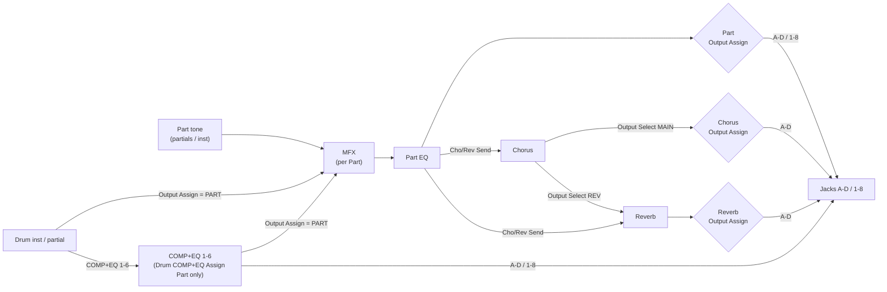

# INTEGRA-7 audio output routing

Research for [#340](https://github.com/sigma/integral/issues/340), under the
DAW-integration map [#336](https://github.com/sigma/integral/issues/336).
It asks which sounds the INTEGRA-7 can route to separate outputs, and how
finely. The answer feeds
[#342 Which plugins make up the family?](https://github.com/sigma/integral/issues/342).

## Sources

- **OM**: Roland *INTEGRA-7 Owner's Manual* (English PDF, mirrored at
  <https://www.adorama.com/col/productManuals/ROINTEGRA7.pdf>). Page numbers
  are the printed ones.
- **Spec**: Roland product specifications,
  <https://www.roland.com/global/products/integra-7/specifications/>.
- **Drivers**: Roland driver downloads,
  <https://www.roland.com/global/support/by_product/integra-7/updates_drivers/>.
- **MIDI**: the MIDI Implementation, extracted in [`docs/midi/`](../midi/README.md).
- **PG**: the Parameter Guide, extracted in [`docs/params/`](../params/README.md).

Anything marked **Unconfirmed** has no first-party statement and has not
been checked on the device.

## Answer in brief

- The unit has **8 analog output channels**: four stereo pairs, A (MIX) to D.
  The same jacks double as eight mono INDIVIDUAL outputs, 1 to 8.
- **Part**, **Chorus**, **Reverb** and the six **drum COMP+EQ units** each
  have an Output Assign. Each MFX is an insert inside its Part; it has no
  output of its own.
- A drum key cannot reach an output alone. It reaches one through one of
  six COMP+EQ units, and only on the single Drum COMP+EQ Assign Part.
- **USB audio is 2 channels in each direction.** Upstream it carries the
  MAIN OUT mix only. It needs Roland's VENDER driver; GENERIC
  (class-compliant) mode is MIDI only.
- **Motional Surround ON** overrides every Output Assign. The 8 jacks then
  carry the 2-channel mix plus a fixed 5.1 layout.

## Physical outputs

| Jack pair     | Stereo name | Mono names (INDIVIDUAL) | [VOLUME] knob | Master EQ |
|---------------|-------------|-------------------------|---------------|-----------|
| A (MIX) L, R  | A           | 1, 2                    | Yes           | Yes       |
| B L, R        | B           | 3, 4                    | No            | No        |
| C L, R        | C           | 5, 6                    | No            | No        |
| D L, R        | D           | 7, 8                    | No            | No        |

- The A (MIX) jacks come as both XLR and TRS and carry the same audio.
  They are the only balanced outputs (OM p. 22-23; Spec).
- The INDIVIDUAL 1-8 jacks "output mono signals". "The output destination
  (A-D, 1-8) can be assigned independently for each part" (OM p. 23).
  - The panel drawing labels jack pairs A, B, C and D as 1-2, 3-4, 5-6 and
    7-8, so the mono outputs are the same eight jacks, not extra ones
    (OM p. 23; the OM p. 46 flow diagram, "A (MIX)-L (1) ... D-R (8)").
  - The Spec lists only OUTPUT A to D, which agrees.
- Master EQ applies to A (MIX) and PHONES only (OM p. 36; PG).
- DIGITAL AUDIO OUT (coaxial S/PDIF) carries "the same signal as is output
  from the OUTPUT A (MIX) jacks", stereo, 24-bit, 44.1/48/96 kHz (OM p. 22).
- **Unconfirmed:** assigning one Part to `A` and another to `1` probably
  sums both on jack A-L. The jack sharing implies it; no source says so.
- So at most **8 discrete channels** leave the unit at once. Mixed layouts
  are allowed, e.g. 2 stereo pairs plus 4 mono. With 16 Parts, Parts beyond
  that share outputs.

## Routing per element

The OM effect diagrams (p. 25, p. 26) gives the chain:

The diagram simplifies two details. The Part sends to Chorus and Reverb
from the Part (the OM puts them after Part EQ). MFX also has its own
Chorus and Reverb send levels.

| Element | Parameter (address) | Values | Granularity | Source |
|---|---|---|---|---|
| Part 1-16 (direct sound) | Part Output Assign, Studio Set Part `00 29` | A, B, C, D, 1-8 | stereo pair or mono jack, per Part | MIDI [05 §7](../midi/05-studio-set.md); OM p. 32; PG |
| MFX | none | — | inline insert in its Part; follows the Part's Output Assign | OM p. 25-26 ("Each tone has one set of multi-effect settings") |
| Part EQ | none | — | inline; follows the Part | OM p. 25 |
| Chorus | Chorus Output Assign, `18 00 04 02` | A, B, C, D | stereo pair only | PG p. 98; device stores 0-3 ([11-fx-parameters](../midi/11-fx-parameters.md)). The MIDI Implementation marks `02` reserved |
| Chorus | Chorus Output Select, `18 00 04 03` | MAIN, REV, MAIN+REV | REV feeds the reverb in mono | MIDI [05 §2](../midi/05-studio-set.md); PG |
| Reverb | Reverb Output Assign, `18 00 06 02` | A, B, C, D | stereo pair only | MIDI [05 §3](../midi/05-studio-set.md); PG |
| Drum key, PCM Drum Kit | Partial Output Assign, partial `00 1B` | PART, COMP+EQ1-6 | per key (88 keys) to the Part or to one of 6 units | MIDI [07](../midi/07-pcm-drum-kit.md); PG |
| Drum key, SN Drum Kit | Output Assign, note `00 12` | PART, COMP+EQ1-6 | per key (notes 27-88) | MIDI [10](../midi/10-supernatural-drum-kit.md); PG |
| COMP+EQ unit 1-6 | Drum Comp/EQ *n* Output Assign, Studio Set Common `00 45`-`00 4A` | PART, A, B, C, D, 1-8 | stereo pair or mono jack, per unit | MIDI [05 §1](../midi/05-studio-set.md); PG ("PART = input to MFX of the part") |
| Which Part gets COMP+EQ | Drum Comp/EQ Part `00 44`, Switch `00 43` | Part 1-16; OFF/ON | **one** Part per Studio Set | MIDI 05 §1; OM p. 26 |
| Ext Part (audio input) | none in MIDI or PG | — | Level and Cho/Rev sends only | MIDI 05 §1 (`00 4C`-`00 4F`); PG |

Notes:

- **MFX** cannot be split from its Part's dry sound, and it cannot process
  outside audio. The Ext Part has no MFX (OM p. 46 flow: inputs pass to
  "Motional Surround or Chorus/Reverb").
- **Drum keys:** only the six COMP+EQ units of the Drum COMP+EQ Assign Part
  can leave the Part's path. Drum kits on other Parts send every key
  through the Part's MFX and Part Output Assign (OM p. 26).
  - **Unconfirmed:** a unit routed to A-D or 1-8 seems to skip that Part's
    MFX, Part EQ and Chorus/Reverb sends. The PG says only PART means
    "input to MFX of the part".
  - **Unconfirmed:** with the Comp/EQ Switch OFF, it is not known whether
    keys routed to COMP+EQ*n* fall back to PART.
- **Ext Part** routing: it has no Output Assign. **Unconfirmed:** it most
  likely sums into A (MIX).

## Motional Surround

When Motional Surround is ON (Studio Set `18 00 08 00`), several settings
are overridden:

- Chorus and Reverb are disabled, and Part Pan is ignored.
- Part Output Assign is ignored, and every COMP+EQ unit returns to its
  Part's MFX (OM p. 26, 32; PG COMP+EQ OUTPUT note).
- The jacks carry a fixed layout (OM p. 46): 2CH L/R on A (MIX), and 5.1
  as B-L L, B-R R, C-L C, C-R Ls, D-L Rs, D-R LFE.

This makes separate outputs and surround mutually exclusive, per Studio
Set.

## USB audio

- Format: **2 channels (stereo)**, 24-bit fixed, at 44.1, 48 or 96 kHz.
  The rate must match the DAW (OM p. 46, "The INTEGRA-7's audio format";
  Spec, "up to 24-bit/96 kHz").
- **Upstream** (to the computer): "the same sound as from the INTEGRA-7's
  MAIN OUT can be recorded into your computer" (OM p. 43). That is the A
  (MIX) bus, so B-D and INDIVIDUAL 3-8 never reach USB.
  - **Unconfirmed:** whether USB is taken before or after Master EQ and
    Output Gain.
- **Downstream** (from the computer): USB INPUT L/R either becomes the Ext
  Part's source (System **Ext Part Source Select** = USB AUDIO, OM p. 48),
  or plays straight to the outputs (OM p. 43).
- **Driver:** audio needs USB Driver = **VENDER (MIDI+AUDIO)**, which
  requires Roland's driver. **GENERIC (MIDI Only)** is the class-compliant
  mode, and USB is then MIDI only. Switching takes a System write and a
  power cycle (OM p. 48).
  - Roland ships drivers up to "Ver.1.0.6 for macOS Sonoma 14.x or later"
    and "Ver.1.0.1 for Windows 10/11" (Drivers).

## Implications for the plugin family (#342)

- **Part instances** can carry their own audio. A Part with a dedicated
  output (pair A-D or a mono 1-8) can feed a DAW audio return. At most 8
  channels exist, and they come back as analog audio through the user's
  interface, not over USB.
- **Per-drum-key instances** cannot each have their own audio. At most six
  key *groups* (COMP+EQ units) on **one** drum Part leave the Part's path,
  sharing the same 8 channels with everything else. A Drum Rack style
  per-key instance would be control-only, or would map onto a COMP+EQ unit
  shared with other keys.
- **MFX as a pass-through effect plugin** does not fit the hardware. MFX
  processes only its own Part's tone, never outside audio. It belongs inside
  the Part instance (or the tone), not on an audio track of its own.
- **Chorus and Reverb** fit a return-track model:
  - Each can be assigned its own stereo pair (A-D), so a DAW return track
    could carry hardware Chorus or Reverb audio.
  - Their inputs are the Part, MFX and Ext Part send levels, so the "send"
    side lives on the device, not in the DAW mixer.
  - Feeding DAW audio into them would mean USB audio into the Ext Part
    (VENDER driver only) or the analog INPUT jacks.
- **USB-only setups** (and wireless or network MIDI setups with no USB
  audio) get one stereo mix. Any separation then needs analog cabling.
- The map's out-of-scope line says the INTEGRA-7 "is a class-compliant MIDI
  device". That holds only in GENERIC mode. In VENDER mode it streams 2x2
  audio, which is still far too narrow for per-Part stems.
