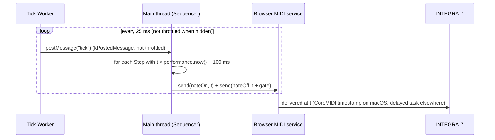

# Browser Scheduler Timing for the Sequencer (#42)

Research for [#42](https://github.com/sigma/integral/issues/42), part of
[#41](https://github.com/sigma/integral/issues/41), blocking
[#43](https://github.com/sigma/integral/issues/43).

**Question.** Can a browser scheduler keep steady 16th-note timing for the
Sequencer? It has to hold up while the user switches pages, while the tab is
hidden, and while the window has lost focus.

**Short answer.** Yes, if the Sequencer schedules a short window of notes
ahead using `MIDIOutput.send(data, timestamp)`, and if it gets its wake-ups
from a dedicated Worker instead of a main-thread timer. A main-thread
`setTimeout` loop stops working the moment the tab is hidden, because both
Chrome and Firefox then fire timers about once per second. Worker timers are
not throttled by default in either browser. Messages a Worker posts to the
main thread are not throttled either. The `send()` calls themselves must
still run on the main thread: no shipping browser exposes Web MIDI to Workers
yet.

Source links into Chromium and Firefox are pinned to Chromium
[`3315803b`](https://github.com/chromium/chromium/tree/3315803bded188b75fcdb8ed39087494ee775490)
and Firefox
[`6411c7c9`](https://github.com/mozilla-firefox/firefox/tree/6411c7c9174104c4173a35749f26acdbf268b127),
both `main` as of 2026-10-10.

For scale, a 16th note lasts `15000 / BPM` ms: 250 ms at 60 BPM, 125 ms at
120 BPM, 75 ms at 200 BPM and 50 ms at 300 BPM.

## 1. Does `MIDIOutput.send(data, timestamp)` schedule ahead, and how precisely?

### What the spec says

Yes, the spec defines scheduled sends. The [Web MIDI API
spec](https://webaudio.github.io/web-midi-api/#MIDIOutput) defines
`send(sequence<octet> data, optional DOMHighResTimeStamp timestamp = 0)`. The
timestamp is "the time at which to begin sending the data to the port (as a
DOMHighResTimeStamp - a number of milliseconds measured relative to the
navigation start of the document)". A timestamp of zero, or any time in the
past, means "as soon as possible". Several calls with the same timestamp must
go out in the order they were made. So the time base is the window's
`performance.now()`. The spec also defines
[`clear()`](https://webaudio.github.io/web-midi-api/#MIDIOutput),
which drops queued data that has not been sent yet.

The spec does not say how precise a scheduled send must be. Precision is up
to the implementation, and it differs between browsers and between platforms.

### How each browser implements it

Chromium (Chrome and Edge) turns the timestamp into a `base::TimeTicks`
measured from the document's time origin. A timestamp of `0` becomes "now"
([`midi_output.cc` L267-282](https://github.com/chromium/chromium/blob/3315803bded188b75fcdb8ed39087494ee775490/third_party/blink/renderer/modules/webmidi/midi_output.cc#L267-L282)).
The timestamp then crosses into the browser process, where each platform
backend handles it differently:

| Browser / platform | How the timestamp is honoured | Source |
|---|---|---|
| Chrome, Edge on **macOS** | Passed to CoreMIDI as the packet's `MIDITimeStamp` (both the legacy `MIDISend` path and the UMP `MIDISendEventList` path). The OS MIDI stack does the scheduling. | [`midi_manager_mac.cc` L368-376](https://github.com/chromium/chromium/blob/3315803bded188b75fcdb8ed39087494ee775490/media/midi/midi_manager_mac.cc#L368-L376), [L427-L454](https://github.com/chromium/chromium/blob/3315803bded188b75fcdb8ed39087494ee775490/media/midi/midi_manager_mac.cc#L427-L454) |
| Chrome, Edge on **Windows** (WinMM, and WinRT behind a feature flag) | The browser process posts a delayed task with delay `timestamp - now`, and the task calls the send API when it runs. | [`midi_manager_win.cc` L811-818](https://github.com/chromium/chromium/blob/3315803bded188b75fcdb8ed39087494ee775490/media/midi/midi_manager_win.cc#L811-L818), [`midi_manager_winrt.cc` L824-838](https://github.com/chromium/chromium/blob/3315803bded188b75fcdb8ed39087494ee775490/media/midi/midi_manager_winrt.cc#L824-L838), [`midi_service.cc` L22-27](https://github.com/chromium/chromium/blob/3315803bded188b75fcdb8ed39087494ee775490/media/midi/midi_service.cc#L22-L27) |
| Chrome on **Linux** (ALSA) | Same delayed-task approach. | [`midi_manager_alsa.cc` L293-301](https://github.com/chromium/chromium/blob/3315803bded188b75fcdb8ed39087494ee775490/media/midi/midi_manager_alsa.cc#L293-L301) |
| Chrome on **Android** | Same delayed-task approach. | [`midi_manager_android.cc` L74-113](https://github.com/chromium/chromium/blob/3315803bded188b75fcdb8ed39087494ee775490/media/midi/midi_manager_android.cc#L74-L113) |
| **Firefox** (all platforms, through the `midir` crate) | Firefox keeps a queue in its MIDI service. Messages due in less than 1 ms are sent at once. Later ones go through `DelayedDispatch` with the delay cast to a whole number of milliseconds, then are sent immediately through `midir`. No timestamp reaches the OS. | [`MIDIOutput.cpp` L41-67](https://github.com/mozilla-firefox/firefox/blob/6411c7c9174104c4173a35749f26acdbf268b127/dom/midi/MIDIOutput.cpp#L41-L67), [`midirMIDIPlatformService.cpp` L153-172](https://github.com/mozilla-firefox/firefox/blob/6411c7c9174104c4173a35749f26acdbf268b127/dom/midi/midirMIDIPlatformService.cpp#L153-L172) |
| **Safari / WebKit** | No Web MIDI support. | [MDN browser-compat-data `MIDIOutput.json`](https://github.com/mdn/browser-compat-data/blob/3b28abed321540dcbe571c16174af543c4e02ac0/api/MIDIOutput.json), [WebKit bug 107250](https://webkit.org/b/107250) |

Edge "mirrors" Chrome in the compat data. Chrome has supported
`MIDIOutput.send` since version 43 and Firefox since 108
([BCD](https://github.com/mdn/browser-compat-data/blob/3b28abed321540dcbe571c16174af543c4e02ac0/api/MIDIOutput.json)).

### Precision by platform (inferred from the source)

I did not measure any of this. The points below are what the code implies.

- **macOS (Chrome/Edge):** this is the best case. The time is handed to
  CoreMIDI, so how precise it is depends on the OS and the driver, not on
  Chrome's task scheduler. The project's own setup is macOS, reaching the
  INTEGRA-7 over RTP-MIDI through a mioXL. Any jitter added by that network
  hop is outside what the browser controls.
- **Windows (Chrome/Edge):** the delayed task is posted with the default
  `PostDelayedTask` policy, `kFlexibleNoSooner`, so it "may not run any sooner
  than the specified time, but might run slightly after"
  ([`delay_policy.h`](https://github.com/chromium/chromium/blob/3315803bded188b75fcdb8ed39087494ee775490/base/task/delay_policy.h)).
  Chromium adds a default leeway of **16 ms on Windows** and **8 ms
  elsewhere** to such tasks
  ([`task_features.h` L23-30](https://github.com/chromium/chromium/blob/3315803bded188b75fcdb8ed39087494ee775490/base/task/task_features.h#L23-L30),
  feature enabled by default in
  [`task_features.cc` L30-32](https://github.com/chromium/chromium/blob/3315803bded188b75fcdb8ed39087494ee775490/base/task/task_features.cc#L30-L32)).
  On Windows, Chromium raises the system timer from its default (about
  15.625 ms) to 1 ms only when the next wake-up is `kPrecise`
  ([`sequence_manager_impl.cc` L646-665](https://github.com/chromium/chromium/blob/3315803bded188b75fcdb8ed39087494ee775490/base/task/sequence_manager/sequence_manager_impl.cc#L646-L665),
  [`time_win.cc` L115-139](https://github.com/chromium/chromium/blob/3315803bded188b75fcdb8ed39087494ee775490/base/time/time_win.cc#L115-L139)).
  A scheduled MIDI send is not `kPrecise`, so expect it to land late by
  anywhere from 0 to roughly 16 ms or more. At 120 BPM that is up to about
  13 % of a 16th note.
- **Linux/Android (Chrome):** same mechanism, with 8 ms of leeway.
- **Firefox (all platforms):** the delay is rounded down to whole
  milliseconds and the send is a timer-driven dispatch on Firefox's MIDI
  thread. The OS does no scheduling. Precision depends on Firefox's timer
  thread, which I did not quantify.

Whatever the platform, the timestamp still helps. It moves the moment of
sending off the renderer's main thread, so jank in the page (layout, GC, React
renders) no longer shifts the notes. Only browser-process timer slack is left.

### `clear()` is missing in Chrome

Chromium does not implement `MIDIOutput.clear()`
([`midi_output.idl` L37](https://github.com/chromium/chromium/blob/3315803bded188b75fcdb8ed39087494ee775490/third_party/blink/renderer/modules/webmidi/midi_output.idl#L37),
"TODO(toyoshim): implement void clear()"; BCD lists it as unsupported with
[crbug.com/40411677](https://crbug.com/40411677)). Firefox does implement it
([`MIDIOutput.webidl` L14](https://github.com/mozilla-firefox/firefox/blob/6411c7c9174104c4173a35749f26acdbf268b127/dom/webidl/MIDIOutput.webidl#L14)).
This means that on Chrome, notes already scheduled inside the lookahead window
cannot be cancelled when the user presses Stop or edits a Step. The design has
to plan for this (see the recommendation below).

## 2. Timer throttling in hidden or background tabs

### Chrome / Edge (main thread)

Chrome's [timer throttling article](https://developer.chrome.com/blog/timer-throttling-in-chrome-88)
(2021-01-18) defines three levels:

- **Minimal throttling.** Applies when the page is visible *or* has made
  sound in the last 30 seconds. Timers run close to the requested time.
- **Throttling.** Applies when the page is hidden and silent. Timers are
  checked **once per second**.
- **Intensive throttling.** Applies after the page has been hidden for more
  than 5 minutes, the timer chain count is at least 5, the page has been
  silent for 30 seconds or more, and WebRTC is not in use. Timers are checked
  **once per minute**.

A `setTimeout` lookahead loop on the main thread therefore falls to 1 Hz as
soon as the tab is hidden, and to 1/min after five minutes. That is useless
for 16th notes. [MDN's `setTimeout`
page](https://developer.mozilla.org/en-US/docs/Web/API/Window/setTimeout#reasons_for_delays_longer_than_specified)
summarises the same rules.

In Chromium's frame scheduler, only timer task types are throttleable:
`kJavascriptTimerDelayedLowNesting` and `kJavascriptTimerDelayedHighNesting`,
with only the latter subject to intensive throttling. `kPostedMessage`, the
task type used for `message` events such as a Worker's `postMessage`, gets
`PausableTaskQueueTraits`. That queue can be paused or frozen but **not
throttled**
([`frame_scheduler_impl.cc` L494-507](https://github.com/chromium/chromium/blob/3315803bded188b75fcdb8ed39087494ee775490/third_party/blink/renderer/platform/scheduler/main_thread/frame_scheduler_impl.cc#L494-L507),
[L567-581](https://github.com/chromium/chromium/blob/3315803bded188b75fcdb8ed39087494ee775490/third_party/blink/renderer/platform/scheduler/main_thread/frame_scheduler_impl.cc#L567-L581),
[L1501-1529](https://github.com/chromium/chromium/blob/3315803bded188b75fcdb8ed39087494ee775490/third_party/blink/renderer/platform/scheduler/main_thread/frame_scheduler_impl.cc#L1501-L1529)).

"Audible" means real sound. Chromium's `AudioStreamMonitor` tracks whether
output streams are actually audible
([`audio_stream_monitor.h` L23-53](https://github.com/chromium/chromium/blob/3315803bded188b75fcdb8ed39087494ee775490/content/browser/media/audio_stream_monitor.h#L23-L53)).
The Sequencer's sound comes out of the INTEGRA-7, not out of the page, so the
page counts as silent.

### Chrome / Edge (dedicated Workers)

Dedicated Worker throttling sits behind the feature
`BlinkSchedulerWorkerThrottling` (`kDedicatedWorkerThrottling`), which is
**disabled by default**
([`features.h` L16-18](https://github.com/chromium/chromium/blob/3315803bded188b75fcdb8ed39087494ee775490/third_party/blink/renderer/platform/scheduler/common/features.h#L16-L18)).
Without it, the Worker never creates budget pools
([`worker_thread_scheduler.cc` L105-108](https://github.com/chromium/chromium/blob/3315803bded188b75fcdb8ed39087494ee775490/third_party/blink/renderer/platform/scheduler/worker/worker_thread_scheduler.cc#L105-L108)).
The code also notes that Worker throttling "doesn't match main thread
throttling for ... intensive throttling" should the feature ever return
([`worker_scheduler_impl.cc` L277-288](https://github.com/chromium/chromium/blob/3315803bded188b75fcdb8ed39087494ee775490/third_party/blink/renderer/platform/scheduler/worker/worker_scheduler_impl.cc#L277-L288)).
So Worker `setTimeout`/`setInterval` keep their normal cadence when the tab is
hidden.

### Firefox

Firefox's `TimeoutManager::MinSchedulingDelay` gives background windows a
floor of `dom.min_background_timeout_value = 1000` ms, plus budget-based
throttling
([`TimeoutManager.cpp` L207-277](https://github.com/mozilla-firefox/firefox/blob/6411c7c9174104c4173a35749f26acdbf268b127/dom/base/TimeoutManager.cpp#L207-L277),
[`StaticPrefList.yaml` L4037-4046](https://github.com/mozilla-firefox/firefox/blob/6411c7c9174104c4173a35749f26acdbf268b127/modules/libpref/init/StaticPrefList.yaml#L4037-L4046)).
Background throttling starts 30 s after the document loads
(`dom.timeout.throttling_delay`,
[L5739-5742](https://github.com/mozilla-firefox/firefox/blob/6411c7c9174104c4173a35749f26acdbf268b127/modules/libpref/init/StaticPrefList.yaml#L5739-L5742)).
A window or worker that "is playing audio" is exempt
([`TimeoutManager.cpp` L97-120](https://github.com/mozilla-firefox/firefox/blob/6411c7c9174104c4173a35749f26acdbf268b127/dom/base/TimeoutManager.cpp#L97-L120)).
MDN describes this exemption as applying to tabs that contain an
`AudioContext`
([MDN](https://developer.mozilla.org/en-US/docs/Web/API/Window/setTimeout#timeouts_in_inactive_tabs)).

Firefox Workers are **not throttled** unless `dom.workers.throttling.enabled`
is set. That pref defaults to `@IS_NIGHTLY_BUILD@`, i.e. on only in Nightly
([`TimeoutManager.cpp` L213-216](https://github.com/mozilla-firefox/firefox/blob/6411c7c9174104c4173a35749f26acdbf268b127/dom/base/TimeoutManager.cpp#L213-L216),
[`StaticPrefList.yaml` L5388-5391](https://github.com/mozilla-firefox/firefox/blob/6411c7c9174104c4173a35749f26acdbf268b127/modules/libpref/init/StaticPrefList.yaml#L5388-L5391)).
Release and Beta builds leave Worker timers alone. Firefox's
`TimeoutManager` throttles timeouts only, so `message` events are not
affected. This last point is inferred from where the throttling lives; I did
not find a Firefox doc that states it outright.

### The `AudioContext` clock

`AudioContext.currentTime` is a clock, not a timer, so throttling does not
apply to it. But a clock cannot wake anything up: a scheduler that reads it
still needs some callback to fire. Chris Wilson's pattern (below) pairs the
audio clock with a timer for exactly this reason. For a MIDI-only Sequencer,
the audio clock adds nothing. `send()` timestamps already use the
`performance.now()` time base
([spec](https://webaudio.github.io/web-midi-api/#MIDIOutput)), so
scheduling against the audio clock would only add a conversion step. Starting
an `AudioContext` also needs a user gesture under Chrome's autoplay policy
([Chrome autoplay policy](https://developer.chrome.com/blog/autoplay#web_audio)).
And a silent context does not make the page "audible", which is what Chrome's
throttling exemption requires (see above).

### Freezing and discarding (Chrome)

From Chrome 133, when **Energy Saver** is active, Chrome freezes a browsing
context group that has been hidden and silent for more than five minutes and
is CPU-intensive. Freezing suspends timers and event handlers
([Chrome blog, 2025-01-20](https://developer.chrome.com/blog/freezing-on-energy-saver)).
Web MIDI is **not** an exemption. The exemptions in the source are audible,
WebRTC, Web Locks, IndexedDB locks, USB, Bluetooth, HID, Serial, capture, and
the origin-trial opt-out
([`cannot_freeze_reason.h`](https://github.com/chromium/chromium/blob/3315803bded188b75fcdb8ed39087494ee775490/components/performance_manager/public/freezing/cannot_freeze_reason.h),
[`freezing_policy.cc` L810-813](https://github.com/chromium/chromium/blob/3315803bded188b75fcdb8ed39087494ee775490/components/performance_manager/freezing/freezing_policy.cc#L810-L813)).
Holding any Web Lock (`navigator.locks.request(...)`) while playing is a cheap,
standard way to opt out. A 25 ms Worker tick that does little work is also
unlikely to count as "CPU-intensive", but the blog gives no threshold.

Memory Saver tab **discarding** protects audible and recently audible pages,
among others. Web MIDI is not in that list either
([`discard_eligibility_policy.cc` L277-358](https://github.com/chromium/chromium/blob/3315803bded188b75fcdb8ed39087494ee775490/chrome/browser/performance_manager/policies/discard_eligibility_policy.cc#L277-L358)).
A discarded tab stops entirely, and no scheduler survives that.

### Window lost focus but still visible

Losing focus alone does not trigger any of the throttling levels above. They
depend on page *visibility* and audibility, not focus
([Chrome blog](https://developer.chrome.com/blog/timer-throttling-in-chrome-88)).
However, Chromium tracks native window occlusion on Windows and macOS, so a
window that is completely covered can be treated as hidden
([`native_window_occlusion_tracker_win.cc`](https://github.com/chromium/chromium/blob/3315803bded188b75fcdb8ed39087494ee775490/ui/aura/native_window_occlusion_tracker_win.cc),
[`web_contents_occlusion_checker_mac.mm`](https://github.com/chromium/chromium/blob/3315803bded188b75fcdb8ed39087494ee775490/content/app_shim_remote_cocoa/web_contents_occlusion_checker_mac.mm)).
Treat "window behind another app" the same as "tab hidden".

## 3. The standard lookahead pattern

Chris Wilson's ["A Tale of Two Clocks"](https://web.dev/articles/audio-scheduling)
(2013-01-09) explains that JS timer callbacks "can easily be skewed by tens of
milliseconds or more by layout, rendering, garbage collection, and
XMLHTTPRequest and other callbacks". The fix is to let a coarse timer wake up
often and schedule each event against a precise clock, for a short window
ahead. His suggested starting point is "100ms of 'lookahead' time, with
intervals set to 25ms". The trade-off: the overall lookahead decides how
quickly tempo and pattern changes take effect, while the interval trades
minimum latency against how often the code runs. His reference
[metronome](https://github.com/cwilso/metronome/blob/main/js/metronome.js)
gets its 25 ms tick from a **Web Worker** (`lookahead = 25.0`,
`scheduleAheadTime = 0.1`, `timerWorker = new Worker(...)`).

Adapted to Web MIDI, the precise clock is the MIDI subsystem's own timestamp
queue, fed with `performance.now()`-based timestamps.

## 4. Can a Worker send on an open `MIDIOutput`?

**Not in any shipping browser.** The spec allows it in principle. Since 2024
it marks `MIDIAccess`, `MIDIPort`, `MIDIOutput`, etc. as
`Exposed=(Window,Worker)` and `MIDIAccess` as `Transferable`
([spec IDL](https://webaudio.github.io/web-midi-api/#MIDIAccess);
[PR #256](https://github.com/WebAudio/web-midi-api/pull/256), merged
2024-07-04, resolving
[issue #99](https://github.com/WebAudio/web-midi-api/issues/99)). Under that
model, the page gets a `MIDIAccess` through `navigator.requestMIDIAccess()`,
which only exists on `Navigator`, i.e. the window, and transfers it to the
Worker.

Neither engine has implemented this:

- Chromium: `MIDIAccess`, `MIDIPort` and `MIDIOutput` are `Exposed=Window` and
  not `Transferable`
  ([`midi_access.idl` L33-36](https://github.com/chromium/chromium/blob/3315803bded188b75fcdb8ed39087494ee775490/third_party/blink/renderer/modules/webmidi/midi_access.idl#L33-L36),
  [`midi_output.idl` L33-40](https://github.com/chromium/chromium/blob/3315803bded188b75fcdb8ed39087494ee775490/third_party/blink/renderer/modules/webmidi/midi_output.idl#L33-L40)).
- Firefox: `Exposed=Window`
  ([`MIDIAccess.webidl` L9](https://github.com/mozilla-firefox/firefox/blob/6411c7c9174104c4173a35749f26acdbf268b127/dom/webidl/MIDIAccess.webidl#L9),
  [`MIDIOutput.webidl` L9-10](https://github.com/mozilla-firefox/firefox/blob/6411c7c9174104c4173a35749f26acdbf268b127/dom/webidl/MIDIOutput.webidl#L9-L10)).

So all `send()` calls must happen on the main thread. A Worker can only be the
**wake-up source**.

Watch out for time origins if the Worker ever computes timestamps. Each
global has its own time origin: navigation start for a Window, and the moment
the Worker starts running for a Worker
([HR Time §4](https://w3c.github.io/hr-time/#sec-time-origin)). A Worker's
`performance.now()` value therefore has to be shifted by
`worker.timeOrigin - window.timeOrigin` before it can be passed to `send()`.
The simplest design avoids this entirely: the Worker only ticks, and the main
thread reads its own `performance.now()`.

## Recommendation for the Sequencer

1. **Tick source:** a dedicated Worker running `setInterval(…, 25)` that
   posts a message to the main thread. Neither Worker timers nor posted
   messages are throttled when the tab is hidden, in Chrome or in release
   Firefox (see §2).
2. **Scheduling:** on each tick, the main thread schedules every Step whose
   start time falls before `performance.now() + 100 ms`. It sends both the
   Note On and its matching Note Off at that point, with absolute
   timestamps. Keep the clock as "Pattern start time + Step index × Step
   duration" so rounding errors don't add up from one tick to the next.
3. **Lookahead numbers:** start with **25 ms tick / 100 ms schedule-ahead**,
   Wilson's defaults. That gives about 75 ms of slack for main-thread jank
   before a Step is late. Edits, tempo changes and Stop take effect within
   at most 100 ms. Even at 300 BPM (50 ms Steps) the window holds only two
   Steps, so a hiccup costs very little.
4. **Stop and edits on Chrome:** `clear()` does not exist there, so
   scheduled notes cannot be pulled back. Sending each Note On and its Note
   Off in the same tick guarantees no note is left hanging. Stop simply stops
   scheduling, and notes already in the window play out (≤ 100 ms). Edits
   apply from the first Step outside the window.
5. **Stay unfrozen:** hold a Web Lock (`navigator.locks.request("sequencer",
   () => playingPromise)`) while playing. Chrome's Energy Saver freezing does
   not freeze pages that hold one.
6. **Notes keep bypassing the SysEx throttle queue**, as
   `IntegraService.sendNoteOn/Off` does today
   ([`web/src/integra.ts:714`](../../web/src/integra.ts)). The Sequencer
   needs a timestamped variant (e.g. an optional `timestamp` argument passed
   through to `this.port.output.send(bytes, timestamp)`).
7. **Expected precision:** Chrome/Edge on macOS should be the tightest, since
   CoreMIDI does the scheduling. On Windows, timestamped sends can land up
   to roughly 16 ms late because of Chromium task leeway and the default
   Windows timer resolution. On Linux and Android expect up to about 8 ms.
   Firefox's precision depends on its MIDI thread's millisecond-rounded
   delayed dispatch. These figures come from reading the source, not from
   measurement. A prototype that timestamps incoming MIDI on a second port
   (or loops back through the device) should confirm them before
   [#43](https://github.com/sigma/integral/issues/43) commits to numbers.

### Not covered

- Jitter added after the browser hands off the message (CoreMIDI → RTP-MIDI →
  mioXL → INTEGRA-7).
- Firefox's exact timer-thread precision per OS.
- Whether Chrome freezes dedicated Workers along with a frozen page. The
  Energy Saver article does not say. The Web Lock opt-out sidesteps the
  question.
