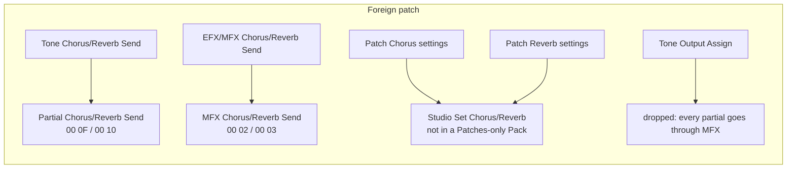

# JV / XV Effects onto INTEGRA-7 MFX (research for #196)

Answers [#196](https://github.com/sigma/integral/issues/196) (parent map
[#192](https://github.com/sigma/integral/issues/192)): how the JV/XP EFX types and the XV MFX
types land on the INTEGRA-7 MFX types of a PCM Synth tone, with the conversion for each
parameter. It also covers where a Foreign patch's Chorus and Reverb go. Per-parameter data
for all 40 JV types is in [`foreign-fx-map.json`](foreign-fx-map.json).

> **Checked against Roland's own conversions** ([#206](https://github.com/sigma/integral/issues/206),
> [`map-check-roland-pairs.md`](map-check-roland-pairs.md)): 37 of 40 JV types are confirmed. XV MFX
> types 1-40 store the JV EFX parameters **verbatim** (XV Parameter n = JV Parameter n). So the
> XV encoding statements below are superseded for types 1-40, and XV 1-40 converts with the JV
> rows.

## TL;DR

- **JV/XP EFX (40 types; JV-1080/2080/1010, XP-30/50/60/80)**: 3 are the same, 25 are
  rescaled with nothing lost, 5 are rescaled with a loss, 5 need a substitute, and 2 have
  no match. The losses are a dropped Output Pan or Pitch Shifter Mode. The substitutes are
  Phaser, Compressor and the three parallel types (Chorus/Delay, Flanger/Delay,
  Chorus/Flanger). **REVERB and GATED REVERB have no target:** the Integra has no reverb MFX.
  Every JV raw value is documented, so the formulas are exact (see
  [Value conversions](#value-conversions)).
- **XV MFX 41-90**: 6 same, 8 rescaled, 12 rescaled with a loss, 19 substitute and 5 with no
  match (Isolator, Isolator 2, Keyboard Multi, JD Multi, 3D Manual). XV types 1-40 are the
  JV types by name, one number up (XV type = JV raw + 1, XV 0 = THROUGH). Their display
  ranges differ in places, for example High Freq and Step Rate.
- **Biggest gap: the raw encoding of XV MFX parameters is not published.** The XV MIDI
  Implementation gives only "MFX Parameter 1-32 (12768-52768)". There is no per-type table
  like the JV's. The XV MFX block is laid out byte for byte like the Integra's, so the
  Integra encoding is the best guess. It must be checked against real dumps before
  anything is built.
- **Chorus and Reverb do not fit in a tone.** An Integra PCM Synth tone has only send levels:
  MFX Chorus/Reverb Send and Partial Chorus/Reverb Send. The Chorus and Reverb units belong
  to the Studio Set. A Patches-only Pack can carry the **sends**, which map exactly, but not
  the chorus or reverb **settings**. Those go to the Conversion report. A later
  Performances → Studio Sets slice could carry them: XV Chorus/Delay/GM2 Chorus and GM2
  Reverb match the Integra Studio Set types, while JV Chorus and JV/XV REVERB are substitutes.
- **Surprise: the Integra keeps the XV byte layout.** The Integra MFX block reserve at `00 01`
  is where the XV kept *MFX Dry Send Level*. Partial reserves `00 0D`/`00 0E`/`00 11` are
  where the XV kept *Tone Chorus/Reverb Send Level (MFX)* and *Tone Output Assign*. The
  Integra's Partial Chorus/Reverb Send are the XV's "(non MFX)" sends.

## Sources (highest trust first)

| # | Source | What it gives |
|---|--------|---------------|
| J1 | Roland *JV-1010 Owner's Manual*, MIDI Implementation, "Correspondence of the EFX algorithm and Exclusive Address" ([PDF](https://static.roland.com/assets/media/pdf/JV-1010_OM.pdf), PDF pp. 83-85) and Patch Common map | Raw range of EFX Parameter 1-12 for each of the 40 types. Patch Common `00 0C`-`00 2B`: EFX, Chorus and Reverb. Same model ID `6A` as the JV-1080/2080. |
| J2 | Roland *JV-1080 Owner's Manual* ([PDF](https://static.roland.com/assets/media/pdf/JV-1080_OM.pdf), a scan, read by OCR; PDF pp. 45-47, 83-99) | Display ranges and step tables (Rate, Pre Delay, Delay Time, Manual). Patch Chorus/Reverb semantics. Tone Output Assign MIX/EFX/OUTPUT1/2. |
| X1 | Roland *XV-5050 Owner's Manual* ([PDF](https://static.roland.com/assets/media/pdf/XV-5050_OM.pdf), PDF pp. 76-103) | All 90 MFX types with parameter, value and description tables. Note lists \*1 and \*2. Chorus types 0-3 (incl. GM2), Reverb types 0-5 (incl. GM2). |
| X2 | Roland *XV-3080 Owner's Manual* ([PDF](https://static.roland.com/assets/media/pdf/XV-3080_OM.pdf), list on PDF p. 36, MIDI Implementation in the appendix) | 63-type list (= XV-5080 1-63). Patch Common MFX/Chorus/Reverb and Patch Tone byte layouts. |
| X3 | Roland *XV-5080 Owner's Manual* ([PDF](https://static.roland.com/assets/media/pdf/XV-5080_OM.pdf), pp. 26-28, 41-42) | 90-type list. MFX Dry/Chorus/Reverb Send. Chorus types 0-2, Reverb types 0-4. |
| X4 | Roland *XV-2020* and *XV-88* Owner's Manuals ([XV-2020](https://static.roland.com/assets/media/pdf/XV-2020_OM.pdf), [XV-88](https://static.roland.com/assets/media/pdf/XV-88_OM.pdf)) | XV-2020: MFX Type 0-40, Chorus OFF/CHORUS, Reverb OFF/REVERB. XV-88: 63 types. |
| X5 | Roland *XP-30 Owner's Manual* ([PDF](https://static.roland.com/assets/media/pdf/XP-30_OM.pdf)) | XP-30: "40 different effects" (JV EFX). |
| I1 | Roland *INTEGRA-7 Parameter Guide* e01 ([PDF](https://static.roland.com/assets/media/pdf/INTEGRA-7_Parameter_Guide_e01_W.pdf), PDF pp. 74-98) | Display ranges of the 68 MFX types, Chorus and Reverb. |
| I2 | Roland INTEGRA-7 Editor JS, `model_excmap_mfx.js` (installed Editor 2.0.5; mirror [@d5b9193](https://github.com/SambaGodschynski/integra7-editor-web/blob/d5b9193874e2a0e3261a231562dff856c685f9fe/js/model/model_excmap_mfx.js)) | Per-type leaf list (id, init, min, max), which gives the MFX Parameter *n* of each Integra parameter, including the sync-sw/value/note triples. |
| R | Repo: [`fx-param-layout.md`](fx-param-layout.md), [`06-pcm-synth-tone.md`](../midi/06-pcm-synth-tone.md), [`05-studio-set.md`](../midi/05-studio-set.md) | Encoding tables (`RATE_HZ`, `PREDELAY_CHO`, `FREQ_BYPASS`, `NOTE`, `FB_PCT`, `PHASE`) and the Integra block layouts. |
| C | Owner's corpus `JV-1080_SP` (outside the repo), read with a throwaway scanner | EFX type usage (see [Corpus weight](#corpus-weight)). |

J1, J2, X1-X5 and I1-I2 are first-party Roland. No secondary write-up was used.

## Model coverage

| Family | EFX/MFX types | Raw type value | Chorus | Reverb |
|--------|---------------|----------------|--------|--------|
| JV-1080/2080/1010, XP-30/50/60/80 | 40 (no THRU) | 0-39 (display 1-40) | Patch Chorus, 0-127 knobs | ROOM1/2, STAGE1/2, HALL1/2, DELAY, PAN-DLY |
| XV-2020 | 1-40 | 0-40 (0 = THROUGH) | OFF, CHORUS | OFF, REVERB |
| XV-3080, XV-88 | 1-63 | 0-63 | OFF, CHORUS, DELAY | OFF, REVERB, SRV ROOM/HALL/PLATE |
| XV-5080, XV-5050 | 1-90 | 0-90 | XV-5050 adds GM2 CHORUS | XV-5050 adds GM2 REVERB |
| INTEGRA-7 (target) | 0-67 (0 = Thru) | own numbering | Studio Set: OFF, Chorus, Delay, GM2 Chorus | Studio Set: OFF, Room 1/2, Hall 1/2, Plate, GM2 Reverb |

The XV lists are prefixes of one another (X2 and X3 lists match 1-63 by name). The
XV-2020 intro says 40 MFX types, but its effects chapter heading says "90 different kinds".
The chapter stops at type 40, and the MIDI Implementation says `MFX Type (0 — 40)`, so the
heading is a copy error. The XV-3080 MIDI Implementation prints `0 - 72` under MFX Type, even
though the unit has 63 types. That is unexplained, so read the type value as 0-63.

XV and Integra type numbers are unrelated: the Integra list was reordered. A lookup table is
always needed.

## Classes

| Class | Meaning |
|-------|---------|
| same | Every source parameter copies raw. Integra-only parameters take a neutral value. |
| rescaled | Same algorithm. Every source parameter lands, some through a formula below. |
| rescaled-lossy | Same algorithm. Some source parameters are dropped or clamped, and each one goes in the Conversion report. |
| substitute | Different algorithm. Closest Integra type, approximate. |
| none | No Integra MFX type. Set MFX to Thru and report the effect. |

## JV/XP EFX → Integra MFX

"Integra" is the Integra MFX Type. `Px` is Integra MFX Parameter *x* (I2 leaf order). The
JSON has every `prm` → `P` pair. Rate, Delay and Step Rate land on the *value* slot of the
Integra sync-sw/value/note triple: write sync sw = 0, or 1 for a note.

| JV | Type | Integra | Class | Conversions / losses |
|----|------|---------|-------|----------------------|
| 1 | STEREO-EQ | 1 Equalizer | rescaled | High Freq +1. JV peaking bands → Mid1/Mid2 (order differs, see JSON) |
| 2 | OVERDRIVE | 28 Overdrive | same | Amp Sw = ON (the JV amp sim is always in line). Tone has no source: Integra init 50 |
| 3 | DISTORTION | 29 Distortion | same | as 2 |
| 4 | PHASER | 9 Phaser 1 | substitute | Manual is a Hz table vs 0-127 with no published curve. Rate `rate_jv`. Pan dropped. Mode/Polarity/X-Feedback: Integra init |
| 5 | SPECTRUM | 2 Spectrum | rescaled-lossy | Pan dropped. Bands, Q and Level copy |
| 6 | ENHANCER | 5 Enhancer | same | all five copy |
| 7 | AUTO-WAH | 6 Auto Wah | rescaled | Rate `rate_jv`. Polarity UP, Phase 0 |
| 8 | ROTARY | 19 Rotary 1 | rescaled | four rates `rate_jv_plain` (×20, no sync slot) |
| 9 | COMPRESSOR | 31 Compressor | substitute | Sustain has no target (Integra uses Threshold). Post Gain ×6. Pan dropped |
| 10 | LIMITER | 32 Limiter | rescaled-lossy | Post Gain ×6. Pan dropped. Ratio list identical |
| 11 | HEXA-CHORUS | 25 Hexa-Chorus | rescaled | Rate. Deviations copy |
| 12 | TREMOLO-CHORUS | 26 Tremolo Chorus | rescaled | two rates |
| 13 | SPACE-D | 27 Space-D | rescaled | Rate |
| 14 | STEREO-CHORUS | 22 Chorus | rescaled | Rate. JV prm7 is unused |
| 15 | STEREO-FLANGER | 23 Flanger | rescaled | Rate |
| 16 | STEP-FLANGER | 24 Step Flanger | rescaled | Rate. Step Rate `step_rate_jv` (×10; 0.05 Hz clamps to 0.10). Filter Type = OFF |
| 17 | STEREO-DELAY | 34 Delay | rescaled | Delay L/R `delay500_jv` |
| 18 | MODULATION-DELAY | 35 Modulation Delay | rescaled | Delay L/R, Rate |
| 19 | TRIPLE-TAP-DELAY | 36 3Tap Pan Delay | rescaled | three delays `delay1000_jv` (ms or note) |
| 20 | QUADRUPLE-TAP-DELAY | 37 4Tap Pan Delay | rescaled | four delays `delay1000_jv`. Low/High Gain 0 dB |
| 21 | TIME-CONTROL-DELAY | 40 Time Ctrl Delay | rescaled-lossy | Delay `delay_tcd_jv`. Pan dropped |
| 22 | 2VOICE-PITCH-SHIFTER | 44 2Voice Pitch Shifter | rescaled-lossy | Mode dropped. Pre Delay A/B `delay500_jv`. Level Balance → Pitch1/2 Level (`level_balance`) |
| 23 | FBK-PITCH-SHIFTER | 43 Pitch Shifter | rescaled-lossy | Mode and Pan dropped. Pre Delay `delay500_jv` |
| 24 | REVERB | — | **none** | Integra MFX has no reverb |
| 25 | GATED-REVERB | — | **none** | as 24 |
| 26-31 | OD/DS → CHORUS/FLANGER/DELAY | 45-50 | rescaled | Rate or Delay. JV prm6 of the → CHORUS types is unused |
| 32-34 | ENHANCER → CHORUS/FLANGER/DELAY | 62-64 | rescaled | Rate or Delay |
| 35-37 | CHORUS→DELAY, FLANGER→DELAY, CHORUS→FLANGER | 65, 66, 67 | rescaled | Rate, Delay |
| 38 | CHORUS/DELAY (parallel) | 65 Chorus → Delay | substitute | parallel becomes serial: the delay now sees the chorus |
| 39 | FLANGER/DELAY (parallel) | 66 Flanger → Delay | substitute | as 38 |
| 40 | CHORUS/FLANGER (parallel) | 67 Chorus → Flanger | substitute | as 38 |

For each type the JSON also lists the Integra parameters that have no source and the value
to write (`integra_unmapped`). That value is Roland's init, except Amp Sw = ON and Step
Flanger Filter Type = OFF.

Confidence: **high** for type identity and the JV raw side (J1 tables and J2 step tables
agree; every step table count matches its raw range). **Medium** for the Integra side of
non-linear parameters, which relies on the I2 leaf ranges plus the encodings already
established in [`fx-param-layout.md`](fx-param-layout.md). **Low** for the substitutes'
sound.

## XV MFX → Integra MFX

**XV 1-40** are the JV types above, by name and parameter list (X1 against J1/J2). Use the
same targets and classes. The display ranges differ in a few places:

- STEREO EQ High Freq is 2000/4000/8000, as on the Integra.
- STEP FLANGER Step Rate is 0.10-20.00 Hz/note, the Integra range.
- Several Rate/Delay parameters accept notes from list \*2. That list is the Integra `NOTE`
  table: 22 entries, 1/64T … 2/1.

~~So the JV formulas do **not** carry over raw.~~ Superseded: Roland's pairs show that XV types
1-40 store the JV raw values verbatim, so the JV formulas do carry over
([`map-check-roland-pairs.md`](map-check-roland-pairs.md)). The STEREO EQ High Freq list is the
one open exception.

**XV 41-90** (from X1):

| XV | Type | Integra | Class | Notes |
|----|------|---------|-------|-------|
| 41 | STEREO PHASER | 9 Phaser 1, or 12 Step Phaser when Step Sw = ON | rescaled-lossy | Type 1/2 dropped |
| 42 | KEYSYNC FLANGER | 23 Flanger / 24 Step Flanger | rescaled-lossy | Keysync, Threshold, Ksync Phase dropped |
| 43 | FORMANT FILTER | 7 Humanizer | rescaled | Keysync → Input Sync Sw, Threshold → Input Sync Threshold |
| 44 | RING MODULATOR | 15 Ring Modulator | rescaled-lossy | Modulator, Monitor dropped |
| 45 | MULTI TAP DELAY | 38 Multi Tap Delay | rescaled | 0-1800 ms within 0-2600 |
| 46 | REVERSE DELAY | 39 Reverse Delay | rescaled-lossy | Which feedback and damp belong to which tap is unverified |
| 47 | SHUFFLE DELAY | 34 Delay | substitute | |
| 48 | 3D DELAY | 36 3Tap Pan Delay | substitute | RSS 3D lost |
| 49 | 3VOICE PITCH SHIFTER | 44 2Voice Pitch Shifter | substitute | voice 3 dropped |
| 50 | LOFI COMPRESS | 41 LOFI Compress | rescaled-lossy | Post Filter 1, Pan dropped |
| 51 | LOFI NOISE | 41 LOFI Compress | substitute | noise generators lost |
| 52 | SPEAKER SIMULATOR | 8 Speaker Simulator | same | same 16 speakers |
| 53 | OVERDRIVE 2 | 28 Overdrive | same | |
| 54 | DISTORTION 2 | 29 Distortion | same | |
| 55 | STEREO COMPRESSOR | 31 Compressor | substitute | Sustain has no target |
| 56 | STEREO LIMITER | 32 Limiter | rescaled | Post Gain ×6 |
| 57 | GATE | 33 Gate | rescaled-lossy | Key, Monitor dropped |
| 58 | SLICER | 18 Slicer | rescaled-lossy | Reset Monitor dropped |
| 59 | ISOLATOR | — | **none** | |
| 60 | 3D CHORUS | 22 Chorus | substitute | |
| 61 | 3D FLANGER | 23 / 24 | substitute | |
| 62 | TREMOLO | 16 Tremolo | rescaled | |
| 63 | AUTO PAN | 17 Auto Pan | rescaled | |
| 64 | STEREO PHASER 2 | 9 / 12 | rescaled-lossy | as 41 |
| 65 | STEREO AUTO WAH | 6 Auto Wah | rescaled | one-to-one |
| 66 | ST FORMANT FILTER | 7 Humanizer | rescaled-lossy | Phase dropped |
| 67 | MULTI TAP DELAY 2 | 38 | rescaled-lossy | 0-3000 ms clamps at 2600 |
| 68 | REVERSE DELAY 2 | 39 | rescaled-lossy | 0-1500 ms clamps at 1300 |
| 69 | SHUFFLE DELAY 2 | 34 Delay | substitute | |
| 70 | 3D DELAY 2 | 36 | substitute | clamps at 2600 |
| 71 | ROTARY 2 | 20 Rotary 2 | rescaled | |
| 72 | ROTARY MULTI | 21 Rotary 3 | substitute | amp sim and EQ lost |
| 73 | KEYBOARD MULTI | — | **none** | |
| 74 | RHODES MULTI | 57-60 EP AmpSim → … | substitute | low confidence |
| 75 | JD MULTI | — | **none** | |
| 76 | STEREO LOFI COMPRESS | 41 | rescaled-lossy | as 50 |
| 77 | STEREO LOFI NOISE | 41 | substitute | as 51 |
| 78 | GUITAR AMP SIMULATOR | 30 Guitar Amp Simulator | rescaled | same 14 amps, 16 speakers |
| 79 | STEREO OVERDRIVE | 28 Overdrive | same | Pan centre |
| 80 | STEREO DISTORTION | 29 Distortion | same | Pan centre |
| 81-83 | GUITAR MULTI A/B/C | 52-56 (pick by enabled block) | substitute | low confidence |
| 84-86 | CLEAN GUITAR MULTI A/B, BASS MULTI | 65 Chorus → Delay, or a drive type | substitute | low confidence |
| 87 | ISOLATOR 2 | — | **none** | |
| 88 | STEREO SPECTRUM | 2 Spectrum | same | |
| 89 | 3D AUTO SPIN | 17 Auto Pan | substitute | low confidence |
| 90 | 3D MANUAL | — | **none** | |

## Value conversions

The JV raw side comes from J1 (ranges) and J2 (step tables). The Integra side comes from I1,
I2 and [`fx-param-layout.md`](fx-param-layout.md). Full text is in the JSON `conversions`.

| Name | JV raw → display | Integra target |
|------|------------------|----------------|
| copy | Low/High Gain 0-30, Pre Delay 0-125, Feedback 0-98, Phase 0-90, Balance 0-100, HF Damp 0-17, Cutoff 0-16, EQ Freq 0-16, Q 0-4, Pan/Level 0-127, Coarse 0-36, Fine 0-100 | identical tables (`PREDELAY_CHO`, `FB_PCT`, `PHASE`, `FREQ_BYPASS`, `FREQ`) |
| `rate_jv` | 0-98 → 0.05·(i+1); 99-118 → 5.0+0.1·(i−99); 119-125 → 7.0+0.5·(i−119) Hz | Rate (Hz) stored = round(20·Hz), sync sw = 0. **Exact** |
| `step_rate_jv` | as `rate_jv` | Step Rate (Hz) stored = max(1, round(10·Hz)) (0.10-20.00 Hz) |
| `delay500_jv` | 0-49 → 0.1·i; 50-59 → 5+0.5·(i−50); 60-89 → 10+(i−60); 90-115 → 40+10·(i−90); 116-126 → 300+20·(i−116) ms | msec = round(ms). Below 10 ms, at most 0.5 ms of rounding error |
| `delay1000_jv` | 0-69 → 200+5·i; 70-115 → 550+10·(i−70) ms; 116-125 → 10 notes | msec, or sync sw = 1 with `NOTE` 6+(i−116) (order assumed, see below) |
| `delay_tcd_jv` | 0-79 → 200+5·i; 80-120 → 600+10·(i−80) ms | msec. **Exact** |
| `post_gain` | ×1/×2/×4/×8 = 0/+6/+12/+18 dB | 6·i. **Exact** |
| `eq_hi_jv` | 0-1 = 4/8 kHz | i+1 (2/4/8 kHz list) |
| `level_balance` | A100:0B … A0:100B (0-100) | Pitch1 Level = round(127·min(1,(100−x)/50)), Pitch2 = round(127·min(1,x/50)). Hypothesis |
| `phaser_manual_jv` | 0-19 → 100+10·i; 20-54 → 300+20·(i−20); 55-125 → 1000+100·(i−55) Hz | no published Hz curve for Integra 0-127: approximate |

Check: each table's entry count equals its J1 raw range. Rate has 99+20+7 = 126 entries
(0-125), Delay 500 has 50+10+30+26+11 = 127 (0-126), Delay 1000 has 70+46+10 notes = 126
(0-125), TCD has 80+41 = 121 (0-120).

## Chorus, Reverb and sends

### Where things land

| Source | Integra destination | Class |
|--------|---------------------|-------|
| JV Tone Chorus/Reverb Send (0-127) | Partial Chorus/Reverb Send Level (06 Partial `00 0F`/`00 10`) | same |
| JV EFX Chorus/Reverb Send | MFX Chorus/Reverb Send Level (MFX `00 02`/`00 03`) | same |
| JV EFX Mix Out Send Level, XV MFX Dry Send Level | none: Integra `00 01` is reserve | report |
| JV Tone Output Assign MIX/EFX/OUT1/OUT2, XV Tone Output Assign MFX/A-D/1-8 | none: every Integra partial goes through the tone MFX | report when a tone bypassed the EFX/MFX while others used it |
| XV Tone Chorus/Reverb Send (non MFX), `00 0F`/`00 10` | Partial Chorus/Reverb Send, same offsets | same |
| XV Tone Chorus/Reverb Send (MFX), `00 0D`/`00 0E` | none: Integra reserve at the same offsets | report |
| Patch Chorus and Reverb **settings** | Studio Set Chorus/Reverb (05 `18 00 04 00`, `18 00 06 00`) | outside the Pack (below) |

### Settings, for a Studio Set slice

| Source | Integra Studio Set | Class |
|--------|--------------------|-------|
| JV Patch Chorus (Rate, Depth, Pre-Delay, Feedback, Level 0-127; Output MIX/REV/MIX+REV) | GM2 Chorus (Rate, Depth, Delay, Feedback, Level 0-127) + Chorus Output Select MAIN/REV/MAIN+REV | substitute (raw copy is plausible; the curves are unpublished) |
| XV Chorus type 1 CHORUS / 2 DELAY | Chorus type 1 Chorus / 2 Delay: same parameter set (X1 p. 102 vs [`fx-param-layout.md`](fx-param-layout.md)) | rescaled (XV-5080 Delay 200-1000 ms, XV-5050 0-1000 ms, both within Integra 0-1000) |
| XV-5050 Chorus type 3 GM2 CHORUS | GM2 Chorus | same |
| JV Reverb ROOM1-HALL2 (Time 0-127, HF Damp list) and XV REVERB type 1 | Room 1/2, Hall 1/2 (Time 0.1-10 s, HF Damp 0-100 linear) or GM2 Reverb (Character, Time 0-127) | substitute: neither curve is published |
| JV/XV Reverb DELAY, PAN-DELAY | none in Integra Reverb (Chorus type Delay is the only delay) | none |
| XV SRV ROOM/HALL/PLATE (Size, High Cut, LF/HF Damp Freq+Gain) | Room/Hall/Plate (Density, Diffusion, LF/HF Damp 0-100, Spread, Tone) | substitute |
| XV-5050 Reverb type 5 GM2 REVERB | GM2 Reverb | same |

## Corpus weight

Owner's `JV-1080_SP` folder: 1,752 distinct Patch Common blocks, EFX Type at `00 0C`.

| EFX | Patches | Class |
|-----|---------|-------|
| STEREO-EQ | 1,020 | rescaled |
| TRIPLE-TAP-DELAY | 130 | rescaled |
| HEXA-CHORUS | 91 | rescaled |
| PHASER | 59 | substitute |
| 2VOICE-PITCH-SHIFTER | 47 | rescaled-lossy |
| SPACE-D | 45 | rescaled |
| REVERB / GATED-REVERB | 33 / 6 | none |
| COMPRESSOR | 15 | substitute |
| parallel types | 4 | substitute |
| all others | 302 | same or rescaled (35 of them rescaled-lossy) |

Many STEREO-EQ hits are probably Patches whose tones never route to EFX: the count does not
check Tone Output Assign. Reverb type: 323 of 1,752 Patches use DELAY or PAN-DLY, which have
no Integra reverb.

## Unresolved

1. **XV MFX raw encoding.** No first-party per-type table was found in X1-X4. Hypothesis: it is
   the Integra encoding for the same parameter, because the block layout is identical
   (both `00 00 01 11`) and parameter names match. Test: decode XV factory Patch dumps
   whose MFX settings are known, or read a few on hardware.
2. **JV note values.** J2 says Step Rate also accepts notes, but J1 gives raw 0-125, which the
   126-entry Hz table already fills. The note order for the 200-1000 ms delays (raw 116-125)
   is assumed equal to XV list \*1. Settle both against corpus Patches that use notes.
3. **Unpublished curves.** JV Patch Chorus/Reverb 0-127 knobs, Integra Phaser Manual
   0-127, Integra Reverb HF Damp 0-100, and Level Balance crossfade law. Settle these by
   listening on the device.
4. **Compressor.** The Integra Compressor has a hidden 7th leaf (`MFX_COMP_RATIO`, 0-2,
   `desc: ''`, I2), like the hidden reverb level in [`fx-param-layout.md`](fx-param-layout.md).
   Its function is unknown. Preserve the init value.

## Repo findings

- [`mfx_params.rs`](../../crates/integral-core/src/mfx_params.rs) flattens every
  sync-sw/value/note triple into one slot. Example: type 34 Delay has 11 parameters there
  but 15 leaves in I2, so every parameter after the first delay is at the wrong MFX
  Parameter number. This confirms open issue
  [#30](https://github.com/sigma/integral/issues/30). A converter must take its parameter
  numbers from the corrected table, not from today's `mfx_params.rs`.

## Bearing on the map's standing decisions

- **"Parameter-faithful" vs "Patches only".** The Chorus/Reverb settings have equivalents
  only in a Studio Set. Under Patches-only, they are dropped and reported. The sends map
  exactly.
- **"XV first".** The case rests on the shared wave table. For effects it is the other way
  round: JV EFX encoding is fully documented, while XV MFX encoding is not. XV is also not
  uniform: 40, 63 or 90 types, and Chorus/Reverb type sets that differ by model.
- **"Unmapped effect type does not block import"** holds. Two JV types and five XV types
  have no match. Their MFX goes to Thru and the Conversion report says so.
