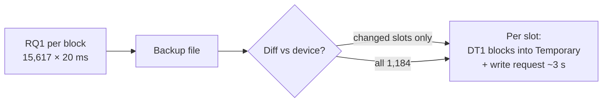

# Full Backup and Restore over SysEx

Research for [#279](https://github.com/sigma/integral/issues/279), part of
map [#276](https://github.com/sigma/integral/issues/276).

**Answer:** user memory, yes. System memory, only in part.

- **User memory** (every User Studio Set and every User tone and kit) can be
  read in full with RQ1. It can be written back through the same path the
  Librarian's import already uses: load the data into Temporary, then send the
  write request. A read takes about **5–8 min**. A write of every slot takes
  about **50–65 min**, almost all of it the device's own ~3 s commit per slot.
- **System memory** can't be restored from a SysEx backup. Only System Common
  (47 bytes) has an address, and writing it by DT1 is not known to persist.
  There is no known SysEx "System Write". The rest of the BACKUP's System entry
  (bits 221–863) has no SysEx address at all.

No device was used for this research. Every number below comes from the
documents and code it cites.

## Sources

| Tag | Source |
|-----|--------|
| **[PROT]** | [`docs/midi/01-protocol.md`](../midi/01-protocol.md): DT1/RQ1 format, the 256-byte / 20 ms rule (Roland MIDI Implementation v1.00) |
| **[MAP]** | [`docs/midi/04-address-map.md`](../midi/04-address-map.md): Setup, System Common, Temporary areas (Roland) |
| **[UND]** | [`docs/midi/99-undocumented.md`](../midi/99-undocumented.md): §2 User memory addresses, §4 write request (device-probed 2026-10-10/11) |
| **[SVD]** | [`docs/svd/`](../svd/README.md), mainly [`04-chunk-types.md`](../svd/04-chunk-types.md), [`10-system.md`](../svd/10-system.md) and [`11-sound-vs-backup.md`](../svd/11-sound-vs-backup.md) (18 Roland BACKUP files) |
| **[OM]** | [`docs/manual/05-operational.md`](../manual/05-operational.md) "Backup/Restore", [`docs/manual/01-architecture.md`](../manual/01-architecture.md) "Memory types" (Owner's Manual pp. 50–53) |
| **[SPEC]** | `crates/integral-core/src/device_spec.rs`: `USER_MEMORY` (address, slot count and block list of each type) and the block size constants it names |
| **[LIB]** | `crates/integral-core/src/librarian/`: `reader.rs`, `export.rs`, `import.rs`, `plan.rs`, `pack.rs`; `user_write.rs`; `svd_convert.rs` |

## What BACKUP Covers

The front panel's BACKUP writes "all settings of the INTEGRA-7": user memory
plus system memory, as one 811,292-byte SVD file. RESTORE overwrites everything
and needs a power cycle afterwards [OM; SVD 11]. The file always holds 64 Studio
Sets, 256 PCM Synth tones, 32 PCM Drum Kits, 512 SN Synth tones, 256 SN Acoustic
tones, 64 SN Drum Kits and 1 System entry (`SYSa`). One entry per slot, INIT
slots included [SVD 11].

BACKUP doesn't cover Setup (`01 00 00 00`: the Sound Mode and the current
Studio Set selection) or the loaded Expansion slots, which are volatile
[MAP; UND §5].

## Address Ranges and Access

| Memory | Address | Slots | RQ1 read | DT1 write |
|---|---|---|---|---|
| User Studio Sets | `2F NN 00 00` | 64 | Yes, silently [UND §2] | RAM only, lost at power-off [UND §2] |
| User PCM Synth | `(30+B) NN 00 00` | 256 | Yes | RAM only |
| User PCM Drum | `(40+B) (k·10h) 00 00` | 32 | Yes | RAM only |
| User SN Synth | `(50+B) NN 00 00` | 512 | Yes | RAM only |
| User SN Acoustic | `(60+B) NN 00 00` | 256 | Yes | RAM only |
| User SN Drum | `6E NN 00 00` | 64 | Yes | RAM only |
| System Common | `02 00 00 00`, 47 B | 1 | Yes [MAP] | Changes the live value. Persistence unknown |
| Rest of `SYSa` (preview notes, unknown tables) | none | – | **No** | **No** |

Each User slot has the block layout of its type's Temporary area [UND §2],
encoded in `USER_MEMORY` [SPEC].

**Storing into a User slot** only works through Temporary. DT1 the data into a
Temporary area (a Part's tone of the right type, or the Temporary Studio Set),
then send RQ1 `0F 00 10 00 <MSB> <LSB> <PC> <part>`. The device replies
`0F 00 10 01` at once and `0F 00 10 02` 2.3–3.0 s later [UND §4]. This is the
front panel's WRITE: it is persistent, and the catalog reflects it.

**System Memory** "requires explicit System Write" [OM 01-architecture]. That
is a front-panel action, and no SysEx equivalent has been found. The write
request takes only User bank MSBs (`55`–`5F`) [UND §4]. So a DT1 to
`02 00 00 00` should be treated as live-only until a device check proves
otherwise. See [Device checks](#device-checks).

## Size

The block sizes come from [SPEC]. The SysEx size counts 1 byte per parameter
byte. "DT1 msgs" counts one DT1 per block, which is how the device answers a
whole-block RQ1 [LIB reader.rs; UND §2 Read Notes]. Each DT1 adds 13 bytes of
framing (`F0 41 dev 00 00 64 12`, 4 address bytes, checksum, `F7`).

| Type | Slots | Bytes/slot | Blocks/slot | SysEx payload | DT1 msgs | On the wire |
|---|---|---|---|---|---|---|
| Studio Set | 64 | 1,666 | 53 | 106,624 | 3,392 | 150,720 |
| SN Synth | 512 | 392 | 5 | 200,704 | 2,560 | 233,984 |
| SN Acoustic | 256 | 215 | 2 | 55,040 | 512 | 61,696 |
| SN Drum Kit | 64 | 1,427 | 65 | 91,328 | 4,160 | 145,408 |
| PCM Synth | 256 | 942 | 8 | 241,152 | 2,048 | 267,776 |
| PCM Drum Kit | 32 | 17,457 | 92 | 558,624 | 2,944 | 596,896 |
| System Common | 1 | 47 | 1 | 47 | 1 | 60 |
| **Total** | **1,185** | | | **1,253,519** | **15,617** | **1,456,540** |

PCM Drum Kits are 45% of the bytes. The largest block is a PCM Drum partial at
195 bytes, which makes a 208-byte DT1. Every block fits in one message under the
256-byte limit [PROT], so no block needs splitting.

For comparison, the BACKUP SVD is 811,292 bytes [SVD 11]: the bit-packed form
is about 0.65× the SysEx payload.

The `04-chunk-types.md` table quotes SN Synth "SysEx total 520 B". That figure
counts address space, not parameter bytes. `USER_MEMORY` gives 392 bytes over
5 blocks.

## Transfer Time

The device sends replies over about 256 bytes as packets ~20 ms apart, and we
send at most one SysEx every 20 ms [PROT; CLAUDE.md]. Two bounds apply:

- **Message pacing:** 15,617 messages × 20 ms ≈ **5.2 min**. This holds over
  USB, where the wire time is negligible.
- **DIN wire time:** 1,456,540 bytes ÷ 3,125 B/s (31.25 kbaud) ≈ **7.8 min**.
  This applies if any hop is 5-pin DIN. The RTP-MIDI path through the mioXL may
  be one.

| Operation | Estimate | What dominates |
|---|---|---|
| **Read** all user memory + System Common | **5–8 min** | 15,617 RQ1/DT1 round trips |
| **Write** all 1,184 slots | DT1s 5–8 min, plus 1,184 × 2.3–3.0 s = 45–59 min, so **≈ 50–65 min** | The device's commit time per slot [UND §4] |
| **Incremental write** (only slots that differ from a fresh read) | 5–8 min read, plus about 3 s × changed slots | Changed slots |

The write can't be parallelised. Each request must wait for its
`0F 00 10 02` before the next one is sent [UND §4].

A whole-slot RQ1 (one request per slot instead of per block) would cut the
number of requests. It would not cut the number of replies, and each reply is
still a paced DT1. The device answers multi-block RQ1s with one DT1 per block
[UND §2, the 384-byte read], so the gain is at most the round-trip latency. It
is untested at slot scale.

## File Format: SVD BACKUP vs Raw SysEx Dump

| | SVD BACKUP shape | Raw `.syx` dump (DT1s at User addresses) |
|---|---|---|
| Size | 811,292 B, fixed | ≈ 1.46 MB |
| Round-trips with the device's USB RESTORE | Yes, if we write the 7-chunk shape | No |
| Writer in the code today | No. `Pack::to_svd` writes only the 6-chunk SOUND shape [LIB pack.rs] | No, but it is a plain concatenation of the DT1s read |
| Reader in the code today | `Pack::from_svd` reads BACKUPs: each entry keeps its slot (`Origin::Backup`) and `SYSa` is **ignored** [LIB pack.rs] | `Pack::read` reads User-slot DT1s, but as `Origin::Dump`, which fills **free slots** and forgets the original slot [LIB plan.rs, foreign/integra.rs] |
| Codec risk | RFRa (PCM Drum), SNTa (SN Acoustic) and SDKa (SN Drum) are **INIT-only**: only their default values have been checked [SVD 04]. A real kit or tone could encode wrongly | None: bytes as the device sent them |
| Undocumented SVD bytes | The SHPa tail (bytes 246–279) and SYSa bits 221–863 can't be read over SysEx. `sysex_to_svd` fills them from `init_tail` or zero when there is no source entry [LIB svd_convert.rs]. A file built from a SysEx read differs from the device's own BACKUP there | Not applicable: those bytes never reach SysEx |
| System | Only bits 0–220 (System Common) can be filled from a read | System Common DT1 only |

**Recommendation:** use the SVD BACKUP shape as the file format.

- It is the device's own format. A file made by Integral can be restored from a
  USB stick without Integral, and a front-panel BACKUP can be restored by
  Integral.
- The Pack model already reads it slot by slot.
- To build it from a SysEx read:
  1. Add a BACKUP-shape writer: 7 chunks, all slots in order.
  2. Fill `SYSa` bits 221–863 from a known BACKUP image, marked as "not from
     this device".
  3. Before trusting the INIT-only codecs on real data, verify RFRa, SNTa and
     SDKa against a device (see [Device checks](#device-checks)).

A raw dump avoids the codec risk, but nothing outside Integral can read it.

## Restore Risks

- **Partial writes.** Each slot is stored by its own write request, so an
  interrupted restore leaves some slots new and some old, never a torn slot.
  `PackImport` stops between slots on cancel or failure and restores its
  Temporary snapshot [LIB import.rs]. A full restore also needs a resumable
  progress record. At ~1 hour, a cable pull or Auto Off (default 240 min [OM])
  is plausible.
- **Studio Set references.** In a BACKUP, Pack position = slot, so references
  stay valid when every slot goes back to its own number [LIB pack.rs]. A
  partial restore can leave a Studio Set pointing at a slot that still holds the
  old tone. Restore tones before Studio Sets, as `PackImport` already does.
- **Overwrites are opt-in.** `plan_import` with `Origin::Backup` only places an
  entry on its original slot if that slot is **free** (INIT-named). Occupied
  slots stay `Unplaced` until the user assigns them [LIB plan.rs]. A one-click
  full restore needs an "overwrite all" mode, which goes against the Free-slot
  rule in [`CONTEXT.md`](../../CONTEXT.md).
- **Temporary state is used.** Every write borrows a Part or the Temporary
  Studio Set. `PackImport` snapshots and restores them [LIB import.rs]. Writing
  a Studio Set Part's `00 06`–`00 08` reloads the Part's tone [UND §6], so the
  order matters.
- **Expansions are not carried.** References to SRX/ExSN/ExPCM banks and Waves
  are restored as numbers. They only sound right if those Expansions are loaded
  [SVD 11; UND §5]. `plan_import` already warns about this.
- **Never DT1 straight to User addresses.** The data reads back as written
  (and the catalog shows it) until the next power cycle, then reverts [UND §2].
  A restore done that way would look successful and silently undo itself.
- **Power cycle.** The front-panel RESTORE needs one [OM]. The SysEx path
  stores each slot with the ordinary WRITE, which takes effect at once and needs
  no power cycle. A System Common DT1 is live at once, but may not survive one.

## Overlap with Packs (Librarian)

| Capability | Packs today | Full backup needs |
|---|---|---|
| Read any User slot silently | Yes: `PackExport` with `ExportSource::User` [LIB export.rs] | The same, over all 1,184 slots |
| Read System Common | No | 1 RQ1 (`02 00 00 00`, size `2F`) |
| Write the BACKUP SVD shape (7 chunks, all slots) | No (SOUND shape only) | A new writer, plus a `SYSa` codec or passthrough |
| Read a BACKUP SVD | Yes, `SYSa` ignored | Keep `SYSa` |
| Store a slot via Temporary + write request | Yes: `PackImport` [LIB import.rs] | The same |
| Put each entry back on its original slot | Only onto free slots | An overwrite-all mode |
| Skip unchanged slots | No | A diff against a fresh read |
| Restore System | No | A DT1 to System Common, persistence unproven |

So a full backup is a **thin layer over the Librarian**: an "all slots" export
source, a BACKUP-shape SVD writer, and an "overwrite to original slots" import
mode. The protocol work (block reads, the write request, the Temporary snapshot)
is done. The one new protocol question is whether System memory can be made to
persist.

## Device Checks

| Unknown | Check that settles it |
|---|---|
| Does a DT1 to System Common persist? | DT1 Master Level `02 00 00 05`, power-cycle, then RQ1 it. |
| Is there a SysEx System Write? | Bridge-capture the iPad editor while it saves a System setting ([UND] "Capturing the iPad Editor's Traffic"). |
| Is the read time real? | Time a read of every User slot with `PackExport` (USB and network paths). |
| Is the per-slot commit time constant across types? | Time the write request for a PCM Drum Kit (17 KB) against an SN Acoustic tone (215 B). |
| Do the RFRa, SNTa and SDKa codecs round-trip real data? | Read a non-INIT kit or tone of each type over SysEx, encode it to SVD, export the same slot from the front panel, and diff. |
| Does a whole-slot RQ1 work? | RQ1 `40 00 00 00` with size `00 03 00 00` (one PCM Drum Kit) and count the DT1s that come back. |
