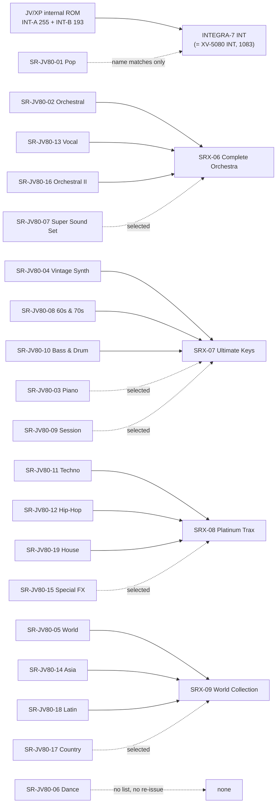

# JV/XP and SR-JV80 Waves on the INTEGRA-7 (research for #195)

Answers [#195](https://github.com/sigma/integral/issues/195) (parent map
[#192](https://github.com/sigma/integral/issues/192)). The question: for each **Wave** a
JV/XP Patch can reference, which INTEGRA-7 **Wave Group** (INT or SRX-01..12) and **Wave
Number** holds the same sample, and which have none?

The mapping is in [`jv-wave-map.json`](jv-wave-map.json). It has one entry per source
Wave, with its target, confidence, evidence codes and sources. This file explains how it was
built and what it shows.

> **Checked against Roland's own conversions** ([#206](https://github.com/sigma/integral/issues/206),
> [`map-check-roland-pairs.md`](map-check-roland-pairs.md)): 1,860 entries confirmed, 42 changed
> (mostly MENU Waves on merged SRX boards), 2,339 not covered. The JSON carries the regraded
> confidence, so the counts below are those before the check.

## TL;DR

- **The JV/XP family has one internal ROM:** 448 Waves, INT-A 1–255 and INT-B 1–193. The
  JV-1080, JV-2080, XP-50, XP-60/80 and XP-30 manuals list the same names in the same order.
  The JV-1010 has it too, plus SR-JV80-09 Session onboard. So "JV-1080 ROM" and
  "JV-2080/XP ROM" are one table, not two.
- **The XV INT table holds all 448 JV Waves (448 of 448 mapped).** 405 are high
  confidence, 36 medium, 7 low. The INTEGRA-7 INT Wave Group is that XV table with the same
  numbering: 1068 of 1083 names are identical. The other 15 are trademark renames
  (`SA Rhodes 1A` became `SA EP 1 A`).
- **Roland renumbered the JV Waves; there is no formula.** INT-A 1 `Ac Piano1 A` is
  INT 19, and INT-A 4 `Ac Piano2 pA` is INT 13. The order mostly holds (INT-A lands
  in 13–575 and INT-B in 473–1083), but a lookup table is needed.
- **SR-JV80 boards reach the INTEGRA-7 only through four SRX re-issues.** Roland's SRX
  manuals and product pages say:
  SRX-06 = SR-JV80-02, -13, -16 + some of -07;
  SRX-07 = SR-JV80-04, -08, -10 + some of -03, -09;
  SRX-08 = SR-JV80-11, -12, -19 + some of -15;
  SRX-09 = SR-JV80-05, -14, -18 + some of -17.
  The name evidence agrees. Each board Roland says is carried "all" maps at 97–100%.
- **Coverage over the 18 SR-JV80 Wave lists found (3,793 Waves):** 3,293 mapped, of
  which 3,198 are high or medium. The gaps are -01 Pop (no SRX re-issue; 94 of 154
  matched by name, mostly into INT), -03 Piano, -07 Super Sound Set, -09 Session,
  -15 Special FX and -17 Country. Roland re-issued only part of each of these. No
  Wave list was found for **SR-JV80-06 Dance**, and no SRX claims it.
- **Surprise for the XV-first decision:** XV Patches can reference SR-JV80 Waves too. The
  XV-5080/3080 had four SR-JV80 slots, and its Wave Group Type is 0–3 = `INT-WAVE`,
  `SRJV80-EXP`, `SRX-EXP`, `SAMPLE`. The INTEGRA-7 only has 0 = INT, 1 = SRX. XV import
  therefore needs this map as well, and must renumber Group Type 2 (SRX) to 1.
- **Roland once made the authoritative map, but it is not online.** The SRX-06..09
  CD-ROMs carry "Data Reproducing the SR-JV's Original Patches" for XV/Fantom. Those
  Patches encode Roland's own SR-JV80 → SRX Wave assignment.

## Sources (highest trust first)

All are Roland primary documents from `static.roland.com` or `roland.com`, fetched in October 2026.
"OCR" means the PDF is a scan. Those were read with macOS Vision OCR and used for
cross-checks only, except SR-JV80-19, which has no text version.

| # | Source | What it gives |
|---|--------|---------------|
| P1 | [XP-60/80 Waveform List, Faxback #10279](https://static.roland.com/assets/media/pdf/XP80_W.pdf) (text) | Canonical names and numbers of the 448 JV/XP internal Waves |
| P2 | [XP-30 Owner's Manual](https://static.roland.com/assets/media/pdf/XP-30_OM.pdf) pp. 160–167 (text) | Same INT-A/INT-B. Built-in XP-A/B/C = the SR-JV80-09/-02/-11 lists (186/206, 172/174 and 244/255 identical name and number). The other entries are faxback typos that the XP-30 copy corrects, so the map uses the XP-30 names and keeps the faxback spelling as `faxback_name`. |
| P3 | [JV-1080 OM](https://static.roland.com/assets/media/pdf/JV-1080_OM.pdf) pp. 122–123, [JV-2080 OM](https://static.roland.com/assets/media/pdf/JV-2080_OM.pdf) pp. 182–183, [XP-50 OM](https://static.roland.com/assets/media/pdf/XP-50_OM.pdf) pp. 160–161 (OCR) | Same 448 Waves. JV-1080: 426 of 448 in order, and all 22 misses are OCR errors. JV-2080: 381 of 448 by set. XP-50: 375 of 448 by set. |
| P4 | [JV-1010 OM](https://static.roland.com/assets/media/pdf/JV-1010_OM.pdf) PDF p. 10 (text) | "SR-JV80-09 'Session' Waves and Patch Data Onboard" |
| P5 | [XV-5080 OM](https://static.roland.com/assets/media/pdf/XV-5080_OM.pdf) pp. 277–281 and MIDI Implementation (text) | XV INT names (original spellings). 1068/1083 identical to `docs/waves/int.json`; the other 15 are the Rhodes→EP renames. Wave Group Type 0–3 = INT-WAVE, SRJV80-EXP, SRX-EXP, SAMPLE. Four SR-JV80 slots. |
| P6 | SRX-06/07/08/09 Owner's Manuals ([06](https://static.roland.com/assets/media/pdf/SRX-06_OM.pdf), [07](https://static.roland.com/assets/media/pdf/SRX-07_OM.pdf), [08](https://static.roland.com/assets/media/pdf/SRX-08_OM.pdf), [09](https://static.roland.com/assets/media/pdf/SRX-09_OM.pdf)) (text) | Which SR-JV80 boards each SRX carries (p. 1), and the CD-ROM with SR-JV original Patches. Their Waveform Lists match `docs/waves/srx-06..09.json` number for number. |
| P7 | SRX product pages ([06](https://www.roland.com/global/products/srx-06/), [07](https://www.roland.com/global/products/srx-07/), [08](https://www.roland.com/global/products/srx-08/), [09](https://www.roland.com/global/products/srx-09/)) | The same claims, sometimes worded differently (see [Contradictions](#contradictions-in-rolands-own-documents)) |
| P8 | SR-JV80 Waveform Lists (Roland faxbacks, text): [01](https://static.roland.com/assets/media/pdf/POP_W.pdf), [02](https://static.roland.com/assets/media/pdf/ORCH_W.pdf), [03](https://static.roland.com/assets/media/pdf/PIANO_W.pdf), [04](https://static.roland.com/assets/media/pdf/VINTAGEW.pdf), [05](https://static.roland.com/assets/media/pdf/WORLD_W.pdf), [07](https://static.roland.com/assets/media/pdf/SOUND_W.pdf), [08](https://static.roland.com/assets/media/pdf/6070_W.pdf), [09](https://static.roland.com/assets/media/pdf/SESSIONW.pdf), [10](https://static.roland.com/assets/media/pdf/BASS_W.pdf), [11](https://static.roland.com/assets/media/pdf/TECHNO_W.pdf), [12](https://static.roland.com/assets/media/pdf/12_HIPW.pdf), [13](https://static.roland.com/assets/media/pdf/VOC_WAV.pdf), [14](https://static.roland.com/assets/media/pdf/ASIA_W.pdf), [15](https://static.roland.com/assets/media/pdf/15EFX_W.pdf), [16](https://static.roland.com/assets/media/pdf/ORCH2_W.pdf), [17](https://static.roland.com/assets/media/pdf/17cntryw.pdf), [18](https://static.roland.com/assets/media/pdf/18_LtnW.pdf); [SR-JV80-19 OM](https://static.roland.com/assets/media/pdf/SR-JV80-19_OM.pdf) p. 6 (OCR) | Source Wave names and numbers per board |
| P9 | [XV-3080 product page](https://www.roland.com/global/products/xv-3080/) | "Compatible with SR-JV80-Series wave expansion boards and most XP/JV-Series Patches" |
| P10 | [INTEGRA-7 product page](https://www.roland.com/global/products/integra-7/) | "The INTEGRA-7 cannot load data from the XV-5080." |
| R1 | `docs/waves/*.json` ([README](../waves/README.md)) | Target Wave Groups and Wave Numbers |

No secondary source was used for any match.

## Findings

### 1. One JV/XP internal ROM (P1–P4)

Every JV/XP manual lists **INT-A 1–255** (`Ac Piano1 A` … `Vox Noise`) and **INT-B
1–193** (`Kalimba` … `DC`). The names and order are the same on the JV-1080, JV-2080,
XP-50, XP-60/80 and XP-30. The text lists (P1, P2) agree exactly. The scanned manuals
(P3) agree up to OCR noise, and every miss checked was a misread or a dropped line (e.g.
`6-Str Gtr A` read as `Str Gtr A`). **A JV/XP Patch's internal Wave is fully identified by
(INT-A|INT-B, number) on every model in scope.**

### 2. The XV INT table contains the whole JV ROM (P1, P5, P9)

All 448 JV Waves have an INT target, each a different INT Wave. That is 448 of the 1083
INT Waves.

- **High (405):** same name, and a neighbouring JV Wave maps within 3 Wave Numbers.
  Roland's patch-compatibility claim (P9) is the third leg.
- **Medium (36):** isolated same-name matches (`Rock Organ` → INT 99, `Kalimba` →
  INT 473, many drum Waves). Also word-order swaps (`606 HiHat Cl` → `606 Cl HiHat` 809),
  and the JV strings set renamed **`JV Strings L/R/A/C`** (INT 420–423). The JV lists
  `ST.Strings-R` before `-L`.
- **Low (7):** `Bottle` → `BottleBlow` 293. `Agogo` → `AgogoBells` 498. `Ride Bell 1` →
  `Ride Bell` 827. `REV Ride` → `REV Ride 1` 1056 (a `REV Ride 2` also exists).
  `REV Cup` → `REV RideBell` 1058. `Tambourine` → `Tambourine 1` 855 and `REV Tamb` →
  `REV Tamb 1` 1077: the XV splits the tambourine into two Waves.

So the standing claim "XV-5080 INT is a superset of the JV ROMs" holds at the name level.
The INTEGRA-7 INT table is the XV table (P5 vs R1), so it holds there too.

**Numbering.** Roland re-laid the ROM: the XV groups all pianos first, so `Ac Piano2` (JV
INT-A 4–9) precedes `Ac Piano1` (JV INT-A 1–3) at INT 13–21. Within a family the order is
kept. 246 of 254 consecutive INT-A pairs ascend, and 176 of 192 INT-B pairs. INT-B lands
in INT 473–1083, interleaved with XV-only Waves. Use the table; no offset rule exists.

### 3. SR-JV80 boards → SRX (P6–P8)

The INTEGRA-7 has no SR-JV80 Wave Group. A SR-JV80 Wave is playable only if Roland put
it on an SRX board, and only while that **Expansion** is loaded in an **Expansion slot**.

| Source Wave Group | Waves | Roland says | Mapped | High | Medium | Low | Unmapped | Lands in |
|---|---:|---|---:|---:|---:|---:|---:|---|
| JV/XP internal ROM, Wave Group INT-A | 255 | XV plays most JV/XP Patches | 255 | 245 | 9 | 1 | 0 | INT 255 |
| JV/XP internal ROM, Wave Group INT-B | 193 | XV plays most JV/XP Patches | 193 | 160 | 27 | 6 | 0 | INT 193 |
| SR-JV80-01 Pop | 154 | no SRX board claims it | 94 | 0 | 59 | 35 | 60 | INT 80, SRX-06 14 |
| SR-JV80-02 Orchestral | 174 | SRX-06: all | 174 | 148 | 26 | 0 | 0 | SRX-06 174 |
| SR-JV80-03 Piano | 73 | SRX-07: selected | 34 | 10 | 6 | 18 | 39 | INT 12, SRX-06 6, SRX-07 16 |
| SR-JV80-04 Vintage Synth | 255 | SRX-07: all (web) / selected (manual) | 255 | 254 | 1 | 0 | 0 | SRX-07 255 |
| SR-JV80-05 World | 255 | SRX-09: all | 248 | 215 | 30 | 3 | 7 | SRX-09 248 |
| SR-JV80-06 Dance | ? | no SRX board claims it | 0 | | | | | no Wave list found |
| SR-JV80-07 Super Sound Set | 255 | SRX-06: selected | 94 | 73 | 3 | 18 | 161 | INT 6, SRX-06 76, SRX-09 12 |
| SR-JV80-08 Keyboards of the 60s & 70s | 255 | SRX-07: all (web) / selected (manual) | 253 | 240 | 13 | 0 | 2 | SRX-07 253 |
| SR-JV80-09 Session | 206 | SRX-07: selected | 99 | 96 | 0 | 3 | 107 | SRX-07 99 |
| SR-JV80-10 Bass & Drum | 241 | SRX-07: all (web) / selected (manual) | 240 | 227 | 13 | 0 | 1 | SRX-07 240 |
| SR-JV80-11 Techno Collection | 255 | SRX-08: all | 252 | 242 | 5 | 5 | 3 | SRX-07 4, SRX-08 248 |
| SR-JV80-12 Hip-Hop Collection | 255 | SRX-08: all | 254 | 249 | 3 | 2 | 1 | SRX-07 1, SRX-08 253 |
| SR-JV80-13 Vocal Collection | 82 | SRX-06: all | 82 | 81 | 1 | 0 | 0 | SRX-06 82 |
| SR-JV80-14 World Collection "Asia" | 175 | SRX-09: all | 174 | 168 | 6 | 0 | 1 | SRX-09 174 |
| SR-JV80-15 Special FX Collection | 248 | SRX-08: selected | 187 | 185 | 0 | 2 | 61 | INT 1, SRX-05 1, SRX-08 185 |
| SR-JV80-16 Orchestral II | 153 | SRX-06: all | 152 | 149 | 3 | 0 | 1 | SRX-06 152 |
| SR-JV80-17 Country Collection | 247 | SRX-09: selected | 193 | 183 | 5 | 5 | 54 | INT 1, SRX-07 1, SRX-08 3, SRX-09 188 |
| SR-JV80-18 World Collection "Latin" | 255 | SRX-09: all | 254 | 248 | 4 | 2 | 1 | SRX-09 254 |
| SR-JV80-19 House Collection | 255 | SRX-08: all | 254 | 249 | 3 | 2 | 1 | SRX-08 254 |

"Lands in" counts only mapped Waves. A board's matches outside its Roland-claimed SRX
are always low confidence (evidence `outside-claimed-board`), because they are probably
name collisions. One example: SR-JV80-11's `TOM MENU` matches SRX-07's `TOM MENU`,
which comes from SR-JV80-10.

What the numbers say:

- **Boards Roland says are carried in full map at 97–100%:** 02, 04, 05, 08, 10, 11,
  12, 13, 14, 16, 18, 19. The last 0–3% are mostly typos in Roland's lists or
  differently numbered Menu Waves. For example, the SR-JV80-11 faxback lists
  `TR808 Snr 1–3` three times (197–199, 201–203, 235–237). The XP-30 manual's copy of
  the same board reads `TR606 Snr 1–3` and `TR808 Kick 1–3`, and with those names all six
  map high. `Wurly 1 p C` appears twice in -08 and has no second source. Where a name is
  repeated, the map leaves the repeat `none` and gives the candidate under
  `alternatives`.
- **Partially re-issued boards:** -03 Piano (16 into SRX-07: the `Rhodes 5` and
  `RhodesBs` sets), -07 Super Sound Set (76 into SRX-06), -09 Session (99 into SRX-07),
  -15 Special FX (185 into SRX-08), -17 Country (188 into SRX-09). The rest have no
  INTEGRA-7 counterpart in the evidence used here. Examples: the -03 grand pianos and
  `Rhodes 1–4/6`, the -15 nature sounds (`Cricket`, `Surf`, `Rain`), and the -17
  fiddle riffs.
- **SR-JV80-01 Pop:** no SRX claims it. 80 of its Waves match INT, most by name and
  neighbour order (`Wurly soft/hard A–C` → INT 43–48, `Clav 2A–4C` → INT 73–81,
  `60's Organ 1–4` → INT 93–96), and 14 match SRX-06 (`Breath Wind`…). With no Roland
  statement to back them, they are at most medium. They are low where the INT target is
  already a JV-internal Wave of the same name (`E. Piano 3A`, `Mad Organ`): the boards
  may share recordings, but nothing says so.
- **SR-JV80-06 Dance:** Roland's site has no Wave list for it, and no SRX names it.
  Unmapped.

### 4. Renames between SR-JV80 and SRX

Most re-issued Waves keep their names. Where they changed, the map pairs them by position
between matched neighbours and records the name similarity:

- `Rhodes` → `70'EP` (SRX-07: `Rhodes 5A p` → `70'EP 5 A p`, `RhodesBs p A` →
  `70'EP Bs p A`). This is a trademark scrub, like INT's `SA Rhodes` → `SA EP`.
- Trailing tempo or labels added: SR-JV80-10 `BW Brush` → SRX-07 `BW Brush  66`, `AL Funk`
  → `AL Funk  120`.
- Typo fixes in the source list: `Dohalla` → `Doholla`, `TR272 Agogo` → `TR727 Agogo`,
  `Tsuzmui Hi` → `Tsuzumi Hi`.
- **Stereo layout changes.** The SR-JV80s list a stereo set as all L Waves then all R
  Waves (`StGrand L pA, L pB, L pC, R pA, …`). The SRX interleaves them (`StGrand L pA,
  StGrand R pA, …`). A JV Tone that plays one channel of a pseudo-stereo pair maps to one
  SRX Wave Number. The importer can also pick up the Stereo pair (Wave Number R) on the
  INTEGRA-7 if it wants to.

### 5. How an XV refers to these Waves (P5)

XV Patches select a Wave by **Wave Group Type** (0 INT-WAVE, 1 SRJV80-EXP, 2 SRX-EXP,
3 SAMPLE), **Wave Group ID** and **Wave Number**. So the XV kept SR-JV80 Waves in their
own group with their original board numbering. Roland never had to renumber them for the
XV. INTEGRA-7 PCM Synth partials have only Type 0 = INT and 1 = SRX
([`06-pcm-synth-tone.md`](../midi/06-pcm-synth-tone.md) `00 27`). For XV import that means:

- Type 0 (INT): the same Wave Number. Verified: same table.
- Type 1 (SR-JV80): look up this map by board (from the Group ID) and Wave Number.
- Type 2 (SRX): becomes INTEGRA-7 Type 1, same Group ID and Wave Number. The SRX-06..09
  Waveform Lists in P6 match `docs/waves` number for number. SRX-01..05 and 10..12 were
  not re-checked here.
- Type 3 (SAMPLE, user RAM): no counterpart.

## Contradictions in Roland's own documents

- **SRX-07:** the product page says it "contains **all** the waveforms" of SR-JV80-04, -08
  and -10. The SRX-07 Owner's Manual says "**specially selected** keyboard sounds from" the
  same boards. The name evidence backs the product page: 255/255, 253/255 and 240/241
  mapped, and the misses are source typos.
- **SRX-08:** the product page says its sounds are "derived from" -11, -12 and -19. The
  manual says "**all** of the waveforms". The evidence agrees with "all" (252/255, 254/255,
  254/255).
- **The SR-JV80 faxback lists contain typos.** Examples: SR-JV80-11 repeats
  `TR808 Snr 1–3`, and SR-JV80-09 has `F.Accordian`. The XP-30 Owner's Manual copies of
  -02, -09 and -11 correct them, and the map prefers those. The -08 repeat
  (`Wurly 1 p C`) has no second source and stays unresolved.

## Open doubts

- **Same name is not proof of the same recording.** No audio was compared. The XV-5080
  may store some re-issued Waves at a different sample rate or loop. The map claims
  "the Wave Roland presents as the successor", not bit-identity.
- **Menu Waves** (`PHRASE MENU`, `Snare MENU 1`, `HAT MENU`) are key-split multi-sample
  Waves. A name match does not prove the key layout is the same. Treat them as medium at
  best whatever the grade says, and audition them.
- **SR-JV80-19** names and numbers come from OCR with row-fitted numbering. They match
  SRX-08 254 of 255, which makes gross errors unlikely, but spellings in the JSON may
  carry OCR noise.
- **Wave Group ID for SR-JV80 on the XV** is assumed to be the board number. The XV-5080
  manual gives only the range (1–16384). Check this against a real XV dump ([#194](https://github.com/sigma/integral/issues/194) territory).
- **Authoritative ground truth exists offline:** the SRX-06..09 CD-ROMs ("Data
  Reproducing the SR-JV's Original Patches", P6). Those Patches, if they turn up in the
  owner's archive, would confirm or correct every SR-JV80 → SRX row mechanically.
- **SR-JV80-06 Dance** and any SR-JV80 not listed on Roland's US site were not mapped.

## Method

1. Parsed each Roland text list by Wave Number. The scanned manuals were read with
   Vision OCR, and the SR-JV80-19 numbers were fitted from row positions. For -02, -09
   and -11, `name` takes the XP-30 manual's spelling where the faxback has a typo, and
   the faxback spelling is kept in `faxback_name`. Other Roland typos are kept in `name`.
2. Normalised names: lowercase, with everything except letters, digits, `+` and `#`
   removed. INT targets match on both the INTEGRA-7 name and the XV-5080 manual name, so
   `SA Rhodes 1A` = `SA EP 1 A`.
3. Searched the claimed SRX first, then INT, then the other SRX. A JV internal Wave
   searches only INT.
4. **Evidence codes** (in the JSON):
   - `name`: exact normalised match.
   - `name-alias`: matches after the Rhodes→70'EP substitution.
   - `order`: a neighbour within ±2 source Waves maps within 3 target Wave Numbers.
   - `position`: the slot is bracketed by matched neighbours, the gap sizes are equal,
     and the name similarity is ≥ 0.75.
   - `fuzzy-window`: the best name similarity among free slots between matched
     neighbours is ≥ 0.8. It gets the `ambiguous` flag when a second candidate is within
     0.05.
   - `manual-rename`: reviewed by hand; see `note`.
   - `roland-board-statement`: Roland says the SRX carries the board.
   - `roland-compat-statement`: P9.
   - `shared-with-jv-internal`, `outside-claimed-board`, `target-named-by-other-source`,
     `duplicate-name-in-source`: downgrade flags.
5. **Confidence:**
   - **high** = name + order + Roland statement.
   - **medium** = two of those three, or a near-identical rename in a bracketed slot of
     a claimed board.
   - **low** = any single leg, an ambiguous candidate, or a downgrade flag.
   - **none** = no candidate.

A converter should treat high and medium as mapped, and low as "closest match, flag
it in the Conversion report". That follows the map's standing decision for unmapped Waves.

## Consequences for #192

- Confirms: XV INT = INTEGRA-7 INT, number for number. JV internal Waves always have an
  INT target. Per-partial INT/SRX mixing covers JV Patches that use both INT and
  expansion Waves.
- Adds: XV import also needs this map, for Wave Group Type 1 (SR-JV80). Type 2 → 1
  renumbering is required. A converted JV Patch that used SR-JV80 boards needs the right
  SRX loaded: SRX-06/07/08/09, one per Expansion slot, four slots. The Conversion report
  should name which SRX to load.
