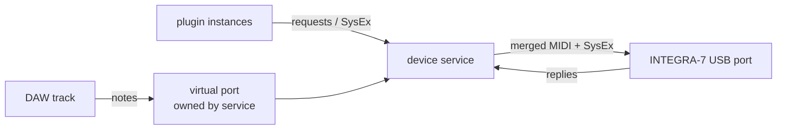

# MIDI port ownership by a device service

Research for [Can one service own the INTEGRA-7 port on macOS and Windows?](https://github.com/sigma/integral/issues/339),
under the map [Drive the INTEGRA-7 from a DAW through a family of plugins](https://github.com/sigma/integral/issues/336).
Gathered 2026-10-21. Claims marked **unconfirmed** have no primary source behind them.

## Question

Can one background service own the INTEGRA-7's USB MIDI port and carry all SysEx,
while the DAW sends notes into a virtual port that the service exposes?

## Answer

- **macOS: yes, with stock tools.** CoreMIDI is multi-client, and `midir`
  already creates virtual ports there; the Bridge does it today.
- **Windows: yes, but only on Windows 11 24H2 and later with Windows MIDI Services,
  and not through `midir`.** Hardware sharing works on 24H2+. App-created virtual
  ports need the new `Windows.Devices.Midi2` API: 25H2+, and the in-box API's
  ship date is contradictory. Rust has no binding. Windows 10 and older Windows 11
  builds need teVirtualMIDI, whose SDK needs a redistribution licence from its author.
- **Latency: no published figure for a virtual-port hop on either platform.**
  The nearest proxy is Microsoft's 20–40 µs service-to-app handoff. The
  [spike](https://github.com/sigma/integral/issues/345) must measure it.
- **Ownership is by convention, not exclusive.** On macOS, and on Windows under
  the new stack, every app can still open the hardware port. The service cannot
  stop a DAW or the web UI from talking to the INTEGRA-7 directly.

## macOS (CoreMIDI)

- **Multi-client.** One MIDI server process loads each driver and talks to it;
  apps reach it over IPC. Any client's input port can connect to any source, and
  its output ports send to any destination.
  [Apple: MIDI Services](https://developer.apple.com/documentation/coremidi/midi-services)
  Apple states no single sentence saying "several processes may open the same
  hardware endpoint". It follows from the server design and is everyday macOS
  behaviour (two DAWs on one interface), but the explicit statement is **unconfirmed**.
- **Virtual endpoints.** `MIDIDestinationCreateWithProtocol` and
  `MIDISourceCreateWithProtocol` create a virtual destination or source owned by
  the client (macOS 11+).
  [destination](https://developer.apple.com/documentation/coremidi/mididestinationcreatewithprotocol(_:_:_:_:_:)),
  [source](https://developer.apple.com/documentation/coremidi/midisourcecreatewithprotocol(_:_:_:_:))
  A virtual source pushes data with `MIDIReceivedEventList`. Apple recommends
  giving it the same unique ID on every launch so other apps keep their
  references to it. The older `MIDIDestinationCreate` is deprecated in favour of
  the `WithProtocol` call; the exact deprecation version is **unconfirmed**.
- **Ports live and die with the process.** A virtual endpoint belongs to its
  client, so the port disappears when the service exits. The Bridge relies on
  this (`crates/integral-cli/src/commands/bridge.rs`, `bridge()` doc comment).

## Windows

### Classic WinMM: single-client

`midiOutOpen` returns `MMSYSERR_ALLOCATED` when another app already holds the device.
[midiOutOpen](https://learn.microsoft.com/en-us/windows/win32/api/mmeapi/nf-mmeapi-midioutopen)
Microsoft's porting guide calls "opening a device is exclusive" a false
assumption *under the new stack*, which confirms it was true under the old one.
[Porting MIDI libraries](https://microsoft.github.io/MIDI/kb/porting-midi-libraries/)
WinMM has no virtual ports at all.

### Windows MIDI Services

- **Availability.** The service ships with Windows 11 and is enabled by updates:
  "Everyone on supported Windows 11 releases (currently 25h2 and later) who has
  updates enabled has the new Windows MIDI Services already in Windows."
  [Project home](https://microsoft.github.io/MIDI/)
  The rollout covers retail 24H2, 25H2 and 26H1. "This does not apply to older
  versions of Windows."
  [Rollout known issues](https://devblogs.microsoft.com/windows-music-dev/windows-midi-services-rollout-known-issues-and-workarounds/)
  Windows 10 is not supported.
  [Minimum requirements](https://microsoft.github.io/MIDI/kb/minimum-requirements/)
- **Multi-client.** "Any endpoint (including MIDI 1.0 devices) can be used by
  multiple applications at the same time." The service is the device's only
  client. [Overview](https://microsoft.github.io/MIDI/overview/)
  Existing WinMM and WinRT MIDI 1.0 apps were "replumbed" onto the service, so
  they share devices too. They still cannot schedule messages or create virtual
  devices (same page). One shared connection per endpoint is recommended, because
  each extra connection adds per-message work in the service.
- **App-created virtual devices.** `MidiVirtualDeviceManager.CreateVirtualDevice`
  creates a device endpoint for the app. When the app opens it, the service
  creates a second, client-side endpoint that other apps use.
  [Virtual transport](https://microsoft.github.io/MIDI/sdk-reference/Transports/Virtual/),
  [MidiVirtualDeviceManager](https://microsoft.github.io/MIDI/sdk-reference/Transports/Virtual/MidiVirtualDeviceManager/)
  Virtual devices need the WinRT connection path, not the COM extensions path.
  There are also built-in loopback endpoints, configured by the user.
  [Loopback setup](https://microsoft.github.io/MIDI/tools/midiloopbacksetup/)
- **Visible to WinMM-only DAWs: probably.** The creation config has
  `CreateOnlyUmpEndpoints`, "True to create only UMP endpoints, with no WinMM or
  WinRT MIDI 1.0 ports". Leaving it false should therefore produce WinMM ports.
  [MidiVirtualDeviceCreationConfig](https://microsoft.github.io/MIDI/sdk-reference/Transports/Virtual/MidiVirtualDeviceCreationConfig/)
  No page states this outright (**unconfirmed**). WinMM port names are capped at
  31 characters, and the MIDI 1.0 ports appear several seconds after the endpoint.
  [Moving from WinMM](https://microsoft.github.io/MIDI/kb/moving-from-winmm-to-wms/)
- **Which version gets the app API.** 24H2 gets the service but never the new
  `Windows.Devices.Midi2` app API; that needs 25H2 or later
  ([Minimum requirements](https://microsoft.github.io/MIDI/kb/minimum-requirements/)).
  The porting guide says the API is "in box in Windows 11 25H2 and later
  starting in 2027". That contradicts the home page's "already in Windows".
  The likely reading is that the service ships now and the app API follows in
  2027 (**unconfirmed**).
- **SDK and Rust.** C++ uses C++/WinRT plus the `Microsoft.Windows.Devices.Midi2`
  package; C# uses C#/WinRT. Microsoft says nothing about Rust.
  [SDK overview](https://microsoft.github.io/MIDI/sdk-overview/)
  - The out-of-band preview runtime "was never supported for redistribution"
    and is dropped in 2027.
  - `MidiApi` loads from the copy in Windows "or from a copy your app ships next
    to itself". Activation through `RoGetActivationFactory` with the published
    class name and IID avoids a build-time SDK dependency.
    [Porting MIDI libraries](https://microsoft.github.io/MIDI/kb/porting-midi-libraries/)
  - A Rust path would generate `windows-rs` bindings from the package's `.winmd`
    metadata (**unconfirmed**; no one is known to have done it).
  - Whether end users must install a separate SDK runtime today is **unconfirmed**.
- **Known issue.** WinMM apps may not see devices plugged in after they start;
  a fix began rolling out 2026-04-30 (rollout post above).

### Fallbacks: loopMIDI and teVirtualMIDI (Tobias Erichsen)

- **loopMIDI** 1.0.16.27 is described as for "Windows 7 up to Windows 10";
  Windows 11 is not mentioned. The page states no licence terms (**unconfirmed**;
  it is commonly treated as free for personal use).
  [loopMIDI](https://www.tobias-erichsen.de/software/loopmidi.html)
  The user creates its ports by hand in a GUI, so an installer cannot rely on them.
- **teVirtualMIDI SDK** 1.3.0.43 offers "on-the-fly creation (and destruction) of
  freely nameable virtual MIDI-ports", so the service could create its own port.
  [virtualMIDI](https://www.tobias-erichsen.de/software/virtualmidi.html)
  It is "NOT freeware or shareware". Software linking to it "MAY NOT BE
  DISTRIBUTED in any way without prior clearance" from the author. Licensees get
  an MSI module to bundle the driver.
  [Licensing](https://www.tobias-erichsen.de/?p=343)
  There is no published price or open-source tier, and no stated Windows 11
  support (**unconfirmed**). That makes it a poor fit for an MIT-licensed project distributed to anyone.
- Forum users report loopMIDI ports missing under the new stack until the MIDI
  service restarts (anecdotal).
  [Hauptwerk forum](https://forum.hauptwerk.com/viewtopic.php?p=162506)

## Rust: `midir`

- The repo pins `midir = "0.10"` in `crates/integral-cli/Cargo.toml` (lock: 0.10.3).
  `nih_plug` pulls in a separate `midir 0.9.1` for its standalone wrapper.
  The latest release is 0.11.1 (2026-10-10).
  [crates.io](https://crates.io/crates/midir), [changelog](https://github.com/Boddlnagg/midir/blob/master/CHANGELOG.md)
- `midir::os::unix::{VirtualInput, VirtualOutput}` provide `create_virtual`.
  They are available on "every platform but Windows" (`src/os/mod.rs` is
  `#[cfg(unix)]`). [docs.rs](https://docs.rs/midir/latest/midir/os/unix/index.html)
- On macOS, `create_virtual` maps to `coremidi` `virtual_destination` and
  `virtual_source` (`midir-0.10.3/src/backend/coremidi/mod.rs:226,372`). Input
  ignore flags default to `Ignore::None`, so SysEx passes through.
- Windows backends are WinMM (default) and a `winrt` feature. The `winrt` feature
  binds the old UWP `Windows.Devices.Midi`, **not** Windows MIDI Services
  `Midi2` (`src/backend/winrt/mod.rs`). There is no Windows MIDI Services backend
  and no open PR for one.
- 0.11.1 includes "Fixes for WinMM and WinRT backend suggested by Microsoft's review".
  Under the new stack, the WinMM backend gets multi-client hardware access for
  free, but still cannot create virtual ports.

## Latency and jitter of the virtual-port hop

- **Windows MIDI Services.** Microsoft measured USB MIDI 1.0 round trips on real
  cables. [Round-trip measurements](https://microsoft.github.io/MIDI/kb/usb-midi-device-round-trip-measurements/)
  - The median for a 3-byte message was about 1.18–1.51 ms, about 960 µs of
    which is the cable.
  - Jitter (interquartile range) was about 23–120 µs.
  - Handing a message from the service to the app took 20–40 µs.
  - Full CPU load moved the median by about 200 µs.

  There are no loopback or app-to-app figures. The 20–40 µs handoff is the
  nearest proxy for one service hop (**unconfirmed** as a virtual-port figure).
- **CoreMIDI virtual/IAC.** No published measurement found. Forum reports range
  from "under 1 ms" to "fairly jittery" (anecdotal, **unconfirmed**).
  [Cycling '74 forum](https://cycling74.com/forums/alternative-for-apple-iac-midi-busses)
  `midir` stamps outgoing CoreMIDI packets with a real timestamp only under the
  `coremidi_send_timestamped` feature; otherwise packets are sent "now".
- **loopMIDI / teVirtualMIDI.** No published data.
- **Scale.** At 31,250 baud a 3-byte note-on takes ~0.96 ms on the INTEGRA-7's
  own DIN timing. Even if the USB path is faster, a sub-0.1 ms hop is small
  beside it. The hop's cost is more likely to show up in **ordering** against
  bulk SysEx than in raw latency. A note can queue behind a 256-byte DT1 under
  the 20 ms throttle. That is the service's merge policy, which
  [Who owns the device link?](https://github.com/sigma/integral/issues/341) has to decide.

## The existing Bridge

`just bridge` runs `cargo run -p integral-cli -- bridge`
(`crates/integral-cli/src/commands/bridge.rs`). Decision:
[ADR 0003](../adr/0003-wireless-via-virtual-midi-port.md).

- **Shape.**
  - `bridge()` loops forever over discovery (RDDP), one `run_session()` per TCP
    session, and `Reconnect` back-off.
  - The protocol is sans-IO in `integral_core::wireless` (`Session`, `Event`);
    the CLI owns the sockets and the port.
- **Port creation.**
  - `open_port()` is called on `Event::Up`. It creates a virtual input
    (`MidiInput::create_virtual`), whose callback encodes every message with
    `wireless::encode_midi` and writes it straight to the shared
    `Arc<Mutex<TcpStream>>`.
  - It also creates a virtual output (`MidiOutput::create_virtual`); device
    `Event::Midi` is forwarded to it.
  - Both are named `wireless::port_name()` (`INTEGRA-7 (Wireless)`). They are
    dropped when the session dies, so the port exists only while the link is up.
- **What it is not.**
  - It holds no device state, applies no throttle and does no ordering: each
    message from any writer is forwarded as it arrives.
  - It has no client protocol beyond the MIDI port itself.
  - It is unix-only, through `midir::os::unix`.
    [Reach the INTEGRA-7 over wireless from the web UI on Windows](https://github.com/sigma/integral/issues/305)
    was closed as not planned for the same Windows gap.

### Generalising it to the USB link

1. **Link abstraction.** Today the "device side" is a TCP `Session`. A USB link
   is a pair of `midir` connections to the hardware port
   (`integral-cli/src/midi.rs` already opens these by name). The loop becomes
   "own one link (wireless or USB), expose one virtual port pair". Reconnect
   then means USB hot-plug: polling port lists, since `midir` has no
   port-change notifications (**unconfirmed** for 0.11).
2. **Port naming and loops.** The hardware port stays visible under its own name
   (`INTEGRA-7` on macOS). The service's port needs a distinct name, and the DAW
   must be told to use it and not the raw port. Nothing enforces that. Routing
   the service's virtual output back into its own input, through a DAW's MIDI
   thru, would loop.
3. **Ordering point.** The virtual-input callback writes directly to the device.
   For the service to be "the throttle and ordering point", the callback must
   enqueue into the same scheduler as plugin SysEx, with a merge policy (notes
   must not wait 20 ms behind a DT1 burst). Today that scheduler lives in
   `DeviceState` queued sends.
4. **Control channel.** Plugins need a second, non-MIDI channel (requests,
   subscriptions). A MIDI port alone cannot carry it. That is
   [Who owns the device link?](https://github.com/sigma/integral/issues/341)'s protocol question.
5. **Windows.** Needs a Windows MIDI Services virtual-device binding (25H2+, raw
   WinRT through `windows-rs`, or a contribution to `midir`) or teVirtualMIDI
   under licence. Hardware sharing on 24H2+ comes free through WinMM.
6. **Module boundary.** Per this repo's CLAUDE.md, a long-running service should
   not live in `integral-cli/src/commands/`; it wants its own crate or binary.

## Implications

- **For [Who owns the device link?](https://github.com/sigma/integral/issues/341).**
  - "Bridge generalised to USB" is viable on macOS and Linux with today's code shape.
  - The service is an owner by convention only. Its design must tolerate other
    apps on the same hardware port: the web UI over Web MIDI, a DAW routed to
    the raw port, Roland's editor. It must also re-read state rather than
    assume it is the sole writer.
  - Its merge policy for notes against throttled SysEx is the real latency risk.
- **For [Drive one Part from Reaper through the device service](https://github.com/sigma/integral/issues/345).**
  - Run it on macOS.
  - Measure the hop directly: loop the virtual port's note-in to the service and
    timestamp it, against the raw hardware port.
  - Measure note latency while a SysEx burst is in flight; that is the number
    that can sink the design.
  - Enable `coremidi_send_timestamped` or record that it was off.
- **For Windows** (map "Not yet specified").
  - Supported floor: Windows 11 24H2+ with Windows MIDI Services for sharing,
    25H2+ for the service's own port.
  - Below that, the plugin path falls back to host MIDI, or the user installs
    loopMIDI and routes it by hand.
  - Shipping teVirtualMIDI needs a licence negotiation.
