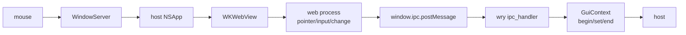

# Plugin Test Host (research for #442)

Answers [#442](https://github.com/sigma/integral/issues/442): which lightweight plugin host an
agent can spawn on macOS to test the Integral plugin, and how the agent drives the **real**
plugin window (the `wry` WKWebView inside the host process). The checks it must replace are the
manual Ableton Live 12 ones left open on
[#345](https://github.com/sigma/integral/issues/345): gesture recording from the plugin UI,
recall from saved state, and SysEx pacing.

## TL;DR

- **No ready-made host does the job.** The job needs a CLI-spawnable host that keeps the real
  editor open, records the plugin's gestures, and round-trips state into a fresh instance.
  Every candidate application misses at least one of these (table below).
- **Recommended host (amended): a small in-repo Rust test host on the
  [`vst3-host`](https://github.com/HelgeSverre/rust-vst3-host) library** (0.11.0, MIT). The first
  pass missed it; see [Addendum: `vst3-host`](#addendum-vst3-host). It hosts **VST3**, the format
  Live uses, and already records the plugin's `beginEdit`/`performEdit`/`endEdit`. That removes
  the CLAP-only limit below. Whether it loads our plugin and its webview editor is checked by a
  prototype.
- **Fallback host: a small in-repo Rust test host on
  [`clack-host`](https://github.com/prokopyl/clack) 0.2.0** (crates.io, MIT OR Apache-2.0).
  It loads our **CLAP** build in process, embeds the editor in an `NSWindow` it owns and keeps
  it open, and logs every `PARAM_GESTURE_BEGIN`/`PARAM_VALUE`/`GESTURE_END` the plugin emits.
  It saves state, drops the instance, and loads the state into a new one. It plays scripted
  notes and automation through `process()`. It builds from the workspace with cargo, so it
  needs no nix packaging.
  - **Limit: it exercises nih-plug's CLAP wrapper, and Live uses VST3.** The two wrappers
    deliver gestures differently. VST3 calls `IComponentHandler::beginEdit` synchronously on
    the GUI thread. CLAP queues output events and asks for a flush. So a pass on CLAP proves
    the page → IPC → `GuiContext` half, but not the VST3 half. To cover VST3, either add a
    `vst3` crate host later (0.3.0, MIT OR Apache-2.0, raw COM bindings, no host example), or
    run the Steinberg `editorhost --componentHandler` in a **debug** build, which prints the
    edit calls to stderr.
- **Gates to add beside it:** [`clap-validator`](https://github.com/free-audio/clap-validator)
  0.4.1 (MIT, headless, state round-trip into a fresh instance) and
  [`pluginval`](https://github.com/Tracktion/pluginval) 1.0.4 `--skip-gui-tests` (GPL-3.0,
  VST3 only on macOS). They check conformance and do no UI driving.
- **Recommended UI route: real pointer events (`CGEvent`), aimed by the Accessibility tree.**
  Use AX to find the target DOM element and its on-screen frame (WebKit exposes
  `AXDOMIdentifier`), then post a mouse down, drag and up at that point. That is the only route
  where a click takes the same path as a user's: WindowServer → host `NSApp` → WKWebView → web
  process → `pointerdown`/`input`/`change` → `window.ipc.postMessage` → our IPC handler →
  `GuiContext`. The test host is the oracle: it reads back what reached the host.
  [Peekaboo](https://github.com/steipete/Peekaboo) (MIT, CLI and MCP server) covers locating,
  clicking and screenshots.
  - **Limits:** a human must grant Accessibility (and Screen Recording, for screenshots) once to
    the process that posts events. The run needs a logged-in, unlocked GUI session with the
    window on screen, so it is local-only and not headless CI. It is timing-sensitive.
- **Rejected as the actuator:** a test-only `evaluate_script` hook sends synthetic, untrusted
  DOM events. It skips native input and WebKit's event dispatch, which is exactly where #345's
  open question sits ("the page's `pointerdown`/`pointerup` never reached the plugin?").
  It is still useful as a readback and setup aid. Safari Web Inspector is not scriptable by a
  third-party program on macOS (entitlement-gated XPC). Use it only for humans debugging.

## Sources (highest trust first)

| # | Source | What it gives |
|---|--------|---------------|
| N | nih-plug at the pinned rev [`28b149e`](https://github.com/robbert-vdh/nih-plug/tree/28b149ec4d62757d0b448809148a0c3ca6e09a95) (from `Cargo.lock`) | How `GuiContext` gestures reach VST3 and CLAP hosts; CLAP GUI modes. |
| S | Steinberg [`vst3sdk`](https://github.com/steinbergmedia/vst3sdk) `3cdf9ca` / [`vst3_public_sdk`](https://github.com/steinbergmedia/vst3_public_sdk) `586dc5e` (SDK 3.8.1, 2026-08-11) | `validator`, `editorhost`, license. |
| P | [`Tracktion/pluginval`](https://github.com/Tracktion/pluginval) `286684f` (2026-10-15) | CLI, tests, formats. |
| CV | [`free-audio/clap-validator`](https://github.com/free-audio/clap-validator) `b2f1d9b` (2026-07-24) | Tests, gesture handling. |
| CK | [`prokopyl/clack`](https://github.com/prokopyl/clack) `27ca283` (2026-09-12) | `clack-host` API and `cpal` example. |
| V | [`coupler-rs/vst3-rs`](https://github.com/coupler-rs/vst3-rs) `b2a45f2`, [`RustAudio/vst3-sys`](https://github.com/RustAudio/vst3-sys) `f3e8f01` | Rust VST3 bindings. |
| CA | [`falkTX/Carla`](https://github.com/falkTX/Carla) `97a9e074` (2026-03-19) | Carla CLI, Python API, gestures. |
| J | [`juce-framework/JUCE`](https://github.com/juce-framework/JUCE) 9.0.5 (2026-11-02) | AudioPluginHost, CLAP hosting (absent). |
| O | [`free-audio/clap-host`](https://github.com/free-audio/clap-host) `c8ce3ee`, [`CrushedPixel/Plugalyzer`](https://github.com/CrushedPixel/Plugalyzer) `955e554`, [`DBraun/DawDreamer`](https://github.com/DBraun/DawDreamer) `d36abd9` | Other hosts found while researching. |
| W | [`tauri-apps/wry`](https://github.com/tauri-apps/wry) tag `wry-v0.57.1` (we pin `=0.57.0`) | `evaluate_script`, devtools, `isInspectable`. |
| K | [WebKit](https://github.com/WebKit/WebKit) source; Apple docs for [`isInspectable`](https://developer.apple.com/documentation/webkit/wkwebview/isinspectable), [`CGEvent.post`](https://developer.apple.com/documentation/coregraphics/cgevent/post(tap:)), [`AXIsProcessTrustedWithOptions`](https://developer.apple.com/documentation/applicationservices/1459186-axisprocesstrustedwithoptions) | Inspector transport, AX exposure of web content, TCC. |
| X | nixpkgs `26.11.20260803.104240a` | Packaging and `meta.platforms`. |

## What the plugin does today

- Both formats are exported (`crates/integral-vst/src/lib.rs:117-118`). The editor is a wry
  WKWebView in a baseview child window. The page posts JSON with `window.ipc.postMessage`; the
  plugin answers with `evaluate_script` (`crates/integral-vst/src/webview/README.md`).
- **On `main` the plugin has no host parameters.** It persists only `editor-size`
  (`lib.rs:31-37`), so today the only thing a recall test can check is the editor size. Gesture
  tests need the parameters from the #345 spike (local bookmark `proto/345`, which adds Level,
  Pan and sends plus a slider whose IPC calls `raw_begin_set_parameter`/`raw_set_parameter_normalized`/`raw_end_set_parameter`),
  or the real Part parameters once they land.
- Devtools are on only in debug builds: `.with_devtools(cfg!(debug_assertions))`
  (`webview/editor.rs`).

### How gestures leave nih-plug (N)

- **VST3:** `raw_begin_set_parameter` calls `handler.begin_edit(hash)` on the host's
  `IComponentHandler`, `raw_set_parameter_normalized` calls `perform_edit`, and the end call
  calls `end_edit`. All three are synchronous on the GUI thread
  ([`vst3/context.rs#L137-L215`](https://github.com/robbert-vdh/nih-plug/blob/28b149ec4d62757d0b448809148a0c3ca6e09a95/src/wrapper/vst3/context.rs#L137-L215)).
- **CLAP:** the same calls push `OutputParamEvent::{BeginGesture, SetValue, EndGesture}` onto a
  queue and call `host_params.request_flush`
  ([`clap/context.rs#L143-L215`](https://github.com/robbert-vdh/nih-plug/blob/28b149ec4d62757d0b448809148a0c3ca6e09a95/src/wrapper/clap/context.rs#L143-L215),
  [`clap/wrapper.rs#L775-L787`](https://github.com/robbert-vdh/nih-plug/blob/28b149ec4d62757d0b448809148a0c3ca6e09a95/src/wrapper/clap/wrapper.rs#L775-L787)).
  The host sees `CLAP_EVENT_PARAM_GESTURE_BEGIN`/`END` only when it next calls `process()` or
  `params.flush()`
  ([`clap/wrapper.rs#L985-L1050`](https://github.com/robbert-vdh/nih-plug/blob/28b149ec4d62757d0b448809148a0c3ca6e09a95/src/wrapper/clap/wrapper.rs#L985-L1050)).
  A CLAP test host must therefore implement `host_params.request_flush` and either run
  `process()` or flush on request.
- **Standalone** (`integral-app`) drops gestures: "there's no automation being recorded here,
  gestures don't mean anything"
  ([`standalone/context.rs#L112-L113`](https://github.com/robbert-vdh/nih-plug/blob/28b149ec4d62757d0b448809148a0c3ca6e09a95/src/wrapper/standalone/context.rs#L112-L113)).
  So it cannot stand in for a host.
- **CLAP editor is embedded only.** nih-plug answers `is_floating = false` and accepts only
  `CLAP_WINDOW_API_COCOA` on macOS
  ([`clap/wrapper.rs#L2581-L2625`](https://github.com/robbert-vdh/nih-plug/blob/28b149ec4d62757d0b448809148a0c3ca6e09a95/src/wrapper/clap/wrapper.rs#L2581-L2625)),
  so the host must give it a parent `NSView`.
- In debug builds both wrappers run a `ParamGestureChecker` that asserts on unbalanced gestures
  ([`util/context_checks.rs`](https://github.com/robbert-vdh/nih-plug/blob/28b149ec4d62757d0b448809148a0c3ca6e09a95/src/wrapper/util/context_checks.rs)).

## Hosts

Columns follow the capabilities #442 lists. "Gestures" means the host *records* the plugin's
`beginEdit`/`performEdit`/`endEdit` (VST3) or gesture events (CLAP).

| Host | CLI, no GUI session | Formats (wrapper exercised) | Notes + automation on a timeline | Gestures captured | State → fresh instance | Editor kept open | Process | License | Maintained | Nix (darwin) |
|---|---|---|---|---|---|---|---|---|---|---|
| **Rust host on `clack-host`** (to build) | Yes, if it skips the GUI | CLAP | Yes (we write it) | Yes (we write it) | Yes (`state` ext, host side) | Yes | In | MIT/Apache-2.0 | 0.2.0, 2026-09 | cargo, in workspace |
| **Rust host on `vst3-host`** (to build; amended) | Yes, if it skips the GUI | VST3 | Yes: `set_parameter_at`, scheduled MIDI | **Yes** (`take_parameter_edits`) | Yes (`save_state`/`load_state`) | Yes (`open_editor`, main thread) | In, or out (opt-in isolation) | MIT | 0.11.0, 2026-11 | cargo, in workspace |
| Rust host on `vst3` crate (to build) | Yes | VST3 | Yes (we write it) | Yes (`IComponentHandler`) | Yes | Yes | In | MIT/Apache-2.0 | 0.3.0, 2026-03 | cargo; raw COM, no host example |
| VST3 SDK `validator` | Yes | VST3 | No | No | No | No editor test | In | MIT (3.8.0+) | 2026-08 | Not packaged; CMake |
| VST3 SDK `editorhost` | Needs GUI | VST3 | No (no processing) | Stderr log, **debug build only** | No | Yes, until quit | In | MIT | 2026-08 | Not packaged; CMake |
| pluginval | Yes (`--skip-gui-tests`) | VST3 (no CLAP) | Static params + MIDI file (2.0 acceptance tests) | No | Same instance only | Opens and closes | In (CLI) | GPL-3.0 | Release 2024-12; main 2026-10 | `pluginval` Linux only |
| clap-validator | Yes | CLAP | Fuzzed, not scripted | Parsed, only shown in `--trace` | Yes (`state-reproducibility-basic`) | No GUI | Out, per test | MIT | 0.4.1, 2026-07 | Not packaged; release zip |
| free-audio `clap-host` | Needs GUI | CLAP | Live MIDI only | **Yes** (tracks begin/end, throws if unbalanced) | Save/load to file | Yes | In | MIT | 2026-06, no releases | Not packaged; Qt6 |
| Carla (`carla-single`, Python API) | Yes (`--no-gui`, Dummy engine) | VST3, CLAP | Notes and set-value calls, no timeline | **Dropped** (empty `touchPluginParameter`; CLAP gestures "TODO") | Yes | Yes | Out (bridge) | GPL-2.0+ | 2026-03 | `carla` Linux only |
| JUCE AudioPluginHost | Needs GUI | VST3 (no CLAP in JUCE 9.0.5) | No | No (`parameterGestureChanged` no-op) | Via graph file | Yes | In | AGPL-3.0 / commercial | 2026-11 | `juce` 8.0.12 darwin; host not packaged |
| Plugalyzer | Yes, offline | VST3 (no CLAP) | **Yes**: MIDI file + keyframed automation | No | Yes (`state` export/import) | Never opens | In | GPL-3.0 | 2026-10 | Not packaged |
| DawDreamer | Yes (Python) | VST3 (no CLAP) | Yes: notes + PPQN automation | No | Yes | `open_editor` blocks | In | GPL-3.0 | 2026-10 | Not packaged |

Per-host evidence, at the commits in [Sources](#sources-highest-trust-first):

- **VST3 SDK (S).**
  - The SDK has been MIT since 3.8.0. The README says "Licensing under GPLv3 and the Steinberg
    proprietary license is no longer available" (`vst3sdk/README.md:243-253`).
  - `validator` flags: `validator.cpp:219-229,339-353`. Its test suite never calls `createView`,
    `getState`/`setState` or `setComponentHandler`.
  - `editorhost`: usage at `editorhost.cpp:255-266`; it shows the view until quit
    (`:203-230`). With `--componentHandler`, its `beginEdit`/`performEdit`/`endEdit` print
    through `SMTG_DBPRT*` (`:93-115`). That macro is empty unless `DEVELOPMENT`
    (`vst3_base/source/fdebug.h:69,118-123,190`). `audiohost` builds only with JACK.
- **pluginval (P).**
  - Host formats: `CMakeLists.txt:182-189` (no CLAP). It embeds a pre-MIT vst3sdk 3.7.14
    (`:88-99`).
  - CLI options: `SettingsParser.cpp:181-215`.
  - Editor tests open and close, or hold the window open only while `setValue` runs
    (`BasicTests.cpp:114-140,603-627`). State tests restore into the same instance
    (`:337-430`).
  - 2.0 acceptance tests take static `state.parameters` and `input.midi`, with no timeline
    (`docs/Acceptance testing.md:36-52`).
- **clap-validator (CV).**
  - Test list: `src/tests/plugin_instance.rs:35-71`. `state-reproducibility-basic` "recreates the
    plugin instance, reloads the state" (`:219-224`).
  - There is no `gui` extension in `src/plugin/ext/`.
  - Gesture events are parsed (`src/plugin/process/events.rs:196-197,239-240`) but only traced.
    `request_flush` is implemented (`src/plugin/instance/shared.rs:718`).
- **clack (CK).**
  - The `host/examples/cpal` example opens the GUI floating or embedded and keeps it open
    (`src/host.rs:158-204`), with cpal audio and midir input. It discards output events
    (`src/host/audio.rs:155`), so gesture capture is ours to add.
  - The library has the gesture event types (`common/src/events/spaces/core.rs`) and host-side
    state save/load (`extensions/src/state/host.rs:14,43`).
- **Rust VST3 (V).** The `vst3` crate ships pre-generated bindings with no SDK needed at build
  time, and its only example is a plugin. `vst3-sys` is GPL-3.0 ("a derivative work of the
  original SDK", README:36-38), was last touched in 2023, and is not on crates.io.
- **Carla (CA).**
  - Formats: `data/carla-single:36-68`. Headless flag: `carla_shared.py:716,733`.
  - Python API: `carla_backend.py:1852-2235`.
  - VST3 `begin_edit`/`end_edit` land in an empty `CarlaEngine::touchPluginParameter`
    (`CarlaPluginVST3.cpp:3683-3729`, `CarlaEngine.cpp:1106-1108`). CLAP gestures are
    swallowed (`CarlaPluginCLAP.cpp:674-677`).
- **JUCE (J).**
  - AudioPluginHost takes only a `.filtergraph` path on the command line
    (`HostStartup.cpp:191-196`). `parameterGestureChanged` is a no-op
    (`GraphEditorPanel.cpp:489`).
  - JUCE 9.0.5 has no CLAP format type, which is why pluginval, Plugalyzer and DawDreamer
    lack CLAP too.
- **Others (O).**
  - `clap-host`: gesture tracking at `host/plugin-host.cc:756-781,836-837`, CLI at
    `host/application.cc:63-77`.
  - Plugalyzer: formats at `CMakeLists.txt:49-52`, CLI in its README.
  - DawDreamer: `open_editor` loops `while (window.isVisible())`
    (`StandalonePluginWindow.h:74`).

### Why a custom host

The #345 checks map onto the capabilities as follows:

- **Gesture recording** needs gesture capture with the editor kept open. In the table, only
  `clap-host` (GUI-only) and a debug `editorhost` (stderr, no processing) capture gestures.
- **Recall** needs save, a fresh instance and restore. Only clap-validator does that headlessly,
  and it cannot open the editor.
- **Pacing** needs the plugin's own device link, not the host (see [Open questions](#open-questions)).

A Rust test host covers all three in a few hundred lines. It uses the dependencies the workspace
already has (`midir`, `cpal` optional), lives under `crates/` like everything else, and needs no
GPL code. The first pass said to write it on `clack-host` first, because the API is safe Rust
and the `cpal` example already embeds a GUI. `vst3-host` supersedes that: it also has a safe
API, and it hosts VST3 with gesture capture built in (see the addendum).

### Addendum: `vst3-host`

Added after the first pass, from
[`HelgeSverre/rust-vst3-host`](https://github.com/HelgeSverre/rust-vst3-host) (0.11.0, MIT,
pushed 2026-11-04), read at its default branch on 2026-11-07.

- **What it is.** A safe Rust library for hosting VST3, built on the `vst3` crate's
  pre-generated bindings, so no SDK is needed at build time. It is the `vst3`-crate host from the
  table, already written, with no `unsafe` in its public API.
- **Gestures.** The host implements `IComponentHandler`
  (`vst3-host/src/internal/com_implementations.rs:1742-1794`) and keeps an ordered log of
  `BeginGesture` / `ValueChange` / `EndGesture` events.
  `Plugin::take_parameter_edits()` drains it (`vst3-host/src/plugin.rs:2367`). The doc says it
  "works across process isolation". This is the synchronous VST3 path nih-plug takes (see
  [How gestures leave nih-plug](#how-gestures-leave-nih-plug-n)), and it is the one Live sees.
- **Editor.** `open_editor` shows the plugin's own view in a standalone `NSWindow`. AppKit needs
  it called on the main thread, and the host drives the run loop
  (`docs/how-to/open-plugin-editor.md`). It can also embed the editor in egui (`EmbeddedEditor`,
  macOS).
- **State.** `save_state` and `load_state` (`plugin.rs:2500-2534`), so state saved from one
  instance can be loaded into a fresh one.
- **Notes and automation.** Sample-accurate `set_parameter_at` and scheduled MIDI. A bundled
  `cpal` backend, or offline rendering.
- **Risks.**
  - It is young: 0.11, one maintainer, 41 stars.
  - Its README says only the macOS editor embedding is verified at runtime, which is our
    platform.
  - Nobody has loaded nih-plug's VST3 wrapper or a wry webview editor in it yet. A prototype on
    [#336](https://github.com/sigma/integral/issues/336) checks that.
- **Effect on the rest of this doc.** The UI route (AX-aimed real pointer events) is unchanged;
  the host's gesture log becomes its oracle. The CLAP-only limit no longer applies. The test
  host is a local dev aid, not a CI gate, so the "local-only" limits on the UI route don't
  matter.

## Driving the real plugin window

What a user's drag on our slider goes through:

| Route | Enters at | Same path as a user? | Setup | Agent ergonomics |
|---|---|---|---|---|
| `CGEvent` mouse events, aimed by AX frames | A | **Yes, end to end** | Accessibility + Screen Recording granted once to the posting process; GUI session; window on screen | Good with Peekaboo (CLI/MCP): find by `AXDOMIdentifier`, click/drag, screenshot |
| AX actions (`AXPress`, set `AXValue`) | D/E, inside WebKit | Partly: WebKit synthesizes the DOM event. Real pointer events are not guaranteed (inference from source, untested) | Accessibility only; window need not be frontmost | Good; works for buttons, unclear for sliders |
| Test-only `evaluate_script` hook | E, as untrusted JS events | No: skips native input and WebKit dispatch (`isTrusted == false`) | A feature-gated channel in the plugin; no TCC | Best: deterministic, scriptable, returns JSON |
| Safari Web Inspector (`isInspectable`) | E | No | Debug build only, through wry `with_devtools` | Not scriptable by a third party (below) |

- **wry (W).** `evaluate_script` and `evaluate_script_with_callback` wrap
  `evaluateJavaScript:completionHandler:` (`src/lib.rs:2101-2116`,
  `src/wkwebview/mod.rs:824,842`). `with_devtools(true)` takes effect only under
  `debug_assertions` or the `devtools` feature. When it does, it calls `setInspectable(true)` and
  sets the private `developerExtrasEnabled` (`src/wkwebview/mod.rs:579-591`).
- **Web Inspector (K).**
  - Apple documents `isInspectable` (macOS 13.3+) for use from Safari's Develop menu only.
  - In WebKit, the inspected app talks XPC to `com.apple.webinspector`
    (`RemoteInspectorConstants.h:32`). Peers without the private entitlement
    `com.apple.private.webinspector.webinspectord` are dropped
    (`RemoteInspectorXPCConnection.mm:146`).
  - Existing bridges (appium-remote-debugger, ios-webkit-debug-proxy) target iOS only.
  - The debugger-side service on macOS is undocumented and was not checked for gating.
- **Accessibility (K).** WebKit's macOS wrapper exposes DOM-backed elements with
  `NSAccessibilityPressAction` and `AXDOMIdentifier`/`AXDOMClassList`
  (`WebAccessibilityObjectWrapperMac.mm:471,709-710,2220,3061-3079`). The web process serves
  that subtree into the host app (`WKAccessibilityWebPageObjectMac.mm:194`). So an agent can
  find `#some-id` in Live or the test host and read its frame. Custom React controls need ARIA
  roles or ids to be findable. *This is an inference from source; nobody has tried it on our
  window yet.*
- **TCC.** Posting events needs the Accessibility permission (`CGPreflightPostEventAccess`,
  10.15+). AX clients must be trusted (`AXIsProcessTrustedWithOptions`). Screenshots need
  Screen Recording (`CGPreflightScreenCaptureAccess`). The grant goes to the process that posts:
  the terminal or agent binary, not the host.

**Recommendation.** Aim with AX, act with `CGEvent`, and assert in the test host:

- The gesture log is the oracle, not the page. It shows begin, then N values, then end, all
  for the right parameter.
- An `evaluate_script` readback is optional. If added, it should sit behind a cargo feature
  that release builds never enable. The `GuiContext` path it would test is already covered.
- The same AX + `CGEvent` driver works on Ableton Live's window unchanged. That gives a
  VST3-in-Live smoke check without a VST3 test host, though Live has no scripted gesture log.

## Mapping the #345 checks

- **Gesture recording.** The test host opens the editor, and the driver drags the Level slider.
  The host log must show `GESTURE_BEGIN`, then values, then `GESTURE_END`. A missing begin or
  end reproduces the #345 confound without Live.
- **Recall.** The host sets parameters, saves state, destroys the instance, creates a new one,
  loads the state and compares. On `main` this covers only `editor-size`.
- **SysEx pacing.** This does not involve the host: the page paces itself and the plugin
  writes through `MidirLink`. To measure it without the device, the link must open a test port
  pair (virtual CoreMIDI endpoints, or a `DeviceLink` test double) and timestamp DT1s. That is a
  plugin-side seam, not a host feature.

## Windows and Linux (note only)

- The editor is macOS-only today (`lib.rs` returns `None` elsewhere).
- `clack-host` and clap-validator are cross-platform. The `CGEvent`/AX route is not: the
  equivalents would be UI Automation and SendInput on Windows, and AT-SPI and XTest on X11.
- pluginval and Carla are packaged in nixpkgs for Linux only.

## Open questions

1. CLAP-only test host first, or VST3 as well, given that Live (VST3) is the target? The VST3
   host costs more: raw COM bindings, and `IComponentHandler`, `IPlugFrame` and `IBStream`
   have to be implemented by hand.
2. Where does the test host live? A `crates/integral-testhost` binary, or a `dev-tools`
   module? And do its tests run in `just check`? The GUI parts cannot run there.
3. Who grants the TCC permissions, and to which binary? Is a local-only, GUI-session test tier
   acceptable to the project?
4. Do the test-only `evaluate_script` readback and a test `DeviceLink` belong in release code
   behind a feature, or only in debug builds?
5. Which parameters do gesture tests target while `main` has none? Cherry-pick the `proto/345`
   ones as a fixture, or wait for real Part parameters?
6. Should clap-validator and pluginval become CI gates? Neither is in nixpkgs for darwin, so a
   flake package or a release-zip fetch would have to pin the exact version.
