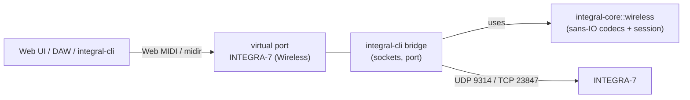
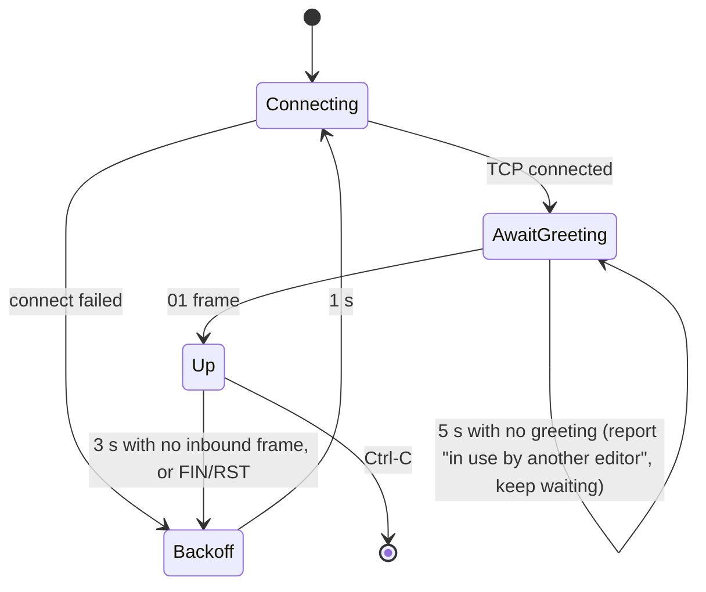

# INTEGRA-7 Wireless Transport

Hand-off spec for reaching the INTEGRA-7 through its WNA1100-RL wireless LAN
adapter, with no MIDI interface. Resolves
[Write the INTEGRA-7 wireless transport spec](https://github.com/sigma/integral/issues/304),
part of map [Reach the INTEGRA-7 over its wireless LAN adapter](https://github.com/sigma/integral/issues/166).
Why a virtual MIDI port: [ADR 0003](../adr/0003-wireless-via-virtual-midi-port.md).
Wire facts and captures: [`docs/research/integra-wireless-capture.md`](../research/integra-wireless-capture.md).

Scope: infrastructure mode only, macOS and Linux only. Ad-hoc mode, other
Roland Wireless Connect devices, and Windows are out of scope.

## Shape

- **`integral-core::wireless`**: sans-IO. Frame codec, RDDP codec, USB-MIDI
  packer and reassembler, and a session state machine fed bytes and an
  injected monotonic clock (`now`), returning frames to send and events. No
  sockets, no threads, no `std::time::Instant`: the module builds for
  `wasm32-unknown-unknown` unchanged, like `midi_bridge::RequestTracker`.
- **`integral-cli bridge`**: a long-running subcommand. Owns the UDP and TCP
  sockets (`std::net`, threads, no async runtime) and the `midir` virtual
  port pair. Its `main.rs` entry is dispatch only; the I/O loop sits in its
  own module.
- **No other surface changes.** The web UI keeps Web MIDI. Other CLI
  commands reach the Bridge's port through the existing `Integra` port
  pattern; they get no `--host` flag. The VST is deferred.

## Discovery (RDDP)

1. Open a TCP listener on an ephemeral port `P`.
2. Send the 8-byte probe `52 44 44 50 76 31 
` (`"RDDPv1"` + port)
   to UDP `255.255.255.255:9314`. Verified on hardware: the device answers a
   limited broadcast, so no interface enumeration is needed.
3. Each INTEGRA-7 that hears it connects to `P`, writes an 84-byte reply and
   closes. Parse: the `"RDDPv1"` magic, then the NUL-terminated ASCII strings
   manufacturer (`Roland`), WirelessID (e.g. `41288`), system version (`1.21`)
   and model (`INTEGRA-7`). The device's IP is the connection's peer address.
   Every other byte is opaque: do not interpret it. Reject replies without the
   magic, and replies whose model isn't `INTEGRA-7`.
4. Re-send the probe once a second, for up to 5 s, collecting replies keyed
   by WirelessID.
   - One device: use it.
   - Several: print WirelessID, IP and version for each, exit non-zero, and
     ask for `--host`.
   - None: exit non-zero, suggesting `--host <ip>`.

**Manual fallback:** `integral-cli bridge --host <ip>` skips discovery
entirely.

## Session (TCP 23847)

### Framing

Both directions: `[type u8][length u24 BE][body: length bytes]`.

| Type | Body                                                         | Direction                      |
| ---- | ------------------------------------------------------------ | ------------------------------ |
| `00` | none: heartbeat                                              | both                           |
| `01` | device uptime ms, u32 BE: greeting                           | device to us, first frame only |
| `02` | timestamp u32 BE, then n × 4-byte USB-MIDI 1.0 event packets | both                           |

Any other type: log it and skip `length` bytes. Never desync the stream.

- **Out:** one `02` frame per MIDI message, timestamp `0`, cable `0`.
  SysEx packs as CIN 4 (start or continue, 3 bytes), then CIN 5/6/7 (end with
  1/2/3 bytes). Channel messages use their CIN (8–E); the system common and
  real-time messages use CIN 2/3/5 or F.
- **In:** the device sends one packet per frame. Feed packets to a
  reassembler that keeps SysEx state _across frames_, ignoring the cable
  nibble and the timestamp.
  - Drop CIN 0 (`00 00 00 07` reply prefixes, `08 08 08 08`) and CIN 1
    (reserved).
  - Decode CIN 2–F to whole MIDI messages and forward them to the port.
    That includes preview notes.
  - Drop a decoded message that isn't well formed, e.g. the stray CIN F
    `0F D6 9C 04` (a lone channel status byte).

### Lifecycle

- **Greeting:** the session is up on the `01` frame. Wait for it with no
  deadline: the device queues a second client and greets it once the first
  leaves. After 5 s without it, report "INTEGRA-7 in use by another editor"
  once, and keep waiting.
- **Heartbeat:** send `00 00 00 00` every 1 s on our own clock while
  connected (including while awaiting the greeting). Don't echo the device's
  heartbeats.
- **Liveness:** any inbound frame counts. Declare the session dead after 3 s
  with none (the device itself times out at about 3 s).
- **Port lifetime:** create the virtual port pair when the session goes up,
  and remove it when it goes down. Web MIDI `statechange` is the page's only
  link-state signal.
- **Reconnect:** loop forever, 1 s between attempts. The device has no
  cool-down and keeps no session state, so a reconnect is a fresh session.
  If the address came from discovery, rediscover after 3 failed attempts
  (DHCP may have moved the device); an address from `--host` is never
  rediscovered.
- **Teardown:** on Ctrl-C, close the TCP connection (FIN; there is no goodbye
  frame) and drop the port.

### Throttle

The Bridge does not throttle. Like a MIDI interface, it is a transparent
port. The 20 ms rule still holds over Wi-Fi (the device silently drops RQ1s
sent under 10 ms apart), and web, core and CLI already enforce it.

## Testing

- `integral-core::wireless` is unit-tested with the byte sequences in
  [the capture doc](../research/integra-wireless-capture.md): greeting,
  heartbeat, the RQ1 frame, the one-packet-per-frame DT1 reply with its CIN 0
  prefix, the 84-byte RDDP reply, and the session timers driven by a fake
  clock.
- On hardware: `integral-cli bridge`, then `just ping` and a web UI session
  over the `INTEGRA-7 (Wireless)` port, with no other MIDI path up. Also
  check the helper-to-page direction, not yet tested in
  [How does the browser reach the INTEGRA-7 over wireless?](https://github.com/sigma/integral/issues/303).
  Linux is unverified.
