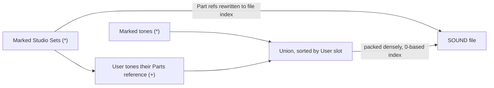
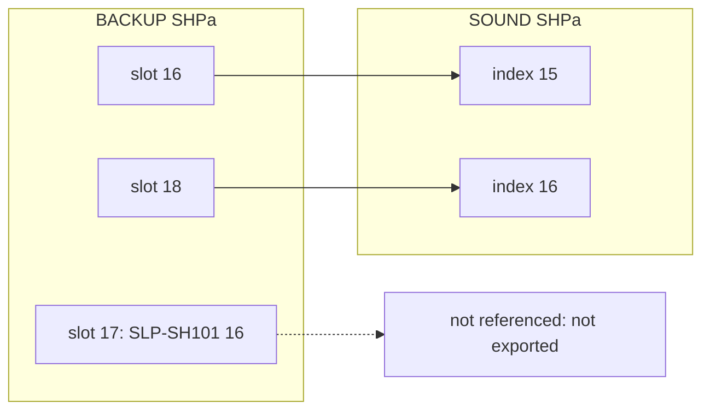

# SOUND vs BACKUP Files

The INTEGRA-7 writes two kinds of SVD file to a USB flash drive. They share the
[container](01-container.md) and the per-type entry layouts, but differ in which
chunks they carry, how many entries each chunk holds, and what a Studio Set's
tone reference points at.

Sources: the INTEGRA-7 Owner's Manual, pp. 50–53
(<https://static.roland.com/assets/media/pdf/INTEGRA-7_OM.pdf>), and the 18
official Roland packs. Each pack ships one BACKUP and one SOUND file.

## The Two Shapes

| | BACKUP | SOUND |
|---|---|---|
| Written by | UTILITY → BACKUP ("all settings of the INTEGRA-7", p. 52) | UTILITY → EXPORT (marked items, p. 51) |
| Read by | UTILITY → RESTORE (replaces all user memory, p. 53) | UTILITY → IMPORT (into chosen User slots, p. 51) |
| Folder | `/ROLAND/BACKUP` | `/ROLAND/SOUND` |
| Header length (bytes 0–1) | `00 7E` (126) | `00 6E` (110) |
| Directory | 7 entries: PRFb RFPa RFRa SHPa SNTa SDKa **SYSa** | 6 entries: same, without SYSa |
| Entry counts | Full user memory: 64 / 256 / 32 / 512 / 256 / 64 / 1 | Only what was exported. Any count, including 0 |
| Entries | One per User slot, in slot order, INIT included | Densely packed, in ascending slot order |
| File size | 811,292 bytes, always | Varies |

All six tone and Studio Set chunks are present in a SOUND file even when empty
(count 0). The empty zone header still carries the entry size.

## What a SOUND File Holds

The manual says: *"When you export a studio set, the tones used by that studio
set will also be exported"* (p. 51). In the EXPORT screen, marked items show `*`,
and the tones those items use show `+`. A `+` cannot be cleared by hand.

The packs confirm this exactly. **A SOUND file holds the marked tones plus the
User tones referenced by the marked Studio Sets.**

- **Every SOUND entry is byte-identical to exactly one BACKUP entry**: all 828
  SHPa and 3 RFPa entries, and 329 of 330 Studio Sets. The odd Studio Set is the
  renumbering case below.
- **No referenced User tone is missing** in any of the 13 packs that export
  Studio Sets.
- In every Studio Set pack except Synth Legends, **exported tones = referenced
  tones**. That includes slot 1, which in several packs is referenced only by
  "filler" Parts 2–16 (`95/0/0`). Synth Legends exports all of slots 1–128, but
  its 32 Studio Sets reference only 115 of them. The 13 extras (6, 17, 68, 69, 71,
  72, 78, 84, 94, 95, 99, 105, 106) were marked directly.
- Tone-only packs (Euro Attack Synth, Synth Legends Pure, NYC Nightlife Remix,
  Sounds of Summer 2014, Super Super Saw) export no Studio Set.

## Tone References Are Renumbered

In a SOUND file, a Studio Set's User tone reference (see
[Tone Reference](05-studio-set.md#tone-reference)) points at the **0-based
position of the tone inside the SOUND file's chunk of that type**, not at a User
slot. Tones are packed in ascending slot order. For a User bank,
`index = LSB × 128 + PC`.

Evidence: **SH-101 Collection Pure** is the one pack where the exported slots
are not contiguous. Its SOUND SHPa chunk holds backup slots **1–16 and 18**.
Slot 17 (`SLP-SH101 16`) is in the sound list, but no Studio Set references it,
so it was not exported. SOUND Studio Set 17 (`SLP-SH101 Wah`) differs from its
BACKUP twin by exactly one bit. Part 1 PC changes from **17 to 16** (byte 191:
`0x46` → `0x42`). That is, slot 18 (0-based PC 17) became file index 16.

Resolving every SOUND User reference as `SOUND entry[LSB × 128 + PC]` and mapping
that entry back to its BACKUP slot gives the BACKUP reference in **4,634 of
4,634** cases, across all packs.

The manual describes import as a slot assignment. The user picks one
destination per imported item, and INIT-named slots ("INIT STUDIO", "INIT TONE",
"INIT KIT") are proposed first, lowest number first (p. 51). Presumably import
rewrites each reference from the file index to the chosen slot. That has not
been observed yet (see the open questions below).

## Non-User References

Preset and expansion references are stored as plain MSB/LSB/PC and are never
renumbered. The live (non-INIT) Studio Sets in the packs reference these banks
(PC 0-based, names from `docs/sounds/*.json` at PC + 1):

| MSB, LSB | Bank | References |
|---|---|---|
| 86, 64 | PCM Drum preset | PC 3 = RaveDrumSet (×181) |
| 87, 64 | PCM Synth preset | PC 0 = 128voicePno (×4); PC 59 = Cathedral (×2); PC 72 = Jimmee Dee (×2) |
| 87, 65 | PCM Synth preset | PC 109 = Film Orch (×2) |
| 87, 66 | PCM Synth preset | PC 34 = St.Strings (×1); PC 35 = Warm Strings (×3); PC 37 = Marcato (×4); PC 38 = Bright Str (×1); PC 44 = Film Octaves (×1); PC 49 = Harp (×1); PC 60 = Deep Strings (×1) |
| 87, 68 | PCM Synth preset | PC 26 = St.Harpsichd (×2); PC 64 = St. Choir (×6); PC 68 = XV Strings (×2) |
| 88, 64 | SN Drum preset | PC 0 = Session Kit (×24) |
| 89, 64 | SN Acoustic preset | PC 0 = Full Grand 1 (×275) |
| 89, 65 | SN Acoustic preset | PC 37 = Vibraphone (×2); PC 59 = Harp Nail (×1); PC 79 = Marcato Str (×4); PC 81 = Strings Stac (×1) |
| 93, 7 | ExPCM | PC 38 = Real Strings (×1); PC 41 = StudioString (×3); PC 51 = Agitato STR (×2); PC 81 = SynStrings (×1); PC 125 = OrchHit SRX (×1) |
| 93, 9 | ExPCM | PC 21 = Piano & Strs (×2); PC 28 = HpsBackSRX 2 (×2); PC 29 = HpsBackSRX 3 (×1) |
| 93, 10 | ExPCM | PC 1 = Choir /Mod (×1) |
| 93, 11 | ExPCM | PC 66 = Vibraphone! (×2); PC 67 = SA Vibe SRX (×1); PC 110 = 858808880SRX (×2) |
| 93, 13 | ExPCM | PC 13 = JP8 Str1 SRX (×1); PC 42 = Shmoog SRX (×1) |
| 93, 14 | ExPCM | PC 58 = VP-330ChrSRX (×2); PC 65 = Vox JX8P SRX (×1) |
| 95, 64 | SN Synth preset | PC 18 = JP-8 Pad 3 (×2) |
| 95, 70 | SN Synth preset | PC 104 = Dirty Saw Ld (×1) |
| 95, 72 | SN Synth preset | PC 77 = Orch Hit (×1) |
| 120, 0 | GM2 drum | PC 25 = GM2 ANALOG (×138) |
| 121, 0 | GM2 tone | PC 11 = Vibraphone (×1); PC 52 = Choir Aahs (×3); PC 55 = OrchestraHit (×1) |

- **User drum kits (86/0, 88/0): 0 references** anywhere, INIT sets included.
- The only expansion references are ExPCM SRX (MSB 93, LSB 7/9/10/11/13/14, all
  from Children of Bodom) and GM2.
- INIT Studio Sets reference `89/64/0` + `88/64/0` in most packs, `95/3/127` +
  `86/64/3` in Synth Legends, and `95/0/0` + `86/64/3` in the SH-101 and TB-303
  packs.

A reader importing a SOUND file must therefore treat a reference as a file index
only when its MSB/LSB selects a User bank. A Studio Set that uses a preset or
expansion tone depends on that content being present on the target device, and
the file does not carry it.

## Open Questions / Device Check

| Unknown | Device check that settles it |
|---------|------------------------------|
| Renumbering when the packed index is ≥ 128 (LSB carry) | Export a Studio Set that references a User SN Synth tone in slot > 128, together with more than 128 marked tones, then inspect LSB/PC. |
| Whether Receive-OFF or muted Parts count as references for export (every referencing Part in the corpus has Receive ON and level > 0) | Save a Studio Set whose only reference to a tone is on a Receive-OFF Part, export it, and check whether the tone is bundled. |
| Whether import rewrites references to the chosen destination slots | Import the SH-101 Collection Pure SOUND file, then read Part 1 MSB/LSB/PC with RQ1 (`18 00 20 06`, size 3) and the tone names with the catalog query. |
