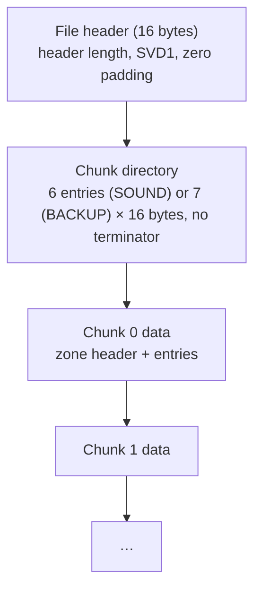

# SVD File Format — INTEGRA-7

The `.SVD` (Synthesizer Voice Data) file is Roland's proprietary binary
format for backing up and restoring user memory on synthesizers. This
document describes the format as reverse-engineered from INTEGRA-7 backup
files and from the 18 official Roland packs. There is no official public
specification from Roland.

## Overview

An SVD file is a flat binary container holding one or more **chunks**, each
containing an array of fixed-size **entries**. Each entry stores a single
patch (tone, studio set, drum kit, etc.) as a **bit-packed** representation
of its SysEx parameters.

The device writes two shapes of file: a **BACKUP** of all user memory and a
**SOUND** file with exported Studio Sets and tones. See
[SOUND vs BACKUP](11-sound-vs-backup.md).

## Related Documents

- [Container Format](01-container.md) — header, chunk directory, zone headers
- [Bit-Packing Encoding](02-encoding.md) — how SysEx parameters map to SVD bits
- [SN Synth Tone (SHPa)](03-sn-synth.md) — device-verified mapping for SuperNATURAL Synth
- [Chunk Type Reference](04-chunk-types.md) — all 7 chunk types, their entry sizes and status, known files
- [Studio Set (PRFb)](05-studio-set.md) — Studio Set mapping and the Part tone reference encoding
- [PCM Synth Tone (RFPa)](06-pcm-synth.md) — PCM Synth mapping, and the MFX section shared by all tone types
- [PCM Drum Kit (RFRa)](07-pcm-drum.md) — PCM Drum Kit mapping
- [SN Acoustic Tone (SNTa)](08-sn-acoustic.md) — SuperNATURAL Acoustic mapping
- [SN Drum Kit (SDKa)](09-sn-drum.md) — SuperNATURAL Drum Kit mapping
- [System (SYSa)](10-system.md) — System Common and the undocumented system area (BACKUP only)
- [SOUND vs BACKUP](11-sound-vs-backup.md) — the two file shapes, export contents, reference renumbering
