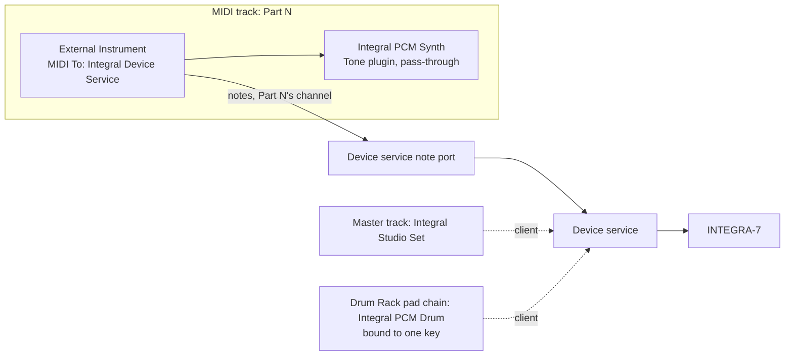

# Live runbook

Checks that need Ableton Live 12 on macOS. Each check runs once, and its result
goes in the table under it. The ticket is [#463], under the PRD [#447].

[#443] moved the rest to the test host: unit tests, pacing, gestures and state
round-trips run there, not here. This runbook covers what needs Live itself,
plus the items the stack's PRs deferred to it ([PR #476], [PR #477], [PR #482],
[PR #485], [PR #487], [PR #488]).

Expected results come from the issue or ADR each check cites. Where the spec is
not in the code yet, or two sources disagree, the check says **Open**. Record
what you see; do not mark it a pass or a fail until the expectation is settled.

Terms (Part, Binding, Tone plugin, Kit plugin, Studio Set plugin, Device service)
are defined in [CONTEXT.md](../../CONTEXT.md).

Result values: **Pass**, **Fail**, or **Blocked** (say why in the notes).

## Before you start

1. Build and install the bundle. Run `just bundle-plugin`, then copy
   `target/bundle/Integral.vst3` to `~/Library/Audio/Plug-Ins/VST3/`, replacing
   any older copy.
2. Start the Device service for the Live checks: `just bridge` (Wireless by
   default), or `just bridge --link rtp --port <name>` for RTP-MIDI.
3. Do not open the INTEGRA-7's MIDI port from another app during a check: the
   CLI monitor, a DAW track, or a second bridge. The web app is fine, because it
   reaches the device through the Device service. Two uncoordinated clients hung
   the INTEGRA-7 once, tracked in [#446] (see [#345] comments, 2026-11-07).
4. In Live, rescan plug-ins from the Plug-ins preferences.
5. Record the Live version (Live > About Live) in every results table.
6. Stop the Device service before any `just plugin-test` run. The scenarios
   refuse to run while a service listens on the default socket. They do not
   detect a service started with another socket, so stop that one yourself.
   `--allow-service` overrides the guard; do not use it for these checks.

## Checks at a glance

| #   | Check                                                    | Source                                                                           | Lands with      |
| --- | -------------------------------------------------------- | -------------------------------------------------------------------------------- | --------------- |
| 1   | Only the service holds the device port                   | [integral-vst README](../../crates/integral-vst/README.md), [PR #476], [PR #485] | none            |
| 2   | Live lists all six plugins, each loads                   | [PR #482]                                                                        | none            |
| 3   | Configure mode                                           | [#463], [#345]                                                                   | none            |
| 4   | Placement                                                | [#463], [ADR 0007](../adr/0007-plugins-per-tone-type.md)                         | none            |
| 5   | Track input                                              | [#463], [#345]                                                                   | none            |
| 6   | SysEx echo into the note port (reproduction)             | [#443]                                                                           | none            |
| 7   | Save and reopen keeps the Binding                        | [PR #482], [ADR 0008](../adr/0008-host-parameter-ids-from-device-addresses.md)   | none            |
| 8   | Tone-type mismatch                                       | [#455], [ADR 0007]                                                               | [#455]          |
| 9   | Kit-bound and key-bound Kit plugins                      | [#455]                                                                           | [#455]          |
| 10  | Duplicate Bindings                                       | [#455], [ADR 0006](../adr/0006-device-service-owns-the-link.md)                  | [#455]          |
| 11  | Automation of a Tone parameter moves the bound Part      | [PR #487], [ADR 0008]                                                            | none            |
| 12  | UI drag recorded as automation, Session and Arrangement  | [#463], [#443], [PR #488]                                                        | none            |
| 13  | Web-app edit with the editor closed recorded as a lane   | [PR #487], [#454]                                                                | none            |
| 14  | Recall smoke test                                        | [#463], [ADR 0009](../adr/0009-recall-pushes-the-project-state.md), [#458]       | [#458]          |
| 15  | PCM Synth performance                                    | [#463], [load.rs](../../crates/integral-plugin-host/src/load.rs)                 | none            |
| 16  | Active Sensing during an Expansion load                  | [PR #476], [MIDI 01-protocol](../midi/01-protocol.md)                            | none (hardware) |
| 17  | Plug-in test host drag (not Live)                         | [PR #477], [#528]                                                                | none            |
| 18  | The Binding as automatable Part and Key parameters       | [#495], [ADR 0007]                                                               | [#495]          |
| 19  | A Tone plugin picks its Part's tone                      | [#496], [ADR 0007], [ADR 0009]                                                   | [#496]          |

[ADR 0007]: ../adr/0007-plugins-per-tone-type.md

## 1. Only the service holds the device port

**Purpose.** The plugins open no MIDI port, and `integral-app` holds none. The
Device service is the only process on the device port.

**Setup.** Device service running (`just bridge`). Live open, with one plugin
editor open on a track.

1. In a terminal, run `pgrep -fl 'integral.* bridge'`.
2. In Live, open Preferences > Link, Tempo & MIDI. Turn off Track and Remote for
   the INTEGRA-7 port. Then play a note through a plugin track.

**Expected.**

- Step 1 prints exactly one line, the service.
- Step 2: the plugin track still sounds Part N, with Live's device port off.

**Open.** `just bridge` runs through cargo and a recipe shell, and both match the
pattern too. If `pgrep` prints more than one line, stop the service, run
`cargo build -p integral-cli`, start `target/debug/integral bridge` directly (the
binary is named `integral`, per [integral-cli Cargo.toml](../../crates/integral-cli/Cargo.toml)),
and check again. The README expects one line; this workaround is not yet tested.

| Date       | Live version         | Result | Notes                                                                                                                                                                                                                                                                                                                                                                                                                                                        |
| ---------- | -------------------- | ------ | ------------------------------------------------------------------------------------------------------------------------------------------------------------------------------------------------------------------------------------------------------------------------------------------------------------------------------------------------------------------------------------------------------------------------------------------------------------ |
| 2026-11-10 | 12.4.16 (2026-10-30) | Pass   | Service started as `target/debug/integral bridge --link rtp --port Integra`. Step 1: `pgrep -lx integral` prints one line. `pgrep -fl 'integral.* bridge'` printed two even with the binary run directly: the shell that launched it matches too, so match the process name with `-x`. Step 2: Live had `Network (Integra)` on for input Track and output Track, Sync and Remote; with all four off, notes through the Tone plugin track still sound Part 6. |

## 2. Live lists all six plugins, each loads

**Purpose.** One bundle exports six classes. Live lists each one and loads it.
Source: [PR #482] (listing and loading all six). Class names are from
[host_params.rs](../../crates/integral-core/src/host_params.rs).

**Setup.** Bundle installed, plug-ins rescanned.

1. Find these six entries: `Integral Studio Set`, `Integral SN Synth`,
   `Integral SN Acoustic`, `Integral PCM Synth`, `Integral SN Drum`,
   `Integral PCM Drum`.
2. Drag each onto a new track. Open each editor.
3. Close the editors. Delete the plugins.

**Expected.** All six appear, each loads with no error, and each editor opens.
Live files all six as audio effects: each class declares the `Fx` and `Tools`
categories ([family/mod.rs](../../crates/integral-vst/src/family/mod.rs), lines
235-236). Record the category Live shows.

| Date       | Live version         | Result | Notes                                                                                                                                                             |
| ---------- | -------------------- | ------ | ----------------------------------------------------------------------------------------------------------------------------------------------------------------- |
| 2026-11-10 | 12.4.16 (2026-10-30) | Pass   | All six listed under Plug-Ins > `sigma`; each loads on an audio track and its editor opens, connected. Each Tone or Kit plugin binds the next free Part (1 to 6). |

## 3. Configure mode

**Purpose.** Live shows only a bounded set of parameters until you pick them in
Configure mode.
Sources: [#463], [#345], and the
[Live parameter notes](../research/host-parameter-limits.md#many-parameters).

**Setup.** A Tone plugin (PCM Synth) on a track, bound to a Part that holds a PCM
Synth tone. Device service running.

1. Select the track and open the plugin's device view in Live.
2. Look at the device view. Count the parameters it shows.
3. Turn on Configure. Choose three or four parameters.
4. Look at the device view again.
5. Read the plugin's editor. Look for how to add parameters.

**Expected.**

- Step 2: an empty device panel, because every class has more than 64 parameters
  and a larger list opens empty until Configure
  ([Live parameter notes](../research/host-parameter-limits.md#many-parameters)).
- Step 4: the chosen parameters appear in the device view.
- Step 5: the editor itself says nothing about Configure; Live's own panel text
  ("To add plug-in parameters to this panel, click the Configure button") is
  the explanation, by decision
  ([#526](https://github.com/sigma/integral/issues/526)).

**Open.** Step 5: resolved by decision
([#526](https://github.com/sigma/integral/issues/526)): the editor will not
explain Configure; Live's panel text is enough. The 2026-11-10 row below
records what the page showed before that decision. Whether Live's `Options.txt`
sets `-_PluginAutoPopulateThreshold` (the research note reports, from users,
that it fills Configure up to 128) is still worth recording.

| Date       | Live version         | Result        | Notes                                                                                                                                                                                                                                                                                                                                                                                                                                                                                                                                                                                            |
| ---------- | -------------------- | ------------- | ------------------------------------------------------------------------------------------------------------------------------------------------------------------------------------------------------------------------------------------------------------------------------------------------------------------------------------------------------------------------------------------------------------------------------------------------------------------------------------------------------------------------------------------------------------------------------------------------ |
| 2026-11-10 | 12.4.16 (2026-10-30) | Fail (step 5) | Run with SN Synth on Part 6 (no Part held a PCM Synth tone). Step 2: the panel is empty, 0 parameters; Live's panel reads "To add plug-in parameters to this panel, click the Configure button". No `Options.txt` exists, so no threshold override. Steps 3-4: in Configure, touching Common Level, Partial 1 Cutoff and Partial 1 Resonance in the editor adds `Tone Level`, `Partial … Cutoff` and `Partial …onance`; they stay after Configure is turned off. Step 5: the editor says nothing about Configure; only Live's panel does ([#526](https://github.com/sigma/integral/issues/526)). |

## 4. Placement

**Purpose.** The Tone plugin follows External Instrument on the Part's track, and
the instrument sends notes to the service's note port. The Studio Set plugin
sits on the master track. A key-bound Kit plugin sits in a Drum Rack pad chain.
Source: [ADR 0007] (Placement); [PR #476] (the "Integral Device Service"
placement, not checked there).

**Setup.** Device service running. Device on. Studio Set plugin shows Part N's
receive channel.

1. Create a MIDI track named for Part N. Insert External Instrument.
2. In External Instrument, set MIDI To to `Integral Device Service`. Set the
   channel to Part N's receive channel.
3. Insert Integral PCM Synth after External Instrument.
4. On the master track, insert Integral Studio Set. Change Part N's level in it.
5. Create a Drum Rack. Put Integral PCM Drum in one pad chain. In the plugin,
   bind it to one key.
6. Play a note on Part N's track.
7. Turn the device off with the service running. Watch the MIDI To list.
8. Stop the Device service. Watch the MIDI To list.

**Expected.**

- Step 6: the note sounds on Part N's tone. The Tone plugin passes audio through
  unchanged.
- Step 4: Part N's level on the device moves with the Studio Set plugin.
- Step 5: triggering that pad sounds only the bound key.
- Step 7: `Integral Device Service` stays in the list. The note port belongs to
  the service process, not to the device
  ([runtime.rs](../../crates/integral-device-service/src/runtime.rs), lines
  104-113).
- Step 8: the port leaves the list once the service process stops.

**Open.** Step 5: the spec does not say which pad note maps to the bound key. Record
the mapping you used. Step 8: [CONTEXT.md](../../CONTEXT.md) says the port is
"present only while the link is up", but the code ties the note port to the
process. Record what Live shows, and whether a rescan changes it.

| Date       | Live version         | Result | Notes                                                                                                                                                                                                                                                                                                                                                                                                                                                                                                                                                                                                                                                                                                                                                         |
| ---------- | -------------------- | ------ | ------------------------------------------------------------------------------------------------------------------------------------------------------------------------------------------------------------------------------------------------------------------------------------------------------------------------------------------------------------------------------------------------------------------------------------------------------------------------------------------------------------------------------------------------------------------------------------------------------------------------------------------------------------------------------------------------------------------------------------------------------------- |
| 2026-11-10 | 12.4.16 (2026-10-30) | Pass   | Run with SN Synth on Part 6 (no Part held a PCM Synth tone) and SN Drum on Part 10 (no Part held a PCM Drum kit). Step 6: notes sound Part 6. Step 4: Part 6 Level read back through the service went 100 to 64, then back to 100. Step 5: mapping used: the pad's chain Play note must equal the bound key. Live's default Play is C3 (60) whatever the pad, so pad C1 first played another drum; with Receive C1 and Play C1 (36), bound to Key C2 (36), only Studio Kick sounds. The plugin names note 36 C2, Live names it C1. Step 7: the service logs `The device stopped answering`; the port stays listed. Step 8: the port leaves the list; Live keeps the track's choice greyed and reselects the port when the service restarts. No rescan needed. |

## 5. Track input

**Purpose.** A track whose input is All Ins also hears the INTEGRA-7's own port.
That lets device SysEx reach the note port. Use the computer keyboard or a
controller, never All Ins or the device's own port.
Sources: [#463], [#345] (2026-11-07: drags record only when the input is not All Ins).

**Setup.** The track from check 4.

1. Open the track's In menu. Choose the computer keyboard. The spec calls it
   Computer Keyboard; if Live labels it another way, pick the computer keyboard
   entry.
2. Arm the track. Play a note.
3. Open the In menu again. Confirm All Ins and the INTEGRA-7's own port are not
   selected.

**Expected.** Notes from the computer keyboard reach Part N. The track's In is the
computer keyboard or a controller, never All Ins or the device's own port.

| Date       | Live version         | Result | Notes                                                                                                                     |
| ---------- | -------------------- | ------ | ------------------------------------------------------------------------------------------------------------------------- |
| 2026-11-10 | 12.4.16 (2026-10-30) | Pass   | Live labels it `Computer Keyboard`. With the device port off in Live, the In menu no longer lists it. Notes reach Part 6. |

## 6. SysEx echo into the note port (reproduction)

**Purpose.** Reproduce the echo. When a monitored track with All Ins hears device
SysEx, the note port must drop it, so no SysEx reaches the device.
Sources: [#443] (row 11, Live-only reproduction; row 4, the unit test of the drop
rule), [ADR 0006] (notes never go inside SysEx).

**Setup.** Track In set to All Ins, track armed, Monitor set to In. Device on.

1. Set the track In to All Ins. Arm the track. Monitor In.
2. Stop the Device service with Ctrl+C, then start it again with `just bridge`.
   On link open, the service asks for the device ID with an Identity Request
   when the link has not learned it ([service.rs](../../crates/integral-device-service/src/service.rs),
   line 381). RTP and USB links also probe with Identity Requests
   ([probe.rs](../../crates/integral-device-service/src/probe.rs)). Wireless sends
   the request only without `--device-id`. The device's Identity Reply then
   arrives on the device port.
3. Watch the track's meter, and the device.
4. Set the track In to the computer keyboard. Repeat step 2.

**Expected.**

- Step 3: whatever reaches the note port, it must not reach the device. The
  device stays responsive, and the service stays up.
- Step 4: no SysEx reaches the note port.

**Open.** The path from the device port into the track is not confirmed. This
check is a reproduction, so a result that shows the echo is a finding to file,
not a blocked check. Record the meter and the device's behaviour.

| Date       | Live version         | Result | Notes                                                                                                                                                                                                                                                                                                                                                                                                                                                                                                                                                              |
| ---------- | -------------------- | ------ | ------------------------------------------------------------------------------------------------------------------------------------------------------------------------------------------------------------------------------------------------------------------------------------------------------------------------------------------------------------------------------------------------------------------------------------------------------------------------------------------------------------------------------------------------------------------ |
| 2026-11-10 | 12.4.16 (2026-10-30) | Pass   | RTP link. Live's input Track on `Network (Integra)` turned on for this check only, track 1 on All Ins, armed, Monitor In. Restarting the service (`Device 10 answered`) and then 15 `integral --service ping` runs, each answered by the device on that port: no activity seen on track 1's meter or Live's MIDI indicator in the screenshots taken. The device kept answering (Part 6 read back) and the service stayed up. Step 4: input back to Computer Keyboard, device port input off again. Screenshots sample the meter, so a short flash could be missed. |

## 7. Save and reopen keeps the Binding

**Purpose.** The Binding is saved with the project. It is a Part, or a Part and a
key. Reopening the set restores it.
Sources: [PR #482] (save and reopen), [ADR 0007] (Binding is explicit and saved),
[ADR 0008] (IDs relative to the Binding).

**Setup.** A Tone plugin bound to Part N. A key-bound Kit plugin in a pad chain,
bound to key K (for the key variant).

1. Note the Binding each plugin shows: Part N, and key K for the Kit plugin.
2. Save the set. Quit Live. Reopen the set.
3. Open each plugin's editor. Read its Binding.

**Expected.** After reopening, each plugin shows the same Part, and the same key
where one was bound. Recall of device state is check 14, not this one.

| Date       | Live version         | Result | Notes                                                                                                                                                                                                                                                                     |
| ---------- | -------------------- | ------ | ------------------------------------------------------------------------------------------------------------------------------------------------------------------------------------------------------------------------------------------------------------------------- |
| 2026-11-10 | 12.4.16 (2026-10-30) | Pass   | Saved as a scratch set, quit Live, reopened by opening the `.als`. Track 1's SN Synth: Part 6 before and after. Pad C1's SN Drum: Part 10, Key C2 (36) before and after; the pad chain kept Receive C1, Play C1. The three Configure parameters on track 1 were kept too. |

## 8. Tone-type mismatch

**Purpose.** When the bound Part holds another tone type, the plugin shows the
mismatch and stays inert. Its automation lanes stay, and resume when the type
matches.
Sources: [#455] (item 1), [ADR 0007] (Type mismatch).

**Setup.** A Tone plugin (PCM Synth) bound to Part N, which holds a PCM Synth tone.
An automation lane on a Tone parameter, as in check 11. Playback running.

1. Play. Confirm Part N moves with the lane.
2. On the device (web app or front panel), change Part N to an SN Synth tone.
3. Look at the plugin. Do not accept its offer to load a default tone.
4. Play the lane again. Watch the device.
5. On the device, change Part N back to a PCM Synth tone.
6. Play the lane again.

**Expected.**

- Step 3: the plugin shows the notice "The bound Part holds another tone type"
  and stays inert ([notice.rs](../../crates/integral-vst/src/family/notice.rs),
  lines 33-34).
- Step 4: the lane writes nothing. Part N's SN Synth tone is unchanged.
- Step 6: the plugin resumes, and the lane moves Part N again.

| Date       | Live version         | Result              | Notes                                                                                                                                                                                                                                                                                                                                                                                                                                                                                                                                                                                                                                                                                                                                                          |
| ---------- | -------------------- | ------------------- | -------------------------------------------------------------------------------------------------------------------------------------------------------------------------------------------------------------------------------------------------------------------------------------------------------------------------------------------------------------------------------------------------------------------------------------------------------------------------------------------------------------------------------------------------------------------------------------------------------------------------------------------------------------------------------------------------------------------------------------------------------------- |
| 2026-11-10 | 12.4.16 (2026-10-30) | Pass, with a caveat | Inverse direction: SN Synth plugin (track 12, lane on `Partial 1 Filter Cutoff`) bound to Part 7, switched on the device to a PCM Synth tone (bank 87/64/0, written through the service). Step 3: the editor shows "The bound Part holds another tone type, so this plugin does nothing until it holds one of its own" with a Load JP8 Strings1 button; the header's tone label still read `SN Synth : 36 : FX 12`. Step 4: Part 7's PCM tone common and partial 1 bytes were identical before and after playing the lane. Steps 5-6: back on its SN Synth tone, the lane did not move Part 7 at first: the tone load made the plugin report the new cutoff (80), and Live overrode the lane. After Re-Enable Automation, playback moved Part 7 from 25 to 99. |

## 9. Kit-bound and key-bound Kit plugins

**Purpose.** A kit-bound Kit plugin leaves its key parameters inert. A key-bound
one leaves the kit-wide parameters inert.
Source: [#455] (item 2), [ADR 0007].

**Setup.** Track A: Integral PCM Drum bound to the whole kit. Track B: Integral
PCM Drum in a pad chain, bound to key K. Configure both so the parameters show.

1. On track A, move a kit-wide parameter (a kit MFX parameter, for example). Watch
   the device.
2. On track A, move a key parameter. Watch the device.
3. On track B, move a kit-wide parameter. Watch the device.
4. On track B, move a key parameter. Watch the device.

**Expected.**

- Steps 1 and 4: the device changes.
- Steps 2 and 3: the device does not change (inert).

| Date       | Live version         | Result                                             | Notes                                                                                                                                                                                                                                                                                                                                                                                                                                                                                                                                                                                                                                                                                               |
| ---------- | -------------------- | -------------------------------------------------- | --------------------------------------------------------------------------------------------------------------------------------------------------------------------------------------------------------------------------------------------------------------------------------------------------------------------------------------------------------------------------------------------------------------------------------------------------------------------------------------------------------------------------------------------------------------------------------------------------------------------------------------------------------------------------------------------------- |
| 2026-11-10 | 12.4.16 (2026-10-30) | Partial: steps 1 and 4 Pass, steps 2 and 3 Blocked | SN Drum kit on Part 10 (no Part held a PCM Drum kit). Track A: audio-track SN Drum rebound to Part 10, Whole kit; track B: the Drum Rack pad's SN Drum, key 36. Step 1: track A's Kit Level moved the device 110 to 78 (`1B 23 00 10`), key 36 Level untouched; restored. Step 4: track B's key Level moved key 36 (`1B 23 19 04`) 100 to 43, Kit Level untouched; restored. Steps 2-3: Blocked. Live lists only parameters picked in Configure, and Configure picks them by touching them in the editor. Track A's editor shows no key controls and track B's no kit controls, so the inert side cannot be reached from Live (the X-Y pad and lane choosers offer only `Kit Level` / `Key Level`). |

## 10. Duplicate Bindings

**Purpose.** Two instances bound to the same Part both work, and each warns.
Sources: [#455] (item 3), [ADR 0006] (duplicates work with a warning).

**Setup.** Two tracks. Each has External Instrument into a Tone plugin bound to
Part N.

1. Open both editors. Read each plugin's notice.
2. Change `Tone Level` on the first plugin. Watch the device.
3. Change `Tone Level` on the second plugin. Watch the device.

**Expected.**

- Step 1: each plugin shows the notice "Another instance is bound to this target"
  ([notice.rs](../../crates/integral-vst/src/family/notice.rs), line 34).
- Steps 2 and 3: the device changes each time.

**Open.** Which write wins when both change: [ADR 0006] says writes are
last-writer-wins. Record which one you saw last.

| Date       | Live version         | Result | Notes                                                                                                                                                                                                                                                                                                                                                                                                                                                                 |
| ---------- | -------------------- | ------ | --------------------------------------------------------------------------------------------------------------------------------------------------------------------------------------------------------------------------------------------------------------------------------------------------------------------------------------------------------------------------------------------------------------------------------------------------------------------- |
| 2026-11-10 | 12.4.16 (2026-10-30) | Pass   | Two SN Synth instances on Part 6 (track 1 behind External Instrument; track 12 rebound from Part 7). Both editors show "Another instance of this plugin is bound to this target: both work, and the last to write wins"; so does a second Studio Set instance. Tone Level read at `1A 21 00 0C` through the service: track 12 set it 100 to 51, and track 1's Live panel then showed 51; track 1 set it to 95, the device read 95. Last writer wins. Restored to 100. |

## 11. Automation of a Tone parameter moves the bound Part

**Purpose.** Automation writes to the bound Part. When the Binding changes, the
automation follows it.
Sources: [PR #487] (not checked: automation of Partial 1 cutoff against Live),
[ADR 0008] (IDs are relative to the Binding).

**Name.** The PR text says "Partial 1 Cutoff Freq". The host name in code is
`Partial 1 TVF Cutoff Frequency`
([field_spec.rs](../../crates/integral-core/src/field_spec.rs), where index 1
gives "Partial 2 TVF Cutoff Frequency"). Use the code name.

**Setup.** A Tone plugin (PCM Synth) bound to Part A. Configure shows `Partial 1
TVF Cutoff Frequency` (check 3). Part B exists on the device.

1. Draw an automation lane for `Partial 1 TVF Cutoff Frequency`.
2. Play. Watch Part A's Partial 1 cutoff on the device.
3. Change the plugin's Binding to Part B.
4. Play again. Watch Parts A and B on the device.

**Expected.**

- Step 2: Part A's Partial 1 cutoff follows the lane. No other Part changes.
- Step 4: Part B follows the lane. Part A stays where it was left.

| Date       | Live version         | Result | Notes                                                                                                                                                                                                                                                                                                                                                                                                                                                                                                                                              |
| ---------- | -------------------- | ------ | -------------------------------------------------------------------------------------------------------------------------------------------------------------------------------------------------------------------------------------------------------------------------------------------------------------------------------------------------------------------------------------------------------------------------------------------------------------------------------------------------------------------------------------------------- |
| 2026-11-10 | 12.4.16 (2026-10-30) | Pass   | SN Synth (track 12) with the Arrangement lane from check 12 on `Partial 1 Filter Cutoff` (SN Synth's name; no Part held a PCM Synth tone). The other instance moved to Part 8 first. Bound to Part 6: with Part 6 set to 40 and Part 7 at 80, playback took Part 6 to the lane's 99 and left Part 7 at 80. Rebound to Part 7: with Part 6 at 40, playback took Part 7 from 25 to 99 and left Part 6 at 40. A write from the service overrides the lane; re-enable per parameter from its context menu when the control-bar button is out of reach. |

## 12. UI drag recorded as automation, Session and Arrangement

**Purpose.** A drag in the plugin's editor records as an automation lane in both
Session and Arrangement view.
Sources: [#463], [#443] (row 12), [PR #488] (not checked: recording a lane by
dragging in Live), [#345] (2026-11-07 run, Live 12.4.16: drags recorded in both
views with the input not All Ins).

**Setup.** Tone plugin (PCM Synth) on a MIDI track. Track In set per check 5.
Editor open. Automation Arm on. Use `Partial 1 TVF Cutoff Frequency` from check 11.

_Session view_

1. Create a MIDI clip in a slot on the track. Loop it.
2. Arm the track. Start the clip. Turn on Session Record.
3. Drag the plugin's slider from low to high, then back. Release each time.
4. Stop. Look at the clip's envelope.

_Arrangement view_

5. Stop the clip. Turn on Arrangement Record. Play from the start.
6. Drag the same slider. Stop.
7. Look at the track's automation lane.
8. Play back. Watch the editor's slider and the device.

**Expected.** Each view gives an envelope for that parameter, with points where you
dragged. No other parameter gets an envelope. Playback moves the slider and the
device's value.

| Date       | Live version         | Result | Notes                                                                                                                                                                                                                                                                                                                                                                                                                                                                                                                                                                                                                  |
| ---------- | -------------------- | ------ | ---------------------------------------------------------------------------------------------------------------------------------------------------------------------------------------------------------------------------------------------------------------------------------------------------------------------------------------------------------------------------------------------------------------------------------------------------------------------------------------------------------------------------------------------------------------------------------------------------------------------- |
| 2026-11-10 | 12.4.16 (2026-10-30) | Pass   | SN Synth on Part 6 (`Partial 1 Filter Cutoff`; no Part held a PCM Synth tone). Session (track 1, MIDI, Computer Keyboard): the looping clip got an envelope for that parameter only; playback moved the device 25 to 99 each loop (read at `1A 21 20 0C`). Arrangement (track 12): the drag recorded a lane; playback moved the device to the lane's value. Each manual drag outside recording, or a write from the service, overrides the lane until Re-Enable Automation is clicked, as Live does for any parameter. The other Part 6 instance (check 10) recorded the same lane too, because it follows the device. |

## 13. Web-app edit with the editor closed recorded as a lane

**Purpose.** A change made elsewhere reaches Live as an automation lane even with
the plugin's editor closed. The nih-plug patch is for this case: without it, a
plugin with its editor closed cannot show Live a change that came from another
client
([PATCHES.md](../../crates/patches/PATCHES.md), lines 19-26).
Sources: [PR #487] (not checked: "a web-UI edit recorded as a lane"), [#454]
(the patch).

**Note.** Automation playback alone does not need the patch. Check 11 covers it.

**Setup.** A Tone plugin on a track, bound to Part N. Automation Arm on. Editor
closed. The web app open and connected to the device through the service.

1. Start Live's Session Record, with the track armed.
2. While it records, change `Tone Level` in the web app. The change reaches the
   device through the service.
3. Stop. Look at the track.
4. Play the lane. Watch Part N on the device.

**Expected.**

- Step 3: an automation lane for `Tone Level`, holding the web-app change.
- Step 4: the lane moves Part N on the device.

**Open.** The PR text does not spell out the exact form of the lane (its points,
or whether it joins an existing lane). Record what you see.

| Date       | Live version         | Result | Notes                                                                                                                                                                                                                                                                                                                                                                                                                                                                                                                                                  |
| ---------- | -------------------- | ------ | ------------------------------------------------------------------------------------------------------------------------------------------------------------------------------------------------------------------------------------------------------------------------------------------------------------------------------------------------------------------------------------------------------------------------------------------------------------------------------------------------------------------------------------------------------ |
| 2026-11-10 | 12.4.16 (2026-10-30) | Pass   | Another client stood in for the web app: `integral --service raw-send` wrote Part 7's SN Synth Tone Level (`1A 41 00 0C`) as 0x50, 0x40, 0x30, 0x46, 0x64 through the Device service, the same path the web app uses. Track 12's SN Synth (Part 7) had its editor closed; Arrangement Record (F9) was running, no arm needed. Step 3: track 12 got a `Tone Level` lane with steps at each write, and Live added `Tone Level` to the device panel. Step 4: with Part 7 reset to 106 and the lane re-enabled, playback set Part 7 to 80, 64, 48 in turn. |

## 14. Recall smoke test

**Purpose.** Reopening a project pushes the project's saved state to the device.
The device's own edit made outside Live is lost, not merged. The device does not
win.
Sources: [#463], [ADR 0009], [#458] (status texts and acceptance), [#345]
(2026-11-07 run: Level came back, Pan did not, because the no-op filter dropped
Pan).

**Setup.** Device service running. A project with a Tone plugin on Part N (note
which tone it is), with its `Tone Level` and `Tone Pan` moved off their defaults.
Studio Set plugin on the master track with Part N's level moved.

1. Save the set.
2. Change the device, not through Live: change Part N's tone, `Tone Level` and
   `Tone Pan`, on the device or in the web app.
3. Quit Live. Reopen the set.
4. Watch the Tone plugin's status and notices.
5. Read Part N on the device: tone, `Tone Level`, `Tone Pan`. Read Part N's level
   in the Studio Set plugin (the name is `Part N Level` as the code builds it;
   confirm the exact name in Live).
6. Play a note on Part N while "Recalling…" is showing.
7. Drop a fresh Integral PCM Synth onto an empty track. It claims a free Part
   itself, preferring one that holds a PCM Synth tone
   ([integral-vst src README](../../crates/integral-vst/src/README.md), lines
   51-58). Note which Part it claimed (M). Read Part M on the device before and
   after.

**Expected.**

- Step 4: "Recalling…" is a notice beside the status while the push is queued and
  sent ([notice.rs](../../crates/integral-vst/src/family/notice.rs), line 32). It
  can show together with "Device offline", which the plugin reports while it
  waits for a session. When the push is out, the notice clears and the status
  reads Connected.
- Step 5: Part N shows the project's tone, `Tone Level` and `Tone Pan`. The
  device's edit from step 2 is gone.
- Step 6: the note sounds. Recall does not gate notes.
- Step 7: Part M does not change. A fresh instance adopts the device and sends
  nothing (ADR 0009).

**Known failure.** In the 2026-11-07 run, Pan did not come back. The fix must
make both `Tone Level` and `Tone Pan` pass.

| Date       | Live version         | Result                            | Notes                                                                                                                                                                                                                                                                                                                                                                                                                                                                                                                                                                                                                                                                                                                                            |
| ---------- | -------------------- | --------------------------------- | ------------------------------------------------------------------------------------------------------------------------------------------------------------------------------------------------------------------------------------------------------------------------------------------------------------------------------------------------------------------------------------------------------------------------------------------------------------------------------------------------------------------------------------------------------------------------------------------------------------------------------------------------------------------------------------------------------------------------------------------------ |
| 2026-11-10 | 12.4.16 (2026-10-30) | Pass (steps 4 and 6 not observed) | SN Synth on Part 8 (track 1); SN Synth has no Tone Pan, so Part 8's Studio Set Pan stood in for it. Saved with Part 8 on Alpha Bs 3 (95/68/114), Tone Level 90, Part Level 80, Pan 40. Outside Live, through the service: tone 95/64/0, Tone Level 30, Level 120, Pan 90. Quit without saving, reopened. Step 5: Part 8 back on Alpha Bs 3, Tone Level 90, Level 80, Pan 40; the outside edit is gone, Pan included. Steps 4 and 6: the push finished before the first screenshot, so "Recalling…" was not seen and no note was played during it. Step 7: a fresh PCM Synth on an empty track claimed Part 4 (free; no Part held a PCM Synth tone, so it shows the mismatch); all 16 Parts' tone, level and pan were identical before and after. |

## 15. PCM Synth performance

**Purpose.** A PCM Synth plugin with its full host list opens, saves, reopens and
automates without stalls. It declares 1,524 parameters (every MFX type's slots
included), as `just plugin-test load` reported in [PR #482]; [#463]'s "about
1,430" predates the tempo-sync slots. Confirm the count from the `load` report
and record it below.
Sources: [#463], [load.rs] (times load, save and reopen against this list).

**Setup.** Stop the Device service. Run `just plugin-test load`, then start the
service for Live.

1. Stop the service. Run `just plugin-test load`. Record the count and the load,
   save and reopen times for `Integral PCM Synth`.
2. Start the service. In Live, add one PCM Synth Tone plugin bound to Part N.
   Open its editor. Note how long it takes to open.
3. Turn on Configure. Add ten parameters. Draw a lane on each.
4. Play. Note any dropouts, and whether the UI stops responding.
5. Save. Quit Live. Reopen. Open the editor. Play the lanes.

**Expected.** Nothing stalls at any step: the editor opens, the save and reopen
finish, and the lanes play without the UI freezing.

**Open.** The spec gives no time limit for a stall. Record the timings; set the
threshold separately.

**After [#529].** A block whose read fails no longer blanks the editor: the
blocks that loaded render, the failed one shows its error with a Retry in
place of its Sections (a Partial's error sits in its lane's WAVE box), and
the webview console names the block and its error
(`[tone blocks] Partial 2 failed: RQ1 timeout for …`). Re-run step 2 with
the webview console open: the error names the read that fails, which the
offline checks could not reproduce — the relay (test
`a_full_size_partial_block_reply_reaches_the_page_intact` in
[service_link.rs]) and the wasm `applyPcms*` decoders were ruled out.

| Date       | Live version         | Result | Notes                                                                                                                                                                                                                                                                                                                                                                                                                                                                                                                                                                                                                                                                                                                                                                                                                                                                                                                                                                                                                 |
| ---------- | -------------------- | ------ | --------------------------------------------------------------------------------------------------------------------------------------------------------------------------------------------------------------------------------------------------------------------------------------------------------------------------------------------------------------------------------------------------------------------------------------------------------------------------------------------------------------------------------------------------------------------------------------------------------------------------------------------------------------------------------------------------------------------------------------------------------------------------------------------------------------------------------------------------------------------------------------------------------------------------------------------------------------------------------------------------------------------- |
| 2026-11-10 | 12.4.16 (2026-10-30) | Fail   | Step 1: `just plugin-test load` exits 1. PCM Synth declares 1,525 parameters (core's list is 1,524, plus `Part`); load 4.1 ms, save 0.7 ms, reopen 6.1 ms, state 40,424 bytes. Every Tone and Kit class fails "the plugin declares its list" by one (`Part`) or two (`Part`, `Key`): the scenario still compares against `host_params()` alone, from before #495's Binding parameters. Step 2: Part 4 set to 128voicePno (PCM, 87/64/0); the editor window opened within 1 s, showed "Bank MSB 0 isn't a tone bank", then "Loading PCM Synth tone data…", then empty Partial 1-3 frames with no controls, still empty after 40 s and after closing and reopening the window. The header (`PCM Synth : 1 : 128voicePno`, Connected) was fine and Live stayed responsive, at about 50% CPU with the window open or closed. Steps 3-5 not run: the editor offers no control to touch ([#529](https://github.com/sigma/integral/issues/529)). `load`'s count check: [#527](https://github.com/sigma/integral/issues/527). |
| 2026-11-11 | 12.4.16 (2026-10-30) | Pass, with a finding ([#544]) | Part 4 set to 128voicePno (PCM, 87/64/0) through the service, restored afterwards. Step 1: `just plugin-test load`: PCM Synth declares 1,525 (1,524 plus `Part`), load 4.3 ms, save 0.8 ms, reopen 4.8 ms, state 40,424 bytes. Step 2: the editor opened in about 3 s on Part 1 (an SN Synth tone: mismatch notice). Bound to Part 4, it rendered Common and Partials 1-3 with their controls within 5 s. Step 3: Configure added 10 parameters, from Partial 2 knobs moved in the editor. They were recorded in Arrangement; 6 of them took a lane (Cutoff, Resonance, keyfollows, Pan). Step 4: playback moved the values (a keyfollow +100 to -100, Resonance 16 to 25, Pan 16R to 63R), with no stall and no service error. Step 5: saved, quit, reopened in under 25 s, with the 10 parameters kept. The editor showed `Tone Common: tone data too short: expected at least 80 bytes, got 12` until Retry ([#544]); then the lanes played. |

## 16. Active Sensing during an Expansion load (hardware)

**Purpose.** The INTEGRA-7 sends Active Sensing about every 250 ms
([01-protocol](../midi/01-protocol.md)). Does it keep sending during an Expansion
load, and what does the service do when the link goes quiet?

The service defers Down only for Expansion loads it started itself
([service.rs](../../crates/integral-device-service/src/service.rs), the
`LinkEvent::Down` handler). A load started from the front panel is not
deferred: the probe reports Down, then the link comes back Up and clients
recover ([#531]). [PR #476]'s description said "Down is deferred during loads
either way"; that was wrong, and the code never did it. Recorded 2026-11-10:
for a front-panel load the link is Down for about a second and the plugin
recovers its tone (result row below).

The probe logic counts any device message, Active Sensing included, as life. It
probes after one second of silence and marks the link Down after three
unanswered probes ([probe.rs](../../crates/integral-device-service/src/probe.rs),
lines 24-30). Only RTP and USB links probe; the Wireless link does not.

Recorded 2026-11-10 (RTP): no Active Sensing (FE) reaches the Mac over the
mioXL RTP hop — `integral monitor` on the RTP session sees none in 20 s of
idle, while midir passes FE by default on CoreMIDI — so on RTP only the probes
keep the link alive.

Sources: [PR #476] (merge danger; a link Down during a service-started
Expansion load is deferred), [#531] (front-panel loads report Down briefly,
by decision).

**Part A: no service, so no probes.**

_Setup._ Live closed. Device service stopped. Wireless has no device port while
the service is stopped, since the service creates the `INTEGRA-7 (Wireless)`
port, so use USB (port `INTEGRA-7`) or an RTP-MIDI session.

1. Run `just monitor --port INTEGRA-7` (USB) or `just monitor --port "<RTP session name>"`.
2. Watch the Active Sensing messages (status byte FE). Note the interval.
3. Start an Expansion load on the device from its own controls.
4. Watch through the load and after it ends. Note the longest gap.

_Expected._ Before the load, Active Sensing about every 250 ms.

_Open._ During the load: record whether FE continues, and the longest gap.

**Part B: service running, so probes run (RTP or USB only).**

_Setup._ `just bridge --link rtp --port <name>` or USB. A plugin editor open in
Live, so the status shows.

1. Start a front-panel Expansion load.
2. Watch the plugin status and the service output for a link Down.

_Expected._ A front-panel load is not deferred (see above): the service
briefly reports the link Down (about a second), then Up again, and the client
recovers — the plugin re-reads its tone. Confirmed 2026-11-10 (row below).

| Date       | Live version         | Result                                     | Notes                                                                                                                                                                                                                                                                                                                                                                                                                                                                                                                                                                                                                                                                                                                                                                |
| ---------- | -------------------- | ------------------------------------------ | -------------------------------------------------------------------------------------------------------------------------------------------------------------------------------------------------------------------------------------------------------------------------------------------------------------------------------------------------------------------------------------------------------------------------------------------------------------------------------------------------------------------------------------------------------------------------------------------------------------------------------------------------------------------------------------------------------------------------------------------------------------------- |
| 2026-11-10 | 12.4.16 (2026-10-30) | Part B: Fail (brief Down); Part A: Blocked | RTP link (mioXL), no USB connection. Part B: SRX01 loaded into slot A from the front panel, SN Synth editor open on Part 7, service polled once a second. The service logged `The device stopped answering` at 20:14:45.095 and `Device 10 answered` at 20:14:46.098; one read failed (20:14:44). The plugin stayed Connected in the screenshots taken, then showed "Loading SN-S tone data…" and recovered its values. So a front-panel load is not deferred: the link goes Down for about a second. Part A: `integral monitor --port Integra` saw no Active Sensing (FE) in 20 s idle; midir passes FE by default on CoreMIDI, so the RTP hop does not carry it. Needs a USB connection to measure. Filed as [#531](https://github.com/sigma/integral/issues/531). |

## 17. Plug-in test host drag (not Live)

**Purpose.** The `drag` scenario sends real mouse events to the plugin window. The
gesture log should show begin, values and end for the parameter it drags. It needs
no Live, but [PR #477] deferred it to this runbook.
Sources: [PR #477] (the check), [justfile](../../justfile) (`plugin-test`), [plugin-test-host research](../research/plugin-test-host.md)
(TCC grants), [#528] (the mixer's unique accessible names).

**Setup.**

- Stop the Device service. The test host runs its own, on a fake INTEGRA-7, at
  the socket the plugin looks for: without a service the editor shows only its
  connection panel, and there is no slider to drag.
- Grant Accessibility and Screen Recording to the terminal that runs the command.
  The grant goes to the process that posts events, not to the host.
- Run at the desk, with the display unlocked. [PR #477] advises against screen
  sharing.

**Run.** `just plugin-test drag` (the Studio Set, `--param` default `Part 1 Level`).
`Part 1 Level` is the Studio Set's host name for Part 1's level
(`PluginKind::StudioSet.host_params()` in
[host_params.rs](../../crates/integral-core/src/host_params.rs)), and since [#528]
the mixer names every slider by that scheme, so `--control`, which defaults to the
parameter name, finds exactly one slider. Read the JSON lines on stdout: the
gesture log.

**Expected.** The gesture log shows begin, one or more values, and end, all for
the dragged parameter, and the gestures balance.

**Open.** None: `drag` drives the Studio Set alone.

| Date       | Live version     | Result  | Notes                                                                                                                                                                                                                                                                                                                                                                                                                                                                                                                                                                                                              |
| ---------- | ---------------- | ------- | ------------------------------------------------------------------------------------------------------------------------------------------------------------------------------------------------------------------------------------------------------------------------------------------------------------------------------------------------------------------------------------------------------------------------------------------------------------------------------------------------------------------------------------------------------------------------------------------------------------------ |
| 2026-11-10 | none (test host) | Blocked | Main: `just plugin-test drag --class "Integral Studio Set" --param "Part 1 Level"` finds the host parameter (id 232411724) and the window, then aborts: "timed out waiting for a stable slider labelled \"Part 1 Level\"". The mixer's faders carry their field name (`Level`) as the accessibility label, the same on every strip, so no `--control` picks Part 1's alone. Spike: `jj restore --from 803883fdeb7f` of `lib.rs` and `editor.rs` no longer compiles on main (`unresolved import crate::family`, 8 errors); scratch change abandoned. Filed as [#528](https://github.com/sigma/integral/issues/528). |
| 2026-11-11 | none (test host) | Pass | `just plugin-test drag` on main plus [#461]'s fixes: the host runs the service on the fake link, which now answers the editor's Identity Request. The slider labelled `Part 1 Level` (id 232411724) was found at 5 s and its frame was stable at 23 s. The drag gave 1 `beginEdit`, 20 `performEdit`, 1 `endEdit`; the value went from 0.787 to 0.0. |

## 18. The Binding as automatable Part and Key parameters

**Purpose.** The Part (and the Key on a Kit plugin) is a host parameter: set it
from Live's device view, and automate it. A host change rebinds exactly as the
editor's bind does.
Sources: [#495], [ADR 0007].

**Setup.** Device service running. A Tone plugin (for example Integral PCM Synth)
and an Integral PCM Drum, each on its own track, with the Parts they claim noted.
Parts N and M hold tones of the plugin's type.

1. Open Configure on the Tone plugin. Read its parameters.
2. Open Configure on the PCM Drum. Read its parameters.
3. Add an Integral Studio Set plugin. Read its parameters.
4. On the Tone plugin, move `Part` to M. Read the editor's Binding.
5. In the editor, choose Part N. Read `Part` in Configure.
6. Save the set, quit Live and reopen it. Read `Part` and the editor's Binding.
7. On the PCM Drum, set `Key` to one key, then back to `Whole kit`. Read the
   editor's Binding each time.
8. Draw an automation lane on the Tone plugin's `Part` that steps between N and
   M. Play a note from the External Instrument track while the lane plays.
9. Drop a second Tone plugin of the same type on a new track. Read its `Part`.

**Expected.**

- Step 1: `Part` (1-16) shows, in a Binding group. Step 2: `Part` and `Key`
  (`Whole kit` or a key of the kit type's range) show. Step 3: neither shows.
- Step 4: the editor shows Part M, the tone and parameters follow it, and the
  duplicate notice shows if another instance has Part M.
- Step 5: `Part` shows N, and the host records the change (undo or a lane in
  Touch or Latch).
- Step 6: `Part` and the editor's Binding agree and are what was saved. A project saved before
  this feature is marked modified on open: the plugin sets `Part` (and `Key`) once
  to its saved Binding, as one gesture.
- Step 7: the editor shows the key, then the whole kit.
- Step 8: the editor's Binding and its parameters follow the lane, rebinding
  to N then M, while the note keeps sounding on the External Instrument
  track's channel's Part: the Binding edits a Part, it does not route notes
  ([#530]).
- Step 9: `Part` shows the Part the new instance claimed, not 1.

| Date       | Live version         | Result                                                                       | Notes                                                                                                                                                                                                                                                                                                                                                                                                                                                                                                                                                                                                                                                                                                                                                                                                                                                                                                                                                                                                                                                                                                                                                                                                                                                  |
| ---------- | -------------------- | ---------------------------------------------------------------------------- | ------------------------------------------------------------------------------------------------------------------------------------------------------------------------------------------------------------------------------------------------------------------------------------------------------------------------------------------------------------------------------------------------------------------------------------------------------------------------------------------------------------------------------------------------------------------------------------------------------------------------------------------------------------------------------------------------------------------------------------------------------------------------------------------------------------------------------------------------------------------------------------------------------------------------------------------------------------------------------------------------------------------------------------------------------------------------------------------------------------------------------------------------------------------------------------------------------------------------------------------------------ |
| 2026-11-10 | 12.4.16 (2026-10-30) | Partial: steps 1, 2, 4, 5, 7 Pass; 3 by code; 6 via check 7; 8 and 9 not run | SN Synth (track 1) and SN Drum (track 6) stood in for PCM. Live's panel and X-Y pad list only Configured parameters, so `Part` and `Key` were read by assigning them to the X-Y pad. Steps 1-2: `Part` listed on the SN Synth; `Key` on the SN Drum, its range starting at D#1 (27). Step 3: `binding_params` is empty for the Studio Set (`host_params.rs`), and its editor shows no Part or Target. Step 5: choosing Part 9 in the editor set `Part` to 9 in Live's panel. Step 4: dragging the X-Y pad set `Part` to 6; the editor followed (`SN Synth : 51 : SEQ 17`) and the panel's other values switched to Part 6's. Step 7: `Key` from the host to 33 showed Key A1 (33) in the editor; back to Whole kit followed too; the editor's own Target menu works both ways. Step 6: the Binding survived save and reopen in check 7. Step 8 not run: External Instrument sends on a fixed channel, so a `Part` lane cannot change which Part a note sounds on unless the channel follows; record what the spec intends. Step 9 not run. Step 8's question: [#530](https://github.com/sigma/integral/issues/530). After the reopen, the whole-kit SN Drum view showed placeholders and no MFX: [#524](https://github.com/sigma/integral/issues/524). |
| 2026-11-11 | 12.4.16 (2026-10-30) | Partial: step 8's rebind and step 9 Pass; step 8's note not run | Three PCM Synth instances; Part 4 held 128voicePno. Step 8: switching the editor's Part 4 to 1 to 4 during Arrangement recording recorded a `Part` lane. On playback the editor rebound to Part 1 (mismatch notice, plus the duplicate notice for the track 2 instance on Part 1), then back to Part 4 with its tone. Not run: whether a note from an External Instrument track keeps sounding on its channel's Part, which needs listening. Step 9: a second instance claimed Part 1, which the first had left for Part 4. A third, on a new track, claimed Part 2, and its `Part` (assigned to the X-Y pad) read 2, not 1. |

[#530]: https://github.com/sigma/integral/issues/530
[#345]: https://github.com/sigma/integral/issues/345
[#443]: https://github.com/sigma/integral/issues/443
[#444]: https://github.com/sigma/integral/issues/444
[#446]: https://github.com/sigma/integral/issues/446
[#447]: https://github.com/sigma/integral/issues/447
[#454]: https://github.com/sigma/integral/issues/454
[#495]: https://github.com/sigma/integral/issues/495
[#496]: https://github.com/sigma/integral/issues/496
[#461]: https://github.com/sigma/integral/issues/461
[#528]: https://github.com/sigma/integral/issues/528
[#455]: https://github.com/sigma/integral/issues/455
[#458]: https://github.com/sigma/integral/issues/458
[#463]: https://github.com/sigma/integral/issues/463
[#531]: https://github.com/sigma/integral/issues/531
[#544]: https://github.com/sigma/integral/issues/544
[PR #476]: https://github.com/sigma/integral/pull/476
[PR #477]: https://github.com/sigma/integral/pull/477
[PR #482]: https://github.com/sigma/integral/pull/482
[PR #485]: https://github.com/sigma/integral/pull/485
[PR #487]: https://github.com/sigma/integral/pull/487
[PR #488]: https://github.com/sigma/integral/pull/488
[ADR 0006]: ../adr/0006-device-service-owns-the-link.md
[ADR 0007]: ../adr/0007-plugins-per-tone-type.md
[ADR 0008]: ../adr/0008-host-parameter-ids-from-device-addresses.md
[ADR 0009]: ../adr/0009-recall-pushes-the-project-state.md
[load.rs]: ../../crates/integral-plugin-host/src/load.rs

## 19. A Tone plugin picks its Part's tone

**Purpose.** A Tone or Kit plugin's editor shows its Part's tone and opens a picker
limited to tones of the plugin's type. Choosing one changes the device's Part, and
the project keeps it.
Sources: [#496], [ADR 0007], [ADR 0009] (the instance's saved tone).

**Setup.** Device service running. An Integral SN Synth plugin on a track, bound to
Part N, which holds an SN Synth tone. A Studio Set plugin on the master track.

1. Open the SN Synth editor. Read the tone button in the bar.
2. Click it. Read the banks listed, then switch to By Category and read the tones.
3. Choose another SN Synth tone. Read the button and Part N on the device.
4. Save the set, quit Live and reopen it. Read Part N on the device.
5. Open the editor. Read the tone button.
6. On the device, change Part N to a PCM Synth tone. Read the button.
7. Open the Studio Set plugin's editor. Look for a tone button.

**Expected.**

- Step 1: the button shows the Part's tone (source, number, name).
- Step 2: only SN Synth banks (and SN Synth Expansion banks) show, and only SN Synth
  tones by category.
- Step 3: the picker closes, the button shows the chosen tone, and Part N on the
  device plays it.
- Step 4: Part N holds the chosen tone, not the one from step 1.
- Step 5: the button shows the chosen tone.
- Step 6: the button is disabled while the plugin shows the type-mismatch notice.
- Step 7: none. The Studio Set plugin shows no tone button and changes no tone.

| Date       | Live version         | Result               | Notes                                                                                                                                                                                                                                                                                                                                                                                                                                                                                                                                                                                                                                                                                                                                                                                               |
| ---------- | -------------------- | -------------------- | --------------------------------------------------------------------------------------------------------------------------------------------------------------------------------------------------------------------------------------------------------------------------------------------------------------------------------------------------------------------------------------------------------------------------------------------------------------------------------------------------------------------------------------------------------------------------------------------------------------------------------------------------------------------------------------------------------------------------------------------------------------------------------------------------- |
| 2026-11-10 | 12.4.16 (2026-10-30) | Pass, with a finding | SN Synth on Part 7 (track 12). Step 1: button `SN Synth : 36 : FX 12`. Step 2: banks Preset and User only (no Expansion loaded); By Category > Synth Lead lists SN-S tones only. Step 3: chose Saw Lead 3; button `SN Synth : 46 : Saw Lead 3`, device Part 7 = 95/70/45 Saw Lead 3. Step 4: saved, quit, set Part 7 back to FX 12 outside Live, reopened: Part 7 = Saw Lead 3. Step 5: button shows Saw Lead 3. Step 6: Part 7 set to a PCM Synth tone (JP8 Strings1); the mismatch notice shows and clicking the button opens nothing. Finding: the button is not greyed and still reads `SN Synth : 46 : Saw Lead 3`, the last tone of its type, not the Part's tone ([#525](https://github.com/sigma/integral/issues/525)). Step 7: the Studio Set editor (Mixer, Surround) has no tone button. |
